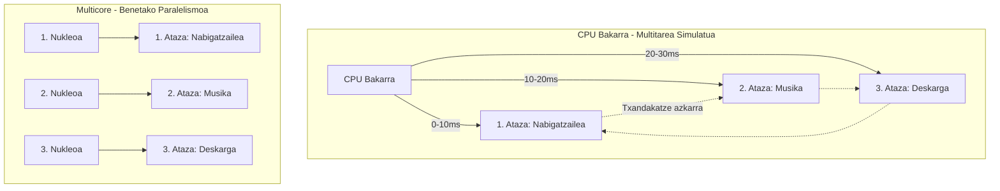
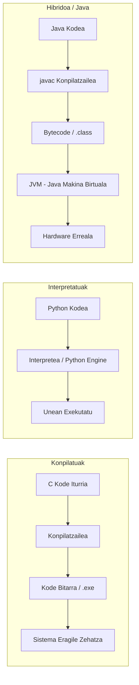
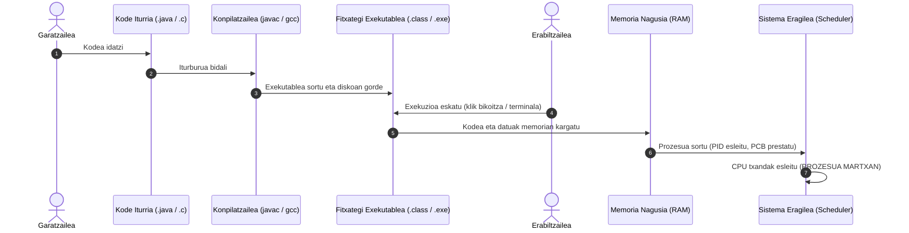
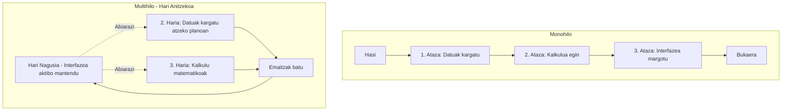
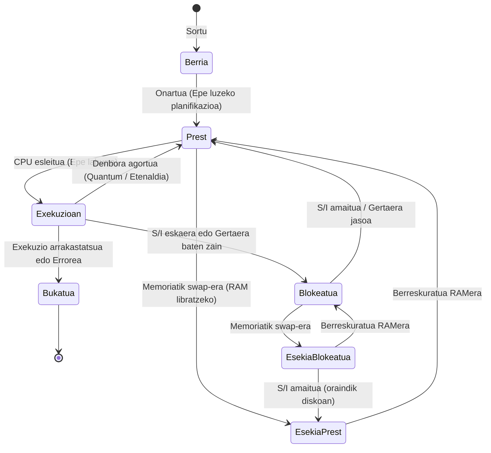
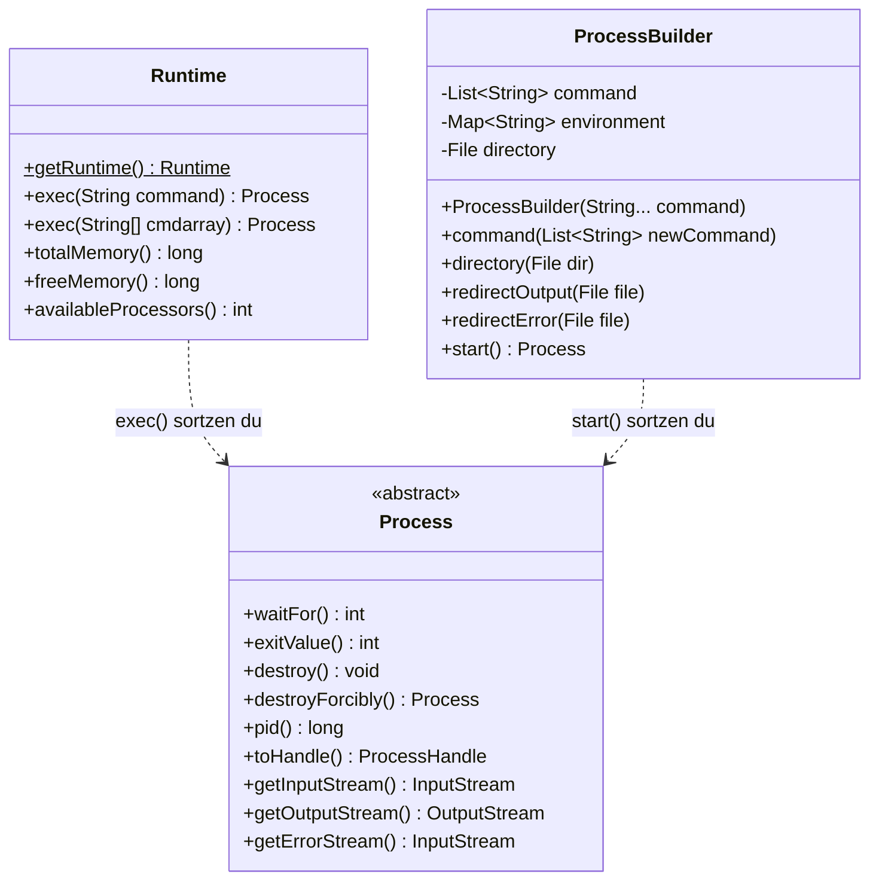
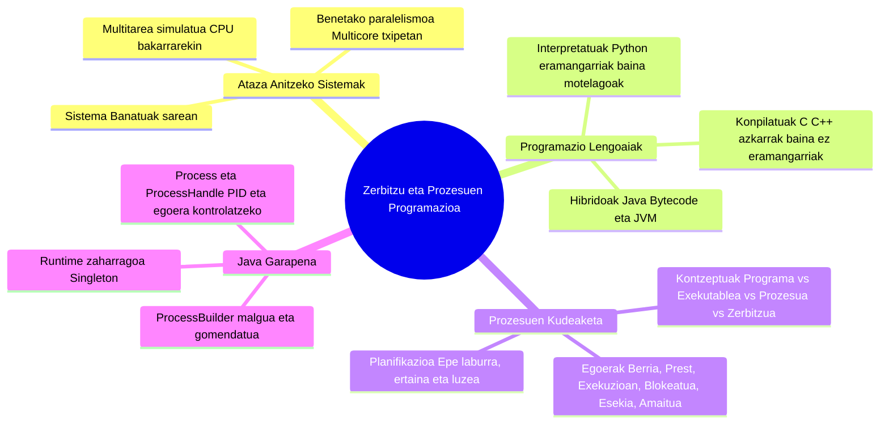

# 0. Zerbitzu eta Prozesuen Programazioa - Sarrera Orokorra

Dokumentu honek **«0-Zerbitzu eta prozesuen programazioa 01.pdf»** aurkezpenaren eduki teoriko, kontzeptual eta praktiko guztiak garatzen ditu sakonki, goi-mailako heziketa-zikloko (DAM / DAW) ikasle eta profesionalentzat prestatuta.

---

## 1. Moduluaren Egitura eta Gai-Zerrenda

Goi-mailako ziklo honetako *Zerbitzu eta Prozesuen Programazioa* moduluak konputazio modernoaren oinarrizko zutabeak jorratzen ditu. Gaur egungo sistema informatikoek ataza anitz aldi berean eta modu koordinatuan exekutatzeko duten beharrari erantzuten dio.

|    Zenb.    | Gaia                                                  | Deskribapen Orokorra                                                                                                                                                            |
| :---------: | :---------------------------------------------------- | :------------------------------------------------------------------------------------------------------------------------------------------------------------------------------ |
| **1** | **Prozesu anitzeko programazioa**               | Sistema Eragileak prozesuak nola kudeatzen dituen, haien bizitza-zikloa eta Java bidez prozesu independenteak sortu eta kontrolatzeko moduak (`ProcessBuilder`, `Runtime`). |
| **2** | **Hari anitzeko programazioa (Multithreading)** | Aplikazio bakar baten barruan hainbat exekuzio-hari aldi berean martxan jartzea, baliabideak partekatuz eta sinkronizazioa bermatuz.                                            |
| **3** | **Sareko komunikazioen programazioa**           | Sare bidez konektatutako prozesuen arteko datu-trukea (Socket TCP/UDP protokoloak, bezero-zerbitzari arkitektura).                                                              |
| **4** | **Sareko zerbitzuen sorrera**                   | Urruneko bezeroei zerbitzua emango dieten sistemak garatzea (HTTP zerbitzariak, REST APIak, zerbitzu banatuak).                                                                 |
| **5** | **Teknika kriptografikoak**                     | Komunikazioen segurtasuna, datuen zifraketa simetrikoa/asimetrikoa, sinadura digitala eta ziurtagiriak.                                                                         |

---

## 2. Ataza Anitzeko Sistemak (Multitasking) eta Prozesadoreak

### 2.1. Aldi-bereko ilusioa vs. Benetako Paralelismoa

Erabiltzaile arrunt batek ordenagailuan musika entzun, webgune bat kontsultatu eta aldi berean fitxategi bat deskargatzen duenean, sentsazioa da gauza guztiak une zehatz berean gertatzen ari direla.

> [!NOTE]
> **Iruzur kalkulatua:** Nukleo bakarreko prozesadore batean hori **gezurra** da fisikoki. CPUak ataza bakoitzari denbora-tarte txiki bat (zenbait milisegundo) eskaintzen dio txandaka. Aldaketa horiek hain dira azkarrak, ezen giza begiarentzat eta hautematearentzat ekintza guztiak batera gertatzen ari direla dirudien.

Hala ere, gaur egun baditugu aukerak **benetako exekuzio paraleloa** lortzeko:

1. **Nukleo anitzeko prozesadoreak (Multicore):** Txip berean prozesatze-unitate fisiko independente bat baino gehiago edukitzea (adib. Dual-Core, Quad-Core, i7, i9).
2. **Sistema banatuak / Klusterrak:** Sare baten bidez elkarri lotutako ordenagailu independenteak kalkulu konplexu bat banatuta ebazten.



### 2.2. Multitarea Kontzeptua

**Multitarea** ordenagailu batek ataza ezberdinak aldi berean kudeatzeko duen gaitasuna da. Bi eratara gauzatu daiteke:

- **Benetako era (Paraleloa):** Ataza kopurua $\le$ Prozesadore/Nukleo kopurua.
- **Era simulatua (Konkurrentea / Aldi berekoa):** Ataza kopurua $>$ Prozesadore/Nukleo kopurua (denbora partekatuz).

### 2.3. Prozesadoreak: Bilakaera Historikoa

Prozesadorea (CPU) gailu elektroniko baten "burmuina" da, aginduak memoria nagusitik irakurri, interpretatu eta exekutatzeaz arduratzen dena.


| Ezaugarria                       | Intel 486 (i486 DX) (1989) | Intel Core i7 (Gaur egungoa)                      |
| :------------------------------- | :------------------------- | :------------------------------------------------ |
| **Erloju-maiztasuna**      | 25 MHz – 50 MHz           | 3.5 GHz – 5.8 GHz (100 bider azkarrago)          |
| **Arkitektura (Bitak)**    | 32 bit                     | 64 bit                                            |
| **Nukleo fisikoak**        | Nukleo 1                   | 8 – 24 nukleo                                    |
| **Hari logikoak**          | Hari 1                     | 16 – 32 hari (Hyper-Threading bidez)             |
| **Kaxako memoria (Cache)** | 8 KB L1 barnekoa           | 24 MB – 36 MB L3                                 |
| **Transistore kopurua**    | ~1,2 milioi                | ~3.000 milioi                                     |
| **Aplikazio-esparrua**     | MS-DOS, testu-interfazeak  | Sistema eragile modernoak, 3D, IA, birtualizazioa |

---

## 3. Teoria eta Oinarrizko Kontzeptuak

### 3.1. Programazio Lengoaiak eta Sistema Eragilea

Programazio-lengoaiak makina-kodera (prozesadoreak ulertzen duen 0 eta 1 sekuentziara) nola itzultzen diren arabera sailkatzen dira:



1. **Lengoaia Konpilatuak (adib. C, C++, Rust):**

   - **Ezaugarriak:** Garatzaileak idatzitako kodea sistema eragile eta hardware arkitektura zehatz baterako bihurtzen da zuzenean konpilazio fasean.
   - **Abantaila:** Exekuzio-abiadura maximoa eta optimizazio handia.
   - **Desabantaila:** Ez da eramangarria (Windows-erako konpilatutako `.exe` bat ezin da zuzenean Linux-en exekutatu; birkonpilatu egin behar da).
2. **Lengoaia Interpretatuak (adib. Python, PHP, JavaScript):**

   - **Ezaugarriak:** Ez dago aldez aurretiko konpilaziorik fitxategi bitar batera. Interprete izeneko programa batek kode-lerroak irakurri eta bertan itzultzen ditu banan-banan exekuzioan.
   - **Abantaila:** Oso eramangarria eta garapen azkarrekoa (testu-fitxategia zuzenean exekutatzen da interpretea dagoen edozein plataformatan).
   - **Desabantaila:** Exekuzio-abiadura askoz motelagoa konpilatuekin alderatuta.
3. **Lengoaia Hibridoak (adib. Java, C#):**

   - **Java-ren kasua:** Erdibideko estrategia erabiltzen du (*"Write Once, Run Anywhere"*).
   - Java kode iturria (`.java`) ez da zuzenean makina-kodera konpilatzen; **Bytecode** deritzon tarteko lengoaiara baizik (`.class`).
   - Ondoren, Sistema Eragile bakoitzean instalatuta dagoen **JVM (Java Virtual Machine)** arduratzen da Bytecode hori hardware zehatzaren agindu bihurtzeaz (JIT – *Just In Time* konpilatzailea erabiliz).

---

### 3.2. Programa, Exekutablea, Prozesua eta Zerbitzua

Kontzeptu hauek sarritan nahasten dira, baina desberdintasun argiak dituzte:

| Kontzeptua                   | Zer da?                                                                                                                                                                                                | Egoera                                                             | Adibidea                                                                                               |
| :--------------------------- | :----------------------------------------------------------------------------------------------------------------------------------------------------------------------------------------------------- | :----------------------------------------------------------------- | :----------------------------------------------------------------------------------------------------- |
| **Programa**           | Agindu multzo logikoa, algoritmo bat definitzen duena. Garatzaileak idatzitako testu-kodea edo proiektua da.                                                                                           | Pasiboa (oraindik ez da konpilatu edo gorde fitxategi bakar gisa). | `Main.java` edo proiektuaren kode-iturburua.                                                         |
| **Exekutablea**        | Sistema eragileak ulertzeko moduko kode bitarra edo bytecode-a gordetzen duen fitxategia, biltegiratze-diskoan dagoena.                                                                                | Pasiboa (disko gogorrean gordea).                                  | `nabigatzailea.exe`, `script.sh`, `aplikazioa.jar`.                                              |
| **Prozesua**           | **Exekuzioan dagoen programa bat da.** Memoria nagusian (RAM) kargatuta dago, baliabideak esleituta ditu (helbide-eremua, erregistroak, fitxategi-deskribatzaileak) eta CPU denbora jasotzen du. | **Aktiboa** (memorian eta Sistema Eragileak kudeatua).       | `chrome.exe` martxan, bere PID zenbakiarekin.                                                        |
| **Zerbitzua (Daemon)** | Erabiltzailearen zuzeneko interakziorik gabe,**atzeko planoan (background)** exekutatzen den prozesu iraunkorra. Normalean sistema abiaraztean automatikoki hasten da.                           | Aktiboa (atzeko planoan zain edo lanean).                          | Inprimaketa-zerbitzua (`spoolsv.exe`), Web zerbitzaria (`nginx`, `apache`), datu-base zerbitzua. |



---

### 3.3. Programazio Banatua (Distributed Computing)

**Prozesamendu banatua** sare baten bidez konektatutako eta sinkronizatutako konputazio-unitate independenteetan exekutatzen den hura da.

- **Ezaugarri nagusiak:**
  - Ez dute memoria fisikorik partekatzen.
  - Komunikazioa mezu-trukearen bidez (sareko protokoloak, TCP/IP, RPC, REST) egiten da.
  - Sareko nodo anitzen bidez arazo handi bat azkarrago ebatzi daiteke (adib. Big Data, hodeiko konputazioa, Hadoop, Spark).

---

## 4. Konputazio Konkurrentea, Paraleloa eta Hariak

### 4.1. Konputazio Konkurrentea vs. Paraleloa

- **Aldi bereko konputazioa (Konkurrentea):** CPU bakar batean, prozesadorearen denbora hainbat atazen artean banatuz (denbora-tarteka). Sistema Eragilearen planifikatzailearen ardura da.
- **Konputazio paraleloa:** Prozesu edo algoritmo baten zati ezberdinak une berean exekutatzen dira nukleo fisiko ezberdinetan. Sistema Eragilearen eta programaren diseinuaren ardura partekatua da.

### 4.2. Hariak (Threads)

Aplikazio arrunt bat lerro bakarreko agindu sekuentzial gisa exekutatzen da: **hari bakarra (monohilo)**.



- **Hari anitzeko arkitekturan (Multithreading):**
  - Algoritmoa zati independenteetan banatzen bada, zati horiek paraleloan exekutatu daitezke.
  - Hari guztiek prozesuaren memoria-eremu bera (aldagai globalak, heap-a) partekatzen dute, eta horregatik dira "arinak", baina sinkronizazio-arazoak sor ditzakete.

---

## 5. 2. Prozesuen Egoerak eta Komunikazioa

### 5.1. Prozesuen Antolaketa eta Egoera Posibleak

Sistema Eragileak memoria nagusian (RAM) eta bigarren mailako memorian (Swap / Diskoan) dauden prozesuak kudeatzeko hiru planifikazio maila erabiltzen ditu:

1. **Epe luzeko planifikazioa (Long-term scheduler):** Sistema eragilean prozesu berriak noiz onartzen diren erabakitzen du. Multiprogramazio-maila kontrolatzen du.
2. **Epe ertaineko planifikazioa (Medium-term scheduler):** Memoria nagusia betetzen denean, prozesu batzuk disko gogorretik swap eremura pasatzen ditu (*Suspensión* edo *Swapping*), RAM lekua libratzeko.
3. **Epe laburreko planifikazioa (Short-term scheduler / CPU Scheduler):** Prest dauden prozesuen artean zeini emango dion CPUren hurrengo txanda erabakitzen du.



#### Egoeren definizio zehatza:

- **Berria (New):** Prozesua sortze-fasean dago; SEak oraindik ez ditu baliabide guztiak esleitu.
- **Prest (Ready):** Memoria nagusian kargatuta dago eta CPU librea geratu zain dago aginduak exekutatzen hasteko.
- **Exekuzioan (Running):** Une horretan CPUren agindupean dago eta bere instrukzioak gauzatzen ari dira.
- **Blokeatua (Blocked / Waiting):** Kanpoko gertaera baten zain dago (adib. erabiltzaileak tekla bat sakatzea, diskoan fitxategi bat idaztea, sareko pakete bat jasotzea). Ezin du CPUa erabili nahiz eta librea egon.
- **Esekia (Suspended):** Memoria nagusitik (RAM) disko osagarrira (swap) eramana izan da baliabideak libratzeko (*Esekia-Prest* edo *Esekia-Blokeatua* izan daiteke).
- **Amaitua (Terminated):** Exekuzioa bukatu du, bere baliabideak askatu dira eta SEaren kontroletik irteten da.

---

### 5.2. Prozesuen arteko Komunikazioa (IPC - Inter-Process Communication)

Prozesuak sistema eragilean elkarrengandik isolatuta daude segurtasunagatik. Horregatik, haien artean datuak trukatzeko mekanismo bereziak behar dira:

1. **Memoria Partekatua (Shared Memory):** Sistema eragileak bi prozesuri memoria-eremu bera irakurtzeko eta idazteko baimena ematen die. Mekanismorik azkarrena da, baina sinkronizazio zorrotza eskatzen du (semaforoak, mutexak).
2. **Mezu-igorpena (Message Passing):**
   - **Tutuak (Pipes):** Prozesu baten irteera estandarra beste baten sarrera estandarrari lotzen zaio (adib. `ps aux | grep java`).
   - **Mezu-ilarak (Message Queues):** Postontzi moduko bat, non mezuak ordenan gordetzen diren beste batek irakurri arte.
   - **Socketak:** Makina berean edo sare bidez konektatutako prozesuen arteko komunikazio estandarra (IP helbidea eta ataka erabiliz).

---

## 6. Java-ko Prozesuen Kudeaketa: Runtime eta ProcessBuilder

Javan beste prozesu independente batzuk abiarazteko eta kudeatzeko bi klase nagusi daude `java.lang` paketean:



### 6.1. Runtime Klasea

- **Zertarako balio du?** Java aplikazioari bere exekuzio-ingurunearekin (JVM eta azpiko SEarekin) komunikatzeko aukera ematen dio. Singleton eredu baten bidez atzitzen da (`Runtime.getRuntime()`).
- **Metodo nagusiak:**
  - `exec(String command)`: Kanpoko programa edo komando bat exekutatzen du eta `Process` objektu bat itzultzen du.
  - `availableProcessors()`: JVMk erabil ditzakeen prozesadore/nukleo kopurua itzultzen du.
  - `totalMemory()` eta `freeMemory()`: JVMren memoria estatistikak itzultzen ditu.

### 6.2. ProcessBuilder Klasea (Gomendatua Java 5-etik aurrera)

- **Zertarako balio du?** Sistema eragileko prozesuak sortzeko modu askoz malguagoa, seguruagoa eta konfiguragarriagoa eskaintzen du.
- **Metodo nagusiak:**
  - `command(String... command)`: Exekutatu nahi den programa eta bere parametroak definitzen ditu.
  - `directory(File file)`: Prozesuaren laneko direktorioa ezartzen du.
  - `environment()`: Prozesuaren ingurune-aldagaiak ikusi eta aldatzeko map-a itzultzen du.
  - `redirectOutput(File/Redirect)`: Irteera estandarra fitxategi batera edo kontsolara bideratzen du.
  - `redirectErrorStream(boolean)`: Errore-korrontea eta irteera arrunta bateratzen ditu.
  - `start()`: Prozesua abiarazten du eta kontrolatzeko `Process` instantzia itzultzen du.

---

### 6.3. Ariketa Praktikoa: Komando-lerrotik Programak Abiaraztea

**Ariketaren Enuntziatua:**

> *«Sortu programa bat komando-lerrotik programa exekutagarrien zerrenda bat jaso, guztiak exekutatu, eta bakoitzaren PID zenbakia eta hasiera-ordua bistaratuko dituena.»*

Jarraian Java 9+ bertsiorako ebazpen osoa eta profesionala aurkezten da (`ProcessBuilder` eta `ProcessHandle` erabiliz):

```java
package eus.goierrieskola.prozesuak;

import java.io.IOException;
import java.time.Instant;
import java.time.ZoneId;
import java.time.format.DateTimeFormatter;
import java.util.ArrayList;
import java.util.List;

/**
 * Komando-lerro bidez pasatako programa exekutagarriak abiarazten dituen klasea,
 * bakoitzaren PID zenbakia eta hasiera-unea pantailaratuz.
 */
public class ProzesuKudeatzailea {

    private static final DateTimeFormatter FORMATZAILEA = 
            DateTimeFormatter.ofPattern("yyyy-MM-dd HH:mm:ss")
                             .withZone(ZoneId.systemDefault());

    public static void main(String[] args) {
        if (args.length == 0) {
            System.out.println("ERROREA: Gutxienez exekutagarri baten izena zehaztu behar duzu.");
            System.out.println("Erabilera: java ProzesuKudeatzailea <prog1> <prog2> ...");
            System.out.println("Adibidea (Windows): java ProzesuKudeatzailea notepad.exe calc.exe");
            return;
        }

        List<Process> abiarazitakoProzesuak = new ArrayList<>();

        System.out.println("=============================================================");
        System.out.println("       PROZESUEN ABIARAZTE ETA JARRAIPEN PROGRAMA           ");
        System.out.println("=============================================================");

        for (String programa : args) {
            try {
                System.out.println("\n[+] '" + programa + "' abiarazten...");
                ProcessBuilder pb = new ProcessBuilder(programa);
            
                // Prozesua hasi
                Process prozesua = pb.start();
                abiarazitakoProzesuak.add(prozesua);

                // Prozesuaren informazioa eskuratu Java 9+ ProcessHandle APIaren bidez
                long pid = prozesua.pid();
                ProcessHandle.Info info = prozesua.info();
            
                String hasieraOrdua = info.startInstant()
                        .map(FORMATZAILEA::format)
                        .orElse(FORMATZAILEA.format(Instant.now()));

                System.out.println("    -> PID (Process ID): " + pid);
                System.out.println("    -> Hasiera-unea:    " + hasieraOrdua);
                System.out.println("    -> Egoera:          MARTXAN (isAlive = " + prozesua.isAlive() + ")");

            } catch (IOException e) {
                System.err.println("    [!] Errorea '" + programa + "' abiaraztean: " + e.getMessage());
            }
        }

        System.out.println("\n-------------------------------------------------------------");
        System.out.println("Guztira abiarazitako prozesuak: " + abiarazitakoProzesuak.size());
        System.out.println("-------------------------------------------------------------");
    }
}
```

---

## 7. Laburpen Praktikoa eta Kontzeptuen Mapa


