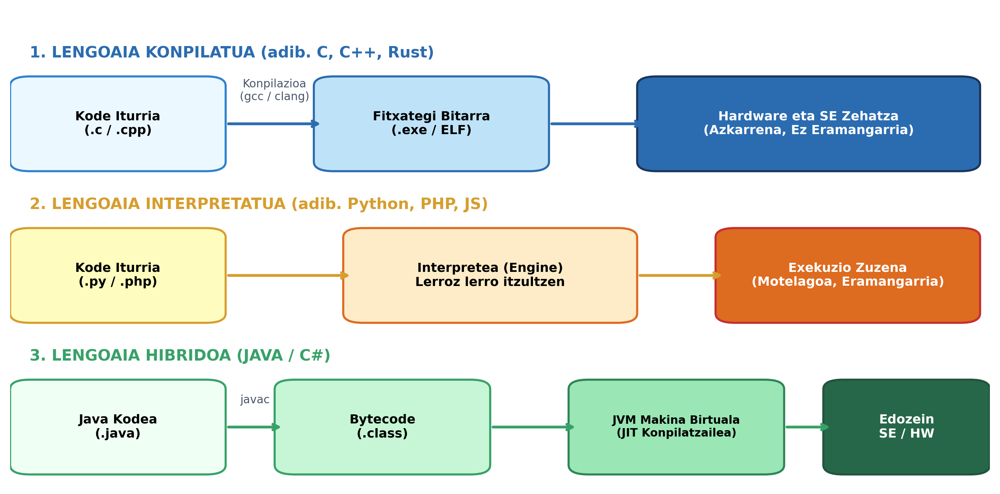
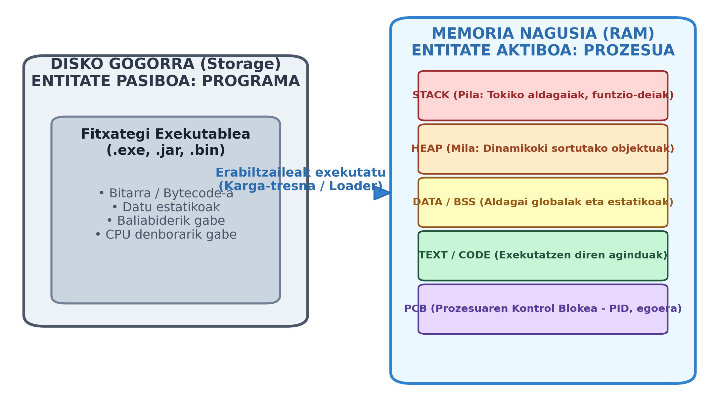
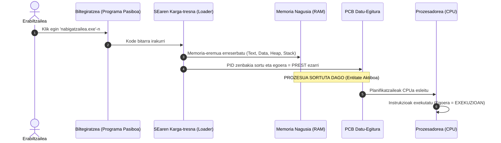
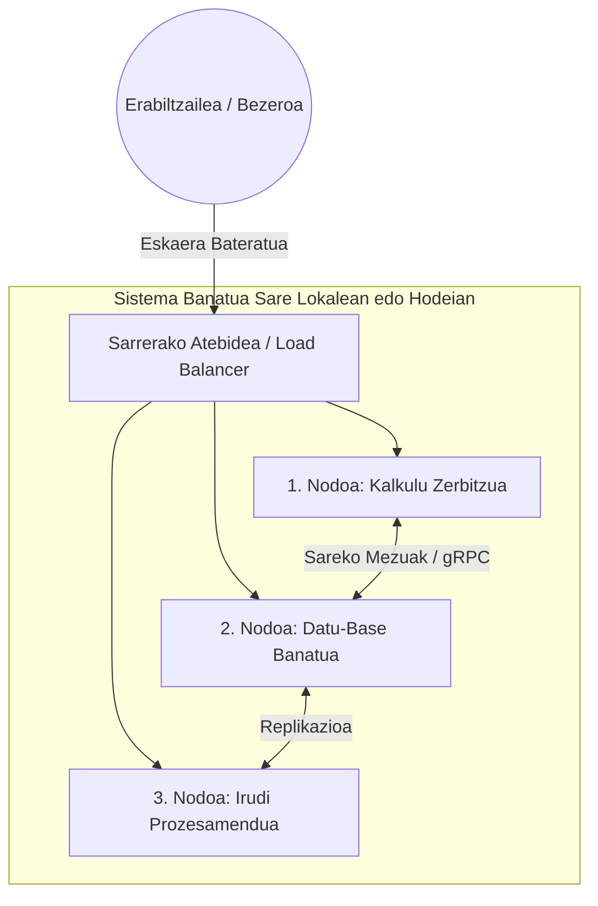
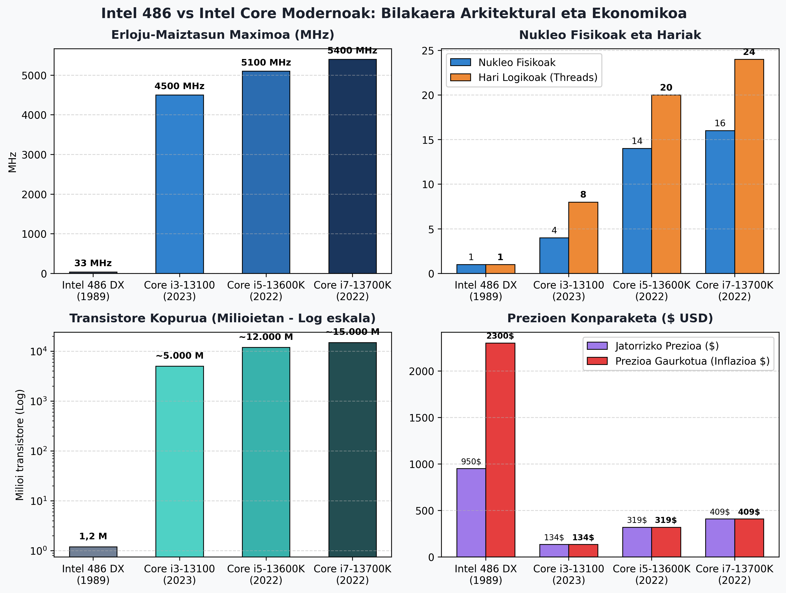

# 1. ATAZA ETA 1.1 JARDUERA: PROZESUAK, LENGOAIAK ETA PROZESADOREEN BILAKAERA

**Modulua:** 0490 - Zerbitzu eta Prozesuen Programazioa
**Zikloa:** Goi-mailako Zikloa (2MG3)
**Ikastetxea:** Goierri Eskola
**Data:** 2026-09-29

---

## Aurkibidea

1. [1. Ariketa: Programazio Lengoaiak (Konpilatuak vs Interpretatuak vs Hibridoak)](#1-programazio-lengoaiak)
2. [2. Ariketa: Programa eta Prozesua (Desberdintasun Sakonak)](#2-programa-eta-prozesua)
3. [3. Ariketa: Programazio Banatua (Distributed Programming)](#3-programazio-banatua)
4. [Actividad Propuesta 1.1: Prozesadoreen Konparaketa Sakona (Intel 486 vs Intel Core i3, i5, i7)](#4-prozesadoreen-konparaketa-sakona)
5. [Ondorio Nagusiak eta Laburpena](#5-ondorio-nagusiak)

---

## 1. Programazio Lengoaiak

### 1.1. Sarrera Kontzeptuala

Garatzaileek giza-hizkuntzatik gertu dauden aginduekin (goi-mailako lengoaiak) idazten dituzte algoritmoak. Alabaina, ordenagailu baten prozesadoreak (CPU) soilik **makina-kodea** (0 eta 1 sekuentzia bitarrak) ulertu eta exekuta dezake. Kode iturburua CPUaren agindu bihurtzeko eraren arabera, hiru paradigma nagusi bereizten dira: **konpilatuak**, **interpretatuak** eta **hibridoak (bytecode bidezkoak)**.

*1. Irudia: Konpilazio, interpretazio eta Java bytecode ereduaren lan-fluxuen konparaketa.*

---

### 1.2. Lengoaia Konpilatuak

#### Funtzionamendua:

Lengoaia konpilatuetan, garatzaileak idatzitako kode iturburu osoa programa espezifiko bati pasatzen zaio: **konpilatzaileari** (adibidez, `gcc`, `clang`, `g++`). Konpilatzaileak kodearen sintaxia eta semantika aztertzen ditu, erroreak bilatzen ditu eta hardwarearen arkitektura jakin baterako (adib. x86_64, ARM64) eta sistema eragile jakin baterako (Windows, Linux, macOS) fitxategi bitar exekutagarri bat (`.exe` Windowsen, ELF Linuxen) sortzen du.

#### Ezaugarri nagusiak:

- **Exekuzio-abiadura maximoa:** Kodea zuzenean prozesadorearen natibo agindutan dagoenez, ez dago bitartekaririk exekuzioan.
- **Optimizazio aurreratua:** Konpilatzaileak erregistroen erabilera, begizten desegitea (*loop unrolling*) eta CPUaren agindu bereziak (AVX, SSE) muturreraino optimiza ditzake.
- **Plataformarekiko lotura estua (Eramangarritasun eza):** Windows-en x86-rako sortutako `.exe` bitarra ezin da Linux edo ARM batean exekutatu. Plataforma bakoitzerako berriz konpilatu behar da iturburu-kodea.
- **Adibideak:** **C**, **C++**, **Rust**, **Go**, **Fortran**.

---

### 1.3. Lengoaia Interpretatuak

#### Funtzionamendua:

Lengoaia interpretatuetan ez da aldez aurretik makina-koderik sortzen. Horren ordez, **interpretea** (edo exekuzio-motorra) izeneko programa bat behar da. Interprete honek iturburu-kodearen instrukzioak banan-banan irakurtzen ditu exekuzio-unean, ulertu eta bertan exekutatzen ditu.

#### Ezaugarri nagusiak:

- **Eramangarritasun bikaina (*Portability*):** Kode bera inolako aldaketarik gabe exekuta daiteke interpretea instalatuta daukan edozein ordenagailutan (Windows, Linux, Raspberry Pi, etab.).
- **Garapen azkarra eta malgua:** Ez dago konpilazio-itxaronaldirik. Aldaketak berehala probatu daitezke.
- **Exekuzio-abiadura motelagoa:** Lerroz lerroko itzulpenak prozesatzeko denbora eskatzen du; beraz, kalkulu astunetan konpilatuak baino 10-50 aldiz motelagoak izan daitezke.
- **Adibideak:** **Python**, **PHP**, **JavaScript**, **Ruby**, **Perl**, **Bash**.

---

### 1.4. Lengoaia Hibridoak: Java eta Bytecode-aren Eredua

Javak konpilazioaren eta interpretazioaren arteko erdibideko irtenbide iraultzaile bat ezarri zuen:

1. **Konpilazio Fasea:** `javac` konpilatzaileak `.java` fitxategia ez du hardware errealerako itzultzen, baizik eta **Bytecode** deritzon tarteko agindu-multzo unibertsal batera (`.class` fitxategia).
2. **Exekuzio Fasea:** Sistema eragile bakoitzean instalatutako **JVM (Java Virtual Machine)** makina birtualak Bytecode hori interpretatzen du, eta sarritan gehien erabiltzen diren atalak makina-koderaino azkartzen ditu **JIT (*Just-In-Time*) konpilatzailea** erabiliz.

- **Leloa:** *"Write Once, Run Anywhere"* (Idatzi behin, exekutatu edonon).

---

### 1.5. Lengoai Moten Taula Konparatiboa

| Ezaugarria                       | Lengoaia Konpilatuak                         | Lengoaia Interpretatuak               | Lengoaia Hibridoak (Bytecode)                  |
| :------------------------------- | :------------------------------------------- | :------------------------------------ | :--------------------------------------------- |
| **Itzulpen Momentua**      | Exekuzioa baino lehen (Konpilazioan)         | Exekuzio-unean (Lerroz lerro)         | Konpilazioan Bytecode-ra; JIT bidez exekuzioan |
| **Bitarteko Entitatea**    | Fitxategi Exekutagarria (`.exe`, ELF)      | Interpretea (`python.exe`, `php`) | JVM / Makina Birtuala (`java.exe`)           |
| **Abiadura**               | Oso azkarra (Nativoa)                        | Motelagoa                             | Tartekoa / Oso ona (JIT optimizazioekin)       |
| **Eramangarritasuna**      | Baxua (Iturburua birkonpilatu behar da)      | Handia (Fitxategi bera edonon)        | Bikaina (Bytecode bera JVM orotan)             |
| **Erroreak Detektatzea**   | Konpilazio-fasean (Mota-egiaztapen zorrotza) | Exekuzio-unean (Runtime error)        | Konpilazioan sintaxia; Runtime-n salbuespenak  |
| **Adibide Garrantzitsuak** | C, C++, Rust, Go                             | Python, PHP, JavaScript, Bash         | Java, C# (.NET CLR), Kotlin                    |

---

## 2. Programa eta Prozesua

Softwarearen eta Sistema Eragileen arkitekturan funtsezkoa da **Programa** eta **Prozesua** kontzeptuak bereiztea. Nahiz eta lagunarteko hizkeran sinonimotzat jo ohi diren, alderdi teknikotik egoera guztiz desberdinak ordezkatzen dituzte.

º

*2. Irudia: Programa pasiboaren (diskoan) eta prozesu aktiboaren (RAM eta PCB) memoria-egituraren diagrama.*

### 2.1. Programa (Entitate Pasiboa)

- **Definizioa:** Ataza edo algoritmo bat burutzeko ordenatutako instrukzio-sekuentzia da.
- **Kokapena eta Izaera:** Disko gogorrean edo biltegiratze-gailu iraunkor batean gordetako **fitxategi pasibo bat** da (`.exe`, `.jar`, `.bin`).
- **Baliabideak:** Ez du CPUren denborarik kontsumitzen, ez du RAM helbiderik okupatzen, eta ez du baliabide librerik atxikitzen. Erabiltzaileak edo sistemak exekutatu arte "hilda" dago diskoan.

---

### 2.2. Prozesua (Entitate Aktiboa)

- **Definizioa:** **Exekuzioan dagoen programa bat da.**
- **Kokapena eta Izaera:** Sistema Eragileak programaren kodea eta datuak disko osagarritik memoria nagusira (RAM) kargatu dituenean sortzen da. Entitate dinamiko eta **aktiboa** da.
- **Baliabideak:** Sistema Eragileak prozesu bakoitzari baliabide propioak eta isolatuak esleitzen dizkio:
  1. **PID (Process ID):** Zenbakizko identifikatzaile esklusiboa.
  2. **Helbide-eremu pribatua (Memoria Egitura):**
     - **Text / Code segmentua:** Exekutatzen ari diren makina-aginduak (irakurketa hutsekoa).
     - **Data / BSS segmentua:** Aldagai globalak eta estatikoak.
     - **Heap (Mila):** Exekuzioan zehar dinamikoki eskatutako memoria (`malloc()` C-n, `new` Javan).
     - **Stack (Pila):** Funtzio-deiak, tokiko aldagaiak eta itzulera-helbideak gordetzen dituena.
  3. **PCB (Prozesuaren Kontrol Blokea):** Sistema Eragileak prozesuaren kudeaketarako behar duen informazio osoa (CPU erregistroak, egoera, lehentasuna, fitxategi irekiak).
  4. **CPU denbora:** Planifikatzaileak (*Scheduler*) aldizka CPUaren erabilera esleitzen dio instrukzioak exekutatzeko.

---

### 2.3. Programa vs. Prozesua Konparaketa-Taula

| Irizpidea                | Programa                                                                                                  | Prozesua                                                           |
| :----------------------- | :-------------------------------------------------------------------------------------------------------- | :----------------------------------------------------------------- |
| **Izaera**         | Entitate**pasiboa** (Fitxategia).                                                                   | Entitate**aktiboa** (Lan-unitatea).                          |
| **Kokapena**       | Disko gogorrean / Biltegiratze iraunkorrean.                                                              | Memoria Nagusian (RAM) kargatuta.                                  |
| **Bizitza-tartea** | Mugagabea (fitxategia ezabatu arte existitzen da).                                                        | Mugatua (sortzen da, exekutatzen da eta amaitu egiten da).         |
| **Baliabideak**    | Disko-espazioa soilik kontsumitzen du.                                                                    | CPUa, RAMa, erregistroak, fitxategi irekiak eta S/I atzitzen ditu. |
| **Erlazioa**       | Programa bakar batetik**hainbat prozesu** abiarazi daitezke aldi berean (adib. Chrome-ren 5 leiho). | Prozesu bakoitzak programa bati egiten dio erreferentzia.          |
| **Kudeatzailea**   | Fitxategi-sistema (File System).                                                                          | Sistema Eragilearen Planifikatzailea (Process Scheduler).          |

---

## 3. Programazio Banatua (Programación Distribuida)

### 3.1. Definizioa eta Oinarrizko Kontzeptua

**Programazio banatua** sare baten bidez elkarrekin konektatutako konputazio-unitate independenteetan (**nodoetan**) atazak exekutatzen dituzten software-sistemen garapena da.

> [!NOTE]
> **Sistema Banatuaren Printzipioa:** Elkarri lotutako ordenagailu-multzo batek erabiltzailearen aurrean **sistema bateratu bakar eta koherente** gisa jarduten du, azpiko konplexutasun fisikoa ezkutatuz.

*3. Irudia: Sare bidez konektatutako nodo banatuen arkitektura integratua.*

---

### 3.2. Programazio Banatuaren Ezaugarri Nagusiak

1. **Ez dago memoria partekaturik:** Nodo bakoitzak bere prozesadorea eta bere RAM memoria pribatua ditu.
2. **Mezu-igorpena (Message Passing):** Nodoen arteko koordinazio eta datu-truke guztia komunikazio-sarearen bidez (TCP/IP, UDP, RPC, REST) egiten da.
3. **Konkurrentzia eta Autonomia:** Nodo bakoitzak bere prozesuak modu autonomoan exekutatzen ditu, beste nodoen erritmoaren menpe egon gabe.
4. **Erroreekiko Erresilientzia (Fault Tolerance):** Nodo batek huts egiten badu, sistemak martxan jarrai dezake lana beste nodo batzuetara bideratuz.

---

### 3.3. Zergatik eta Zertarako Erabiltzen Da?

- **Eskalagarritasun Horizontala:** Ordenagailu handiago eta garestiago bat erosi beharrean (*eskalatze bertikala*), ordenagailu arrunt gehiago gehitzen zaizkio sareari karga handiagoa jasateko.
- **Kalkulu Handiak Bizkortzea:** Datu erraldoiak (Big Data) nodo askoren artean zatitu eta paraleloan prozesatzen dira.
- **Geografia-banaketa:** Mundu osoko erabiltzaileei latentzia txikiarekin zerbitzua ematea (CDN zerbitzuak, banku-sareak).
- **Adibide Teknologikoak:**
  - **Hodeiko Konputazioa (Cloud):** AWS, Google Cloud, Microsoft Azure.
  - **Datu-Prozesamendu Masiboa:** Apache Hadoop, Apache Spark, Kafka.
  - **Mikrozerbitzuak:** Docker eta Kubernetes bidez kudeatutako edukiontzi banatuak.
  - **P2P Sareak eta Blockchain:** BitTorrent, Bitcoin/Ethereum sareak.

---

## 4. Prozesadoreen Konparaketa

Ariketan eskatutako moduan, **Intel 486 (i486)** familia historikoa eta gaur egungo **Intel Core i3, i5 eta i7** familia modernoak alderatuko ditugu zehatz-mehatz, parametro teknikoak, arkitekturak eta prezio historiko/gaurkotuak aztertuz.

*4. Irudia: Intel 486 vs Intel Core i3, i5 eta i7-ren maiztasuna, nukleoak, transistoreak eta prezioak alderatzen dituen infografia.*

---

### 4.1. Aukeratutako Txipak eta Haien Profila

1. **Intel 80486 DX (i486 DX - 33 MHz):** 1989an merkaturatua. Garai hartako ordenagailu pertsonalen gailurra izan zen; lehen aldiz integratu zituen CPUa, matematika-koprozesadorea (FPU) eta L1 cache memoria txip berean.
2. **Intel Core i3-13100 (Raptor Lake - 13. Belaunaldia):** 2023ko sarrera-mailako prozesadorea, bulego eta joko arrunten errendimendu oso altua ematen duena.
3. **Intel Core i5-13600K:** 2022ko gama ertain-altuko prozesadore indartsua, arkitektura hibridoarekin (errendimendu-nukleoak + eraginkortasun-nukleoak).
4. **Intel Core i7-13700K:** 2022ko goi-mailako prozesadorea, lan profesional astunetarako eta aldi bereko prozesamendu masiborako sortua.

---

### 4.2. Parametro Teknikoen Taula Konparatiboa

| Parametro Teknikoa                 | Intel 80486 DX (1989)             | Intel Core i3-13100 (2023)    | Intel Core i5-13600K (2022)   | Intel Core i7-13700K (2022)   | Aldaketa-Faktorea (486 vs i7)                   |
| :--------------------------------- | :-------------------------------- | :---------------------------- | :---------------------------- | :---------------------------- | :---------------------------------------------- |
| **Arkitektura (Bitak)**      | **32 bit** (x86)            | **64 bit** (x86-64)     | **64 bit** (x86-64)     | **64 bit** (x86-64)     | 32 bit$\rightarrow$ 64 bit jauzia             |
| **Erloju-Maiztasun Arrunt**  | 33 MHz (0.033 GHz)                | 3.4 GHz                       | 3.5 GHz                       | 3.4 GHz                       | $\times$ 103                                  |
| **Turbo Maiztasun Maximoa**  | Ez (33 MHz finkoa)                | **4.5 GHz** (4.500 MHz) | **5.1 GHz** (5.100 MHz) | **5.4 GHz** (5.400 MHz) | $\mathbf{\times 163}$ aldiz azkarrago         |
| **Nukleo Fisikoak**          | **1 nukleo**                | **4 nukleo**            | **14 nukleo** (6P + 8E) | **16 nukleo** (8P + 8E) | $\mathbf{\times 16}$ nukleo gehiago           |
| **Hari Logikoak (Threads)**  | 1 hari                            | 8 hari                        | 20 hari                       | **24 hari**             | $\mathbf{\times 24}$ hari gehiago             |
| **Kaxako Memoria (Cache)**   | 8 KB L1 (guztira)                 | 12 MB L3 + 5 MB L2            | 24 MB L3 + 20 MB L2           | **30 MB L3 + 24 MB L2** | $\mathbf{\times 6.750}$ memoria cache gehiago |
| **Transistore Kopurua**      | ~1,2 milioi                       | ~4.500 milioi                 | ~12.000 milioi                | ~**15.000 milioi**      | $\mathbf{\times 12.500}$ transistore gehiago  |
| **Fabrikazio Litografia**    | 1.000 nm (1 µm)                  | Intel 7 (10 nm FinFET)        | Intel 7 (10 nm FinFET)        | Intel 7 (10 nm FinFET)        | 100 aldiz trinkoagoa                            |
| **RAM Muga Helbideragarria** | 4 GB teorikoa (normalean 4-16 MB) | 128 GB DDR4 / DDR5            | 128 GB DDR4 / DDR5            | 128 GB (edo 192 GB)           | Gigabyte-tik ehunka gigabyte-ra                 |
| **Instrukzio Multzoa**       | x86 oinarrizkoa + x87 FPU         | AVX2, SSE4.2, FMA3, AES       | AVX2, SSE4.2, Intel DL Boost  | AVX2, SSE4.2, Intel DL Boost  | Kalkulu bektorialak eta IA                      |

---

### 4.3. Parametroen Azterketa Xehea

#### 1. Abiadura eta Erloju-Maiztasuna:

- Intel 486ak segundoko **33 milioi ziklo** egiten zituen (33 MHz). Gaur egungo Core i7 batek **5.400 milioi ziklo** egiten ditu segundoko (5.4 GHz).
- Horretaz gain, gaur egungo prozesadoreek **IPC (Instructions Per Cycle)** askoz handiagoa dute: ziklo bakoitzean hainbat instrukzio batera exekutatzeko gai dira exekuzio espekulatiboari eta hoditeriari (*pipelining*) esker. Horregatik, abiadura erreala ez da 160 aldiz handiagoa, baizik eta **milaka aldiz handiagoa**.

#### 2. Bit Kopurua (32 bit vs 64 bit):

- 486a 32 biteko prozesadorea zen. Horrek esan nahi du erregistroek 32 bit zituztela eta gehienez $2^{32}$ byte (4 GB) helbideratu zitzakeela teorian (nahiz eta garaiko plaketan 4 MB eta 16 MB RAM jartzen ziren).
- Core i3/i5/i7 familiak 64 bitekoak dira ($2^{64}$ byte teorikoak, petabyte-ak). Horri esker memoria erraldoiak erabil daitezke eta 64 biteko zenbaki handiekin eragiketak ziklo bakarrean egin daitezke.

#### 3. Nukleoak eta Hariak:

- 486ak nukleo bakarra zuen: ataza anitzak egiteko, simulazio hutsa (*multitarea kooperatiboa edo aproposa*) erabili behar zen denbora zatituz.
- Core i7-13700K txipak **16 nukleo fisiko** ditu: 8 Errendimendu-nukleo (P-Cores, zeregin astunetarako) eta 8 Eraginkortasun-nukleo (E-Cores, atzeko atazetarako), guztira **24 hari** aldi berean benetako paralelismoan exekutatuz.

---

### 4.4. Prezioen Konparaketa Eguneratua eta Balorazio Ekonomikoa

Ariketaren alderdirik harrigarrienetako bat hardwarearen prezioen eta balioaren bilakaera da:

| Prozesadorea                      | Merkaturatze Urtea | Jatorrizko Prezioa (USD $) | Gaur Egungo Prezio Eguneratua (Inflazioarekin, ~2024-2026) | Gaur Egungo Salmenta Prezioa (Merkatuan) |
| :-------------------------------- | :----------------: | :------------------------: | :--------------------------------------------------------: | :--------------------------------------: |
| **Intel 80486 DX (33 MHz)** |    1989 / 1990    |      **~950 $**      |   **~2.350 $ – 2.400 $** (Gaur egungo ~2.200 €)   |       Kolekzionismoan: 20 $ - 50 $       |
| **Intel Core i3-13100**     |        2023        |      **~134 $**      |                 **~134 $** (~125 €)                 |             110 € – 130 €             |
| **Intel Core i5-13600K**    |        2022        |      **~319 $**      |                 **~330 $** (~300 €)                 |             280 € – 310 €             |
| **Intel Core i7-13700K**    |        2022        |      **~409 $**      |                 **~425 $** (~390 €)                 |             360 € – 400 €             |

#### Analisi Ekonomikoaren Ondorioa:

1. **Garai bateko ordenagailuen prezio neurrigabea:** 1989an Intel 486 DX txip soilak 950 $ balio zuen (ordenagailu oso batek 3.000 $ - 5.000 $ baino gehiago balio zuen, gaur egungo 8.000 €-ren baliokidea). Garai hartan informatika enpresa handi eta aberatsen esku zegoen soilik.
2. **Mooren Legea eta Demokratizazioa:** Gaur egun, 120 € inguru balio duen **Core i3** xume batek 486 hark baino **milaka aldiz kalkulu-ahalmen handiagoa** ematen du, 20 aldiz merkeagoa den prezioan.
3. **Gaur egungo Core i7-ak** (~390 €) 1989ko txip haren prezio erlatiboaren sei aldiz gutxiago balio du, baina 15.000 milioi transistore ditu txip bakar batean integratuta.

---

## 5. Ondorio Nagusiak

1. **Lengoaien eboluzioa:** Garatzaileek eraginkortasunaren (konpilatuak) eta eramangarritasunaren (interpretatuak/hibridoak) artean hautatzen dute. Javak bere JVM arkitekturari esker sistema anitzeko bateragarritasuna ziurtatzen du.
2. **Prozesua eta Baliabideak:** Programa bat biltegiratze-kode hila den bitartean, prozesua Sistema Eragileak RAMean aktiboki kudeatzen duen lan-unitatea da, bere memoria-eremu isolatu eta PCB egiturarekin.
3. **Konputazio Banatua:** Gaur egungo erronka konputazional handiak (IA, Big Data, hodeia) ezin dira makina bakar batean ebatzi; horregatik, sare bidez koordinatutako nodo independenteek osatzen dute informatika modernoaren bizkarrezurra.
4. **Hardwarearen jauzi erraldoia:** 486tik Core i7rako 30 urteko bilakaeran maiztasuna 160 aldiz biderkatu da, nukleoak 16 aldiz gehitu dira, eta transistoreak 12.500 aldiz hazi dira, prezioak herritar guztientzat eskuragarri bihurtu diren bitartean.
