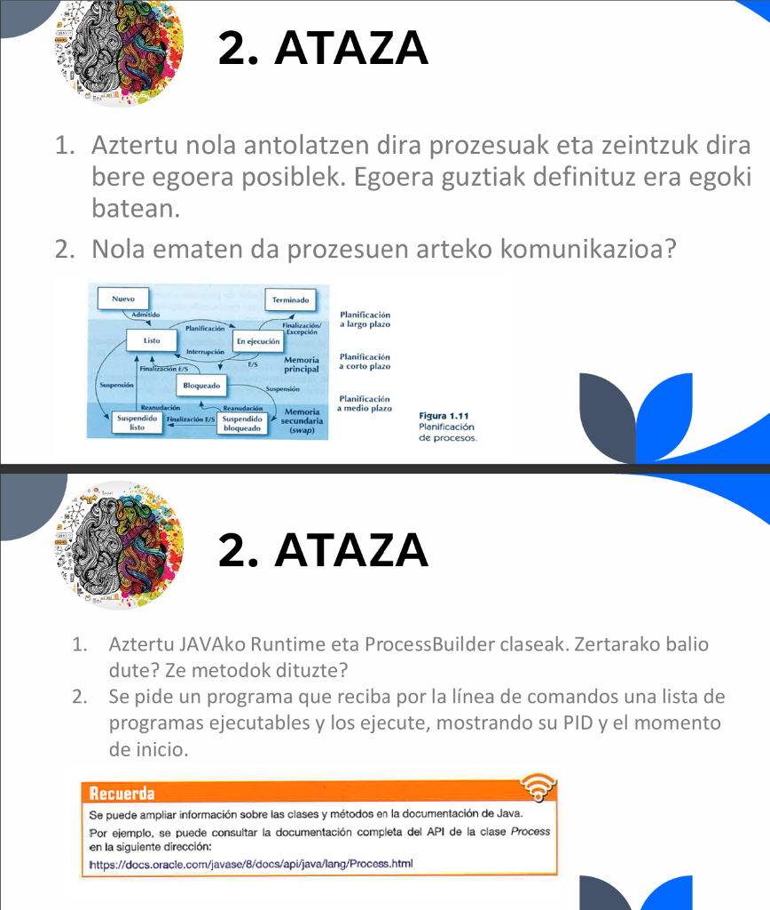
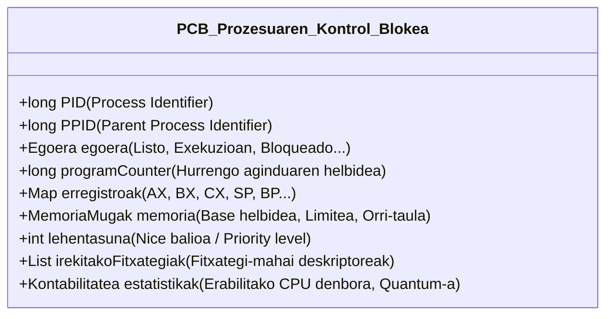
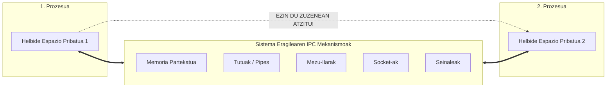
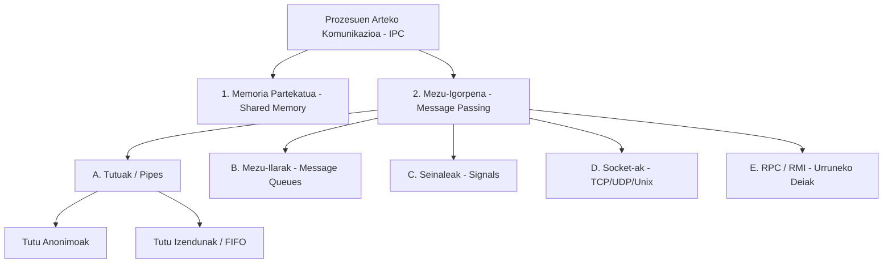
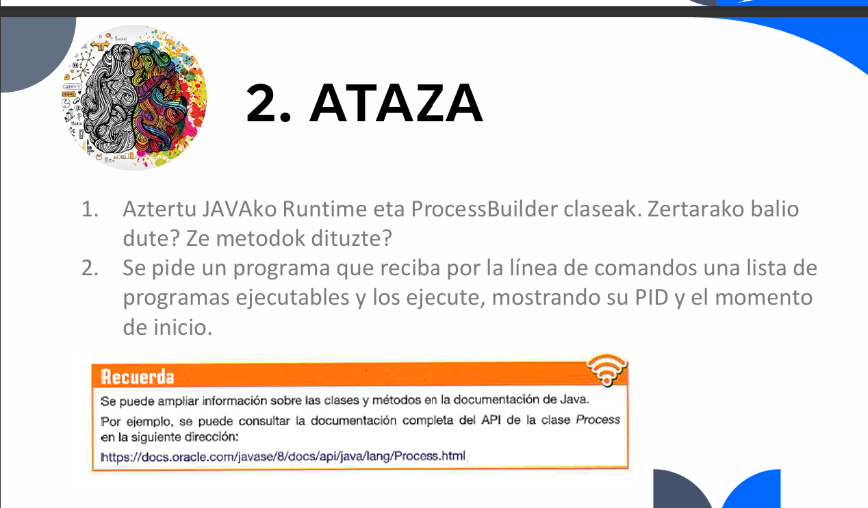

# 2. ATAZA: PROZESUEN EGOERAK, PLANIFIKAZIOA, IPC ETA JAVAKO PROZESUEN KUDEAKETA

**Modulua:** 0490 - Zerbitzu eta Prozesuen Programazioa
**Zikloa:** Goi-mailako Zikloa (DAM / DAW - 2MG3)
**Ikastetxea:** Goierri Eskola
**Data:** 2026-09-30
**Egilea:** Ikaslea (Zerbitzu eta Prozesuen Programazioa)

---

## Ariketen Enuntziatua

Jarduera honetan bi atal nagusi proposatzen dira (1. irudian ikusgai), sistema eragileen prozesu-kudeaketan, planifikazio-mailetan, prozesuen arteko komunikazioan (IPC) eta Java lengoaiako kanpoko prozesuen kudeaketan (`Runtime`, `ProcessBuilder` eta `Process`) sakontzeko.


*1. Irudia: 2. Atazaren enuntziatua (1. zatia: Prozesuen antolaketa, egoerak eta IPC; 2. zatia: Java Runtime, ProcessBuilder eta exekuzio programa).*

---

## Aurkibidea

1. [1. BLOKEA: Prozesuen Antolaketa, Egoerak eta Komunikazioa (IPC)](#1-blokea-prozesuen-antolaketa-egoerak-eta-komunikazioa-ipc)
   - [1.1. Ariketa: Prozesuen Antolaketa eta Egoera Posibleak](#11-ariketa-prozesuen-antolaketa-eta-egoera-posibleak)
     - [1.1.1. Prozesuen Antolaketa Sistema Eragilean eta PCB egitura](#111-prozesuen-antolaketa-sistema-eragilean-eta-pcb-egitura)
     - [1.1.2. Sistema Eragilearen Planifikazio Mailak (Hiru Mailako Eredua)](#112-sistema-eragilearen-planifikazio-mailak-hiru-mailako-eredua)
     - [1.1.3. Prozesuen Egoera Posibleak eta Bizitza-Zikloa (7 Egoerako Eredu Osoa)](#113-prozesuen-egoera-posibleak-eta-bizitza-zikloa-7-egoerako-eredu-osoa)
     - [1.1.4. Egoeren Arteko Trantsizioen Azalpen Zehatza](#114-egoeren-arteko-trantsizioen-azalpen-zehatza)
   - [1.2. Ariketa: Prozesuen Arteko Komunikazioa (IPC - Inter-Process Communication)](#12-ariketa-prozesuen-arteko-komunikazioa-ipc---inter-process-communication)
     - [1.2.1. Zergatik behar da IPC? (Memoria-babesa eta Isolamendua)](#121-zergatik-behar-da-ipc-memoria-babesa-eta-isolamendua)
     - [1.2.2. IPC Mekanismo Nagusien Azterketa](#122-ipc-mekanismo-nagusien-azterketa)
     - [1.2.3. Sinkronizazioa, Lasterketa-Baldintzak eta Blokeo Elkarrekikoa (Deadlock)](#123-sinkronizazioa-lasterketa-baldintzak-eta-blokeo-elkarrekikoa-deadlock)
     - [1.2.4. IPC Mekanismoen Taula Konparatiboa](#124-ipc-mekanismoen-taula-konparatiboa)
2. [2. BLOKEA: Java Runtime, ProcessBuilder eta Exekuzio Programa](#2-blokea-java-runtime-processbuilder-eta-exekuzio-programa)
   - [2.1. Ariketa: Java `Runtime` eta `ProcessBuilder` Klaseen Azterketa Sakona](#21-ariketa-java-runtime-eta-processbuilder-klaseen-azterketa-sakona)
     - [2.1.1. Java eta Prozesu-Kudeaketaren Oinarriak](#211-java-eta-prozesu-kudeaketaren-oinarriak)
     - [2.1.2. `java.lang.Runtime` Klasea](#212-javalangruntime-klasea)
     - [2.1.3. `java.lang.ProcessBuilder` Klasea](#213-javalangprocessbuilder-klasea)
     - [2.1.4. `java.lang.Process` eta `ProcessHandle` Klaseak](#214-javalangprocess-eta-processhandle-klaseak)
     - [2.1.5. Konparaketa: `Runtime.exec()` vs `ProcessBuilder`](#215-konparaketa-runtimeexec-vs-processbuilder)
   - [2.2. Ariketa: Exekutagarrien Zerrenda Abiarazteko Java Programa Praktikoa](#22-ariketa-exekutagarrien-zerrenda-abiarazteko-java-programa-praktikoa)
     - [2.2.1. Programaren Eskakizunak eta Arkitektura](#221-programaren-eskakizunak-eta-arkitektura)
     - [2.2.2. Kode Iturburu Osoa (`ProzesuExekutatzailea.java`)](#222-kode-iturburu-osoa-prozesuexekutatzaileajava)
     - [2.2.3. Kodearen Pausoz Pausoko Azalpen Teknikoa](#223-kodearen-pausoz-pausoko-azalpen-teknikoa)
     - [2.2.4. Konpilazio eta Exekuzio Gida](#224-konpilazio-eta-exekuzio-gida)
     - [2.2.5. Froga Praktikoak eta Exekuzioaren Emaitza Errealak](#225-froga-praktikoak-eta-exekuzioaren-emaitza-errealak)
3. [Ondorio Nagusiak eta Laburpena](#3-ondorio-nagusiak-eta-laburpena)
4. [Erreferentzia Bibliografikoak](#4-erreferentzia-bibliografikoak)

---

# 1. BLOKEA: Prozesuen Antolaketa, Egoerak eta Komunikazioa (IPC)


*2. Irudia: 1. Blokeko enuntziatua eta prozesuen planifikazioaren diagrama hedatua (Figura 1.11).*

---

## 1.1. Ariketa: Prozesuen Antolaketa eta Egoera Posibleak

> **Enuntziatua:** *Aztertu nola antolatzen dira prozesuak eta zeintzuk dira bere egoera posiblek. Egoera guztiak definituz era egoki batean.*

### 1.1.1. Prozesuen Antolaketa Sistema Eragilean eta PCB egitura

Sistema Eragile baten ikuspuntutik, **prozesua** ez da diskoan dagoen fitxategi estatiko bat (programa edo exekutagarria), baizik eta **une jakin batean exekuzio-bidean dagoen entitate aktibo eta dinamikoa**. Prozesu bati baliabide propioak esleitzen zaizkio: CPU denbora, memoria-eremu independentea (helbide-espazioa), sarrera/irteera gailuak eta irekitako fitxategiak.

Sistema eragileak ehunka prozesu batera kudeatu ahal izateko (multiprogramazioa), egitura zentral baten bidez antolatzen ditu: **PCB (Process Control Block - Prozesuaren Kontrol Blokea)**.



PCBaren osagai nagusiak:

1. **PID (Process Identifier):** Sistema Eragileak esleitutako zenbakizko identifikatzaile bakarra.
2. **Uneko Egoera:** Prest, Exekuzioan, Blokeatua, Esekia, etab.
3. **Programa Kontagailua (Program Counter - PC):** Exekutatu behar den hurrengo aginduaren memoria-helbidea.
4. **CPU Erregistroak eta Pila (Stack Pointer):** Prozesadorean uneko eragiketen datuak gordetzen dituzten gelaxkak. Testuinguru-aldaketa (*Context Switch*) gertatzean, datu hauek PCBn gordetzen dira geroago bertatik jarraitzeko.
5. **Memoria Kudeaketarako Informazioa:** Oinarrizko helbidea, mugako helbidea eta memoria-orrien taulak (*Page Tables*). Horrela bermatzen da prozesu batek ez duela beste baten memoria inbaditzen (*Memory Protection*).
6. **Planifikazio eta Lehentasun Informazioa:** Prozesuaren lehentasuna, quantum balioa eta ilaretako posizioa.
7. **Baliabideen Kontabilitatea:** Irekitako fitxategien deskriptoreak, S/I gailuen esleipenak eta CPU denbora-kontsumoa.

#### Testuinguru-Aldaketa (Context Switch):

CPUak prozesu batetik bestera jauzi egiten duenean:

1. Unean exekutatzen ari den prozesuaren erregistroak eta PC balioa bere **PCBan gordetzen** dira.
2. Hurrengo prozesuaren PCB bilatzen da.
3. Hurrengo prozesu horren balioak CPU erregistroetara **kargatzen** dira.
4. CPUak prozesu berriaren exekuzioari ekiten dio.

> [!WARNING]
> **Gainkarga (Overhead):** Testuinguru-aldaketan zehar CPUak ez du erabiltzailearen lan baliagarririk egiten; sistema eragilearen administrazio-lana da soilik. Hori dela eta, planifikatzaileak oreka bilatu behar du erantzun-bizitasunaren eta gainkargaren artean.

---

### 1.1.2. Sistema Eragilearen Planifikazio Mailak (Hiru Mailako Eredua)

Enuntziatuko 1.11 irudian argi ikus daiteke prozesuen antolaketak hiru planifikazio-maila nagusi dituela:

```mermaid
flowchart TD
    subgraph PlanifikazioaLargoPlazo [1. Epe Luzeko Planifikazioa - Long-Term Scheduler]
        Nuevo[Berria / Nuevo] -->|Admitido / Onartua| Listo[Prest / Listo]
    end

    subgraph MemoriaNagusia [MEMORIA NAGUSIA (RAM)]
        Listo -->|Planifikazioa / Despacho| Exec[Exekuzioan / En Ejecución]
        Exec -->|Interrupzioa / Quantum| Listo
        Exec -->|S/I Eskaera| Bloq[Blokeatua / Bloqueado]
        Bloq -->|S/I Amaiera| Listo
    end

    subgraph PlanifikazioaCortoPlazo [3. Epe Laburreko Planifikazioa - Short-Term Scheduler]
        Listo <--> Exec
    end

    subgraph PlanifikazioaMedioPlazo [2. Epe Ertaineko Planifikazioa - Medium-Term Scheduler / Swapper]
        Listo -->|Suspensión / Swap-out| SuspListo[Esekia Prest / Suspendido Listo]
        SuspListo -->|Reanudación / Swap-in| Listo
        Bloq -->|Suspensión / Swap-out| SuspBloq[Esekia Blokeatua / Suspendido Bloqueado]
        SuspBloq -->|Reanudación / Swap-in| Bloq
        SuspBloq -->|S/I Amaiera| SuspListo
    end

    subgraph MemoriaSekundarioa [MEMORIA SEKUNDARIOA (SWAP / DISKOA)]
        SuspListo
        SuspBloq
    end

    Exec -->|Finalización / Excepción| Terminado[Amaitua / Terminado]
```

1. **Epe Luzeko Planifikazioa (*Planificación a largo plazo* edo *Job Scheduler / Loader*):**

   - **Funtzioa:** Diskoan dauden programen artetik zeintzuk onartuko diren sistema eragilearen memoria nagusira (RAM) erabakitzen du (`Nuevo` $\rightarrow$ `Listo`).
   - **Garrantzia:** **Multiprogramazio-maila** (*Degree of Multiprogramming*) kontrolatzen du, hau da, memorian aldi berean zenbat prozesu egongo diren.
   - **Maiztasuna:** Gutxitan exekutatzen da (segundo edo minutuero, prozesu berriak sortzen direnean).
   - **Helburua:** CPUari lotutako atazen (*CPU-bound*) eta S/Iari lotutako atazen (*I/O-bound*) arteko nahasketa egokia lortzea.
2. **Epe Ertaineko Planifikazioa (*Planificación a medio plazo* edo *Swapper*):**

   - **Funtzioa:** Memoria nagusia (RAM) gainezka dagoenean edo prozesu batek denbora luzea blokeatuta eman behar duenean, prozesu horren memoria-orriak disko osagarrira eramaten ditu (**Swap-out / Suspensión**). RAMean lekua askatzean, berriz RAMera ekartzen ditu (**Swap-in / Reanudación**).
   - **Garrantzia:** Memoria birtuala modu eraginkorrean kudeatzen du eta RAMeko saturazioa saihesten du.
   - **Maiztasuna:** Tarteka exekutatzen da (RAM memoriaren presioaren arabera).
3. **Epe Laburreko Planifikazioa (*Planificación a corto plazo* edo *CPU Scheduler / Dispatcher*):**

   - **Funtzioa:** RAM memorian prest dauden prozesuen artetik (`Listo`), une bakoitzean CPUa zeini emango dion erabakitzen du.
   - **Garrantzia:** Sistemaren arintasuna eta interaktibitatea bermatzen ditu.
   - **Maiztasuna:** Etengabe eta oso azkar exekutatzen da (10 milisegundoro behin edo maizago).
   - **Algoritmo erabiliak:** Round-Robin (RR), Lehentasunen araberakoa, FCFS (First-Come, First-Served), SJF (Shortest Job First) eta Ilara Anitzekoak (*Multilevel Feedback Queues*).

---

### 1.1.3. Prozesuen Egoera Posibleak eta Bizitza-Zikloa (7 Egoerako Eredu Osoa)

Enuntziatuko 1.11 irudiari jarraituz, 7 egoerako eredu hedatua dugu (5 egoera klasikoak gehi disko osagarriko 2 esekipen egoerak):

| Egoera                        | Gaztelaniaz (Irudian)    | Kokapen Fisikoa                      | Definizio Zehatza                                                                                                                                                                        |
| :---------------------------- | :----------------------- | :----------------------------------- | :--------------------------------------------------------------------------------------------------------------------------------------------------------------------------------------- |
| **1. Berria**           | *Nuevo*                | Diskoa / RAM hasiera                 | Prozesua sortu berri da (adib. erabiltzaileak klik egin du edo agindua eman du). Sistema eragilea bere PCB prestatzen ari da, baina oraindik ez da onartu memorian exekuziorako prest.   |
| **2. Prest**            | *Listo*                | **Memoria Nagusia (RAM)**      | Prozesua RAMean dago kargatuta, behar dituen baliabide guztiak eskuragarri ditu eta CPUaren txandaren zain dago ilaran.                                                                  |
| **3. Exekuzioan**       | *En ejecución*        | **CPU + RAM**                  | Prozesuak CPUaren kontrol osoa dauka une horretan eta bere instrukzioak prozesadoreak zuzenean exekutatzen ari da.                                                                       |
| **4. Blokeatua**        | *Bloqueado*            | **Memoria Nagusia (RAM)**      | Prozesuak ezin du exekutatzen jarraitu, kanpoko gertaera baten zain dagoelako (adib. diskoan fitxategi bat irakurtzea, sareko pakete bat jasotzea edo erabiltzaileak teklatua sakatzea). |
| **5. Esekia Prest**     | *Suspendido listo*     | **Memoria Sekundarioa (Swap)** | Prozesua exekutatzeko prest dago (baliabide guztiak ditu eta ez dago blokeatuta), baina RAM memorian lekurik ez zegoenez, aldi baterako diskora eraman da (Swap-out).                    |
| **6. Esekia Blokeatua** | *Suspendido bloqueado* | **Memoria Sekundarioa (Swap)** | Prozesua kanpoko gertaera baten zain dago ETA, aldi berean, RAM memoria libre uzteko diskora (Swap) eraman da.                                                                           |
| **7. Amaitua**          | *Terminado*            | Sistemak askatua                     | Prozesuak bere lana amaitu du (arrakastaz edo salbuespen/errore baten ondorioz). Sistema Eragileak bere baliabide guztiak askatu ditu eta PCB ezabatzen du.                              |

---

### 1.1.4. Egoeren Arteko Trantsizioen Azalpen Zehatza

Diagramako geziek prozesu baten bizitzan gertatzen diren trantsizio posible guztiak adierazten dituzte:

1. **Admitido (Onartua): `Nuevo` $\rightarrow$ `Listo`**
   - Epe luzeko planifikatzaileak erabakitzen du prozesu berria RAM memorian kargatzea eta prest daudenen ilaran jartzea.
2. **Planificación / Despacho (CPU Esleipena): `Listo` $\rightarrow$ `En ejecución`**
   - Epe laburreko planifikatzaileak (*Dispatcher*) CPUaren kontrola ematen dio ilarako hurrengo prozesuari.
3. **Interrupción (Etenaldia / Quantum amaiera): `En ejecución` $\rightarrow$ `Listo`**
   - Multiataza aproposan (*Preemptive*), prozesuari esleitutako gehienezko denbora-tartea (*quantum*) amaitu da, edo lehentasun handiagoko beste prozesu bat prest jarri da. SEak CPUa kendu eta prozesua berriro `Listo` egoerara bidaltzen du.
4. **E/S o espera de evento (S/I Eskaera): `En ejecución` $\rightarrow$ `Bloqueado`**
   - Prozesuak kanpoko baliabide bat eskatu du (diskotik irakurri, sareko datuak itxaron, erabiltzailearen sarrera). Ezin duenez jarraitu, CPUa libre uzten du beste prozesu batek aprobetxatu dezan.
5. **Finalización E/S (S/I Amaiera): `Bloqueado` $\rightarrow$ `Listo`**
   - Itxaroten ari zen gertaera gauzatu da (datuak diskotik RAMera iritsi dira). Prozesua ez da zuzenean exekuziora pasatzen; prest egoerara doa CPU txanda berri baten zain.
6. **Finalización / Excepción (Amaiera edo Akatsa): `En ejecución` $\rightarrow$ `Terminado`**
   - Prozesuak bere azken instrukzioa burutu du edo berreskura ezin den salbuespen bat gertatu da (adibidez, zeroz zatitzea, *Segmentation Fault*). SEak prozesua itxi eta baliabideak birziklatzen ditu.
7. **Suspensión (Swap-out): `Listo` $\rightarrow$ `Suspendido listo`**
   - Epe ertaineko planifikatzaileak RAMeko lekua askatu behar du beste prozesu batzuentzat, eta prest dagoen prozesu hau diskora (Swap eremura) mugitzen du.
8. **Reanudación (Swap-in): `Suspendido listo` $\rightarrow$ `Listo`**
   - RAMean memoria nahikoa libre geratu denean, prozesua diskotik berriro RAMera ekartzen da CPUa har dezan.
9. **Suspensión (Swap-out): `Bloqueado` $\rightarrow$ `Suspendido bloqueado`**
   - Blokeatuta dagoen prozesu batek RAM memoria okupatzea ez denez eraginkorra, SEak diskora bidaltzen du memoria nagusia arintzeko.
10. **Reanudación (Swap-in): `Suspendido bloqueado` $\rightarrow$ `Bloqueado`**
    - RAMean lekua egin da eta prozesua RAMera itzultzen da, oraindik bere gertaeraren zain badago ere.
11. **Finalización E/S esekita dagoenean: `Suspendido bloqueado` $\rightarrow$ `Suspendido listo`**
    - **Oso trantsizio garrantzitsua:** Prozesua diskoan (Swap) esekita zegoen bitartean, itxaroten ari zen S/I eragiketa amaitu da. Prozesua jada ez dago blokeatuta; exekutatzeko prest dago, baina oraindik diskoan dagoenez `Suspendido listo` egoerara pasatzen da, SEak berriro RAMera igo arte zain.

---

## 1.2. Ariketa: Prozesuen Arteko Komunikazioa (IPC - Inter-Process Communication)

> **Enuntziatua:** *Nola ematen da prozesuen arteko komunikazioa?*

### 1.2.1. Zergatik behar da IPC? (Memoria-babesa eta Isolamendua)

Sistema Eragile modernoek **memoria-babes zorrotza** (*Memory Protection*) ezartzen dute. Prozesu bakoitzari helbide-espazio birtual propio eta isolatua esleitzen zaio:



- Prozesu batek beste prozesu baten memoria zuzenean irakurri edo aldatzen saiatzen bada, hardwareak (MMU - Memory Management Unit) eta kernelak salbuespen larri bat sortzen dute (**Segmentation Fault** Linuxen, **Access Violation** Windowsen) eta prozesu erasotzailea berehala suntsitzen dute.
- **Zergatik behar da orduan komunikazioa?**
  1. **Informazioa partekatzea:** Hainbat erabiltzailek edo prozesuk datu-base edo fitxategi berberak atzitu behar dituztelako.
  2. **Kalkulua bizkortzea (Konkurrentzia/Paralelismoa):** Ataza handi bat zati txikiagotan banatu eta prozesu ezberdinek paraleloan ebazteko.
  3. **Modularitatea:** Sistema konplexuak prozesu espezializatu txikiagotan egituratzeko (adib. Web zerbitzaria + Datu-base zerbitzaria).

Hori lortzeko, Sistema Eragileak **IPC (Inter-Process Communication)** protokolo eta mekanismo ofizialak eskaintzen ditu.

---

### 1.2.2. IPC Mekanismo Nagusien Azterketa

Prozesuen arteko komunikazioa bi filosofia nagusitan banatzen da: **Memoria Partekatua** eta **Mezu-Igorpena**.



#### 1. Memoria Partekatua (*Shared Memory*):

- **Nola funtzionatzen du?** Sistema eragileari eskaera eginez, bi prozesu independentek RAMeko memoria-segmentu fisiko bera mapatzen dute beren helbide-espazio birtualean.
- **Abantaila:** **Mekanismorik azkarrena da**. Behin memoria-eremua partekatuta, datuak irakurri eta idazteko ez dago kernelera deirik egin beharrik (*Zero-Copy* eraginkortasuna).
- **Desabantaila:** Datuen koherentzia eta sinkronizazioa (lasterketa-baldintzak saihestea) garatzailearen ardura da erabat. Nahitaezkoa da **Semaforoak** edo **Mutex-ak** erabiltzea.

#### 2. Tutuak (*Pipes*):

Fluxu unidirekzionaleko (noranzko bakarreko) komunikazio-kanalak dira:

- **Tutu Anonimoak (*Anonymous Pipes*):**
  - Guraso-ume erlazioa duten prozesuen artean soilik erabil daitezke.
  - Adibide ezaguna komando-lerroan: `ps aux | grep java` (lehenengo prozesuaren irteera estandarra bigarrenaren sarrera estandarrera bidaltzen da tutuan zehar).
- **Tutu Izendunak (*Named Pipes* edo *FIFOak*):**
  - Fitxategi-sisteman izen propioa duen fitxategi berezi baten bidez gauzatzen dira (Linuxen `mkfifo nire_tutua`).
  - Edozein prozesuren artean erabil daitezke, nahiz eta haien artean senidetasun-erlaziorik ez egon.

#### 3. Mezu-Ilarak (*Message Queues*):

- Prozesuek mezu egituratuak idatzi eta irakur ditzaketen ilara kudeatuak dira, sistema eragilearen kernelean biltegiratzen direnak (POSIX `mq_open` edo System V `msgget`).
- **Izaera Asinkronoa:** Igorleak mezua ilaran utzi eta bere lanarekin jarraitu dezake; hartzaileak bere erritmoan jasoko du mezu hori (posta-kutxa baten antzera).

#### 4. Seinaleak (*Signals*):

- Sistema eragileak edo beste prozesu batek bidalitako **jakinarazpen asinkronoak** dira (software etenaldiak).
- Ez dute datu-bloke handirik garraiatzen, gertaera baten abisua baizik.
- Adibide arruntak:
  - `SIGINT` (Ctrl + C): Prozesua eteteko eskaera.
  - `SIGTERM` (15): Prozesuari modu txukunean ixteko eskaera.
  - `SIGKILL` (9): Prozesua berehala eta baldintzarik gabe akabatzeko agindua.
  - `SIGCHLD`: Ume-prozesu bat amaitu denean gurasoari bidalitako abisua.

#### 5. Socket-ak (*Sockets*):

- Sare bidezko edo ordenagailu bereko prozesuen arteko muturreko komunikazioa (*Endpoints*).
- **Mota nagusiak:**
  - **Unix Domain Sockets / IPC Sockets:** Makina berean dauden prozesuentzat optimizatuak, sare-protokoloen gainkargarik gabe.
  - **Internet Sockets (TCP/IP edo UDP):** Ordenagailu bereko zein sareko beste makinetako prozesuekin komunikatzeko balio dute (IP helbidea + Portua).
- Bezero-Zerbitzari (*Client-Server*) arkitekturaren oinarria dira.

#### 6. Urruneko Prozedura-Deiak (*RPC* / Java *RMI*):

- Prozesu batek beste makina edo prozesu batean dagoen funtzio edo metodo bati dei egiten dio, deia lokala balitz bezala tratatuz. Javaren kasuan **RMI (Remote Method Invocation)** erabiltzen da objektu banatuen artean.

---

### 1.2.3. Sinkronizazioa, Lasterketa-Baldintzak eta Blokeo Elkarrekikoa (Deadlock)

Memoria partekatua edo baliabide arruntak erabiltzean, bi arrisku nagusi agertzen dira:

1. **Lasterketa-Baldintza (*Race Condition*):** Bi prozesu aldaketa egiten ari dira aldi berean memoria-eremu berean, eta emaitza azkenak nola idatzi duen araberakoa da (inkohorentzia). Hori saihesteko **Atal Kritikoa** (*Critical Section*) babestu behar da **Mutex** (*Mutual Exclusion*) edo **Semaforo** bidez.
2. **Blokeo Elkarrekikoa (*Deadlock* edo *Interbloqueo*):** 1. Prozesuak A baliabidea dauka eta B behar du; 2. Prozesuak B dauka eta A behar du. Biek elkarri itxaroten diote betiko, sistema erabat blokeatuz.

---

### 1.2.4. IPC Mekanismoen Taula Konparatiboa

| Mekanismoa                      | Igorpen Eredua             | Abiadura                      | Sinkronizazio Beharra            | Eremua (Scope)                        | Datu Mota                      |
| :------------------------------ | :------------------------- | :---------------------------- | :------------------------------- | :------------------------------------ | :----------------------------- |
| **Memoria Partekatua**    | Zuzeneko RAM sarbidea      | **Bikaina (Azkarrena)** | **Altua (Mutex/Semaforo)** | Makina Lokala                         | Datu-egitura gordinak, byteak  |
| **Tutu Anonimoak**        | Byte-korrontea (Stream)    | Altua                         | Integratua (blokeatzailea)       | Guraso-Ume harremana                  | Byte-korronte sekuentziala     |
| **Tutu Izendunak (FIFO)** | Byte-korrontea (Stream)    | Altua                         | Integratua (blokeatzailea)       | Makina bereko edozein prozesu         | Byte-korronte sekuentziala     |
| **Mezu-Ilarak**           | Mezu-paketeak              | Ertaina-Altua                 | Kudeatua (Asinkronoa)            | Makina Lokala                         | Mezu egituratuak               |
| **Seinaleak**             | Jakinarazpen asinkronoa    | Oso azkarra                   | Ez da beharrezkoa                | Makina Lokala                         | Seinale-zenbakiak (gertaerak)  |
| **Socket-ak**             | Sareko korrontea / paketea | Ertaina (Protokolo gainkarga) | Integratua (Protokolo bidez)     | **Lokala eta Sarea (Mundiala)** | Byteak, paketeak, testua, JSON |

---

# 2. BLOKEA: Java Runtime, ProcessBuilder eta Exekuzio Programa


*3. Irudia: 2. Blokeko enuntziatua (Java Runtime, ProcessBuilder eta agindu-lerroko exekutagarrien programa).*

---

## 2.1. Ariketa: Java `Runtime` eta `ProcessBuilder` Klaseen Azterketa Sakona

> **Enuntziatua:** *Aztertu JAVAko Runtime eta ProcessBuilder claseak. Zertarako balio dute? Ze metodok dituzte?*

### 2.1.1. Java eta Prozesu-Kudeaketaren Oinarriak

Java plataforma independentea da printzipioz (*"Write Once, Run Anywhere"*), eta bere aplikazioak Java Makina Birtualaren (JVM) gainean isolatuta exekutatzen dira. Hala ere, sarritan aplikazio batek azpiko **Sistema Eragilearen aginduak, programak edo baliabideak exekutatu eta kontrolatu behar ditu** (adibidez, diskoaren egoera kontsultatu, konpresio-tresna bat abiarazi, bideo-kodetzaile bati deitu edo script bat exekutatu).

Horretarako, Java APIak `java.lang` paketean bi klase nagusi eskaintzen ditu:

1. `java.lang.Runtime` (Java 1.0 bertsio zaharretik dagoena).
2. `java.lang.ProcessBuilder` (Java 5 bertsioan gehitu zena, diseinu modernoago eta malguago batekin).
3. `java.lang.Process` eta `java.lang.ProcessHandle` (abiarazitako prozesua kontrolatzeko).

---

### 2.1.2. `java.lang.Runtime` Klasea

#### Zertarako balio du?

`Runtime` klaseak Java aplikazio bati aukera ematen dio uneko exekuzio-ingurunearekin (JVM eta Sistema Eragilea) elkarrekintzan aritzeko.

> [!NOTE]
> **Diseinu-Patroia: Singleton:**
> Aplikazio batek ezin du `new Runtime()` egin (eraikitzailea pribatua da). JVM bakoitzeko instantzia bakar bat existitzen da, eta `Runtime.getRuntime()` metodo estatikoaren bidez eskuratzen da.

#### Metodo Nagusiak:

| Metodoa                                       | Deskribapen Zehatza                                                                                                      | Erabilera / Adibidea                                                                      |
| :-------------------------------------------- | :----------------------------------------------------------------------------------------------------------------------- | :---------------------------------------------------------------------------------------- |
| `getRuntime()` *(static)*                 | Uneko JVMari lotutako`Runtime` instantzia bakarra itzultzen du.                                                        | `Runtime r = Runtime.getRuntime();`                                                     |
| `exec(String command)`                      | Kanpoko sistema eragilearen agindu bat exekutatzen du eta`Process` objektu bat itzultzen du.                           | `Process p = r.exec("notepad.exe");`                                                    |
| `exec(String[] cmdarray)`                   | Komandoa eta argumentuak array batean pasata prozesua abiarazten du.                                                     | `r.exec(new String[]{"ping", "8.8.8.8"});`                                              |
| `exec(String cmd, String[] envp, File dir)` | Prozesua abiarazten du ingurune-aldagai zehatzekin (`envp`) eta lan-direktorio zehatz batean (`dir`).                | Lan-direktorioa aldatzeko aproposa.                                                       |
| `availableProcessors()`                     | JVMrentzat eskuragarri dauden nukleo edo prozesadore logikoen kopurua itzultzen du.                                      | Hari-kopurua optimizatzeko oso erabilia (`Runtime.getRuntime().availableProcessors()`). |
| `freeMemory()`                              | JVMaren memorian une honetan libre geratzen den byte kopurua itzultzen du.                                               | Memoria-kontsumoa kontrolatzeko.                                                          |
| `totalMemory()`                             | JVMak sistema eragileari une honetan esleituta dion memoria osoa (byteetan).                                             | Heap-aren tamaina ikusteko.                                                               |
| `maxMemory()`                               | JVMak gehienez erabil dezakeen memoria-muga (`-Xmx` parametroak ezarritakoa).                                          | Memoria agortzeak aurreikusteko.                                                          |
| `gc()`                                      | JVMari zabor-biltzailea (*Garbage Collector*) exekutatzeko iradokizuna egiten dio.                                     | `Runtime.getRuntime().gc();`                                                            |
| `exit(int status)`                          | Uneko JVMren exekuzioa guztiz amaitzen du egoera-kode batekin (0 arrakasta,$\neq 0$ akatsa).                           | `System.exit(0)`-k metodo honi deitzen dio.                                             |
| `addShutdownHook(Thread hook)`              | JVM itzaltzen denean (adib. Ctrl+C edo itxiera arrunta) exekutatuko den haria erregistratzen du (*Graceful Shutdown*). | Fitxategiak eta konexioak txukun ixteko.                                                  |

---

### 2.1.3. `java.lang.ProcessBuilder` Klasea

#### Zertarako balio du?

`ProcessBuilder` Java 5en sortu zen, `Runtime.exec()` metodoak zituen hutsuneak eta zurruntasuna gainditzeko. Kanpoko sistema eragileko prozesuak **konfiguratu, pertsonalizatu eta abiarazteko** klase gomendatua eta estandarra da.

> [!TIP]
> **Diseinu-Patroia: Builder:**
> Prozesuaren ezaugarriak banan-banan konfiguratzen dira (agindua, ingurune-aldagaiak, lan-direktorioa, sarrera/irteeren birbideraketak), eta azkenik `start()` metodoaren bidez prozesu berria mundura ekartzen da.

#### Metodo Nagusiak:

| Metodoa                                        | Deskribapen Zehatza                                                                                                                                      |
| :--------------------------------------------- | :------------------------------------------------------------------------------------------------------------------------------------------------------- |
| `ProcessBuilder(String... command)`          | Eraikitzailea. Komandoa eta argumentuak jasotzen ditu zerrenda aldakor batean (`varargs`).                                                             |
| `ProcessBuilder(List<String> command)`       | Eraikitzailea. Komandoa eta argumentuak`List<String>` gisa jasotzen ditu.                                                                              |
| `command(String... command)` / `command()` | Exekutatuko den komandoa ezartzen edo kontsultatzen du.                                                                                                  |
| `directory(File directory)`                  | Prozesu berriaren lan-direktorioa (*Working Directory*) finkatzen du.                                                                                  |
| `environment()`                              | Prozesuak heredatuko dituen ingurune-aldagaien mapa (`Map<String, String>`) itzultzen du, aldaketak egiteko aukerarekin (`env.put("PORT", "8080")`). |
| `redirectInput(File file)`                   | Sarrera estandarra (`stdin`) fitxategi batetik irakurtzeko birbideratzen du.                                                                           |
| `redirectOutput(File file)`                  | Irteera estandarra (`stdout`) fitxategi batera idazteko birbideratzen du.                                                                              |
| `redirectError(File file)`                   | Errore-irteera (`stderr`) fitxategi batera birbideratzen du.                                                                                           |
| `redirectErrorStream(boolean redirect)`      | Egia ezarriz gero,**irteera estandarra eta errore-irteera kanal bakarrean batzen ditu**, irakurketa askoz errazagoa eginez.                        |
| `inheritIO()`                                | Prozesu berriak gurasoaren (Java programaren) kontsola-sarrera eta irteerak zuzenean heredatzen ditu.                                                    |
| `start()`                                    | **Prozesua abiarazten du** konfigurazioaren arabera eta `Process` instantzia bat itzultzen du.                                                   |

---

### 2.1.4. `java.lang.Process` eta `ProcessHandle` Klaseak

`ProcessBuilder.start()` edo `Runtime.exec()` deitzean, **`Process`** objektu bat lortzen dugu. Objektu horrek martxan dagoen kanpoko prozesua ordezkatzen du:

- **`waitFor()`:** Prozesua amaitu arte Java haria blokeatzen du, eta prozesuaren irteera-kodea (*exit code*) itzultzen du.
- **`exitValue()`:** Prozesua amaituta badago, bere irteera-kodea itzultzen du (0 normalean arrakasta da). Oraindik martxan badago, `IllegalThreadStateException` jaurtitzen du.
- **`isAlive()`:** Prozesua oraindik exekutatzen ari den ala amaitu den adierazten du (`boolean`).
- **`destroy()`:** Prozesuari itzaltzeko eskaera adeitsua bidaltzen dio (`SIGTERM` Linuxen).
- **`destroyForcibly()`:** Prozesua berehala akabatzen du bortxaz (`SIGKILL` / `TerminateProcess`).
- **`getInputStream()`:** Prozesuaren irteera estandarra (`stdout`) irakurtzeko sarrera-korrontea.
- **`getOutputStream()`:** Prozesuaren sarrera estandarrean (`stdin`) datuak idazteko irteera-korrontea.
- **`getErrorStream()`:** Prozesuaren errore-korrontea (`stderr`) irakurtzeko.

#### Java 9+ Berrikuntza Nagusiak (`Process.pid()` eta `ProcessHandle`):

Java 8ra arte, Java bidez abiarazitako prozesu baten PIDa (Process ID) jakitea oso zaila zen (JNA edo C bidezko dei natiboak behar ziren). **Java 9tik aurrera**:

- `process.pid()`: Zuzenean prozesuaren `long` motako PIDa lortzen du!
- `process.toHandle()`: `ProcessHandle` interfazera sarbidea ematen du.
- `process.info()`: `ProcessHandle.Info` objektua itzultzen du:
  - `startInstant()`: Sistema eragileak erregistratutako hasiera-une zehatza (`Instant`).
  - `totalCpuDuration()`: Prozesuak kontsumitu duen CPU denbora osoa.
  - `user()`: Prozesua abiarazi duen sistema eragileko erabiltzailea.
  - `commandLine()`: Exekutatutako komando-lerro osoa.

---

### 2.1.5. Konparaketa: `Runtime.exec()` vs `ProcessBuilder`

| Ezaugarria                          | `java.lang.Runtime.exec()`                            | `java.lang.ProcessBuilder`                                |
| :---------------------------------- | :------------------------------------------------------ | :---------------------------------------------------------- |
| **Java Bertsioa**             | Java 1.0 (Zaharra)                                      | Java 5+ (Gaur egungo estandarra)                            |
| **Diseinu-eredua**            | Singleton (`Runtime.getRuntime()`)                    | Builder patroia (`new ProcessBuilder()`)                  |
| **Argumentuen banaketa**      | String bakar batekin huts egin dezake espazioak badaude | Argumentuak banatuta hartzen ditu modu sendoan              |
| **Ingurune-aldagaiak**        | `String[]` matriz zurruna pasatu behar da             | `Map<String, String>` bidez erraz aldatzen dira           |
| **Lan-direktorioa**           | `exec()` deian parametro gisa                         | `directory(File)` metodoaren bidez argi ezartzen da       |
| **S/I Birbideraketa**         | Eskuz irakurri behar dira hari bereziekin               | Fitxategietara birbideraketa automatikoa edo`inheritIO()` |
| **Errore eta Irteera batzea** | Ez du onartzen                                          | `redirectErrorStream(true)` bidez oso erraza              |
| **Gomendioa**                 | **Ez da gomendatzen proiektu berrietan**          | **Erabat gomendatua (Estandar modernoa)**             |

---

## 2.2. Ariketa: Exekutagarrien Zerrenda Abiarazteko Java Programa Praktikoa

> **Enuntziatua:** *Se pide un programa que reciba por la línea de comandos una lista de programas ejecutables y los ejecute, mostrando su PID y el momento de inicio.*

### 2.2.1. Programaren Eskakizunak eta Arkitektura

Ariketak eskatzen duen programa diseinatzeko ondorengo irizpide sendoak hartu dira kontuan:

1. **Komando-lerroko argumentuak jasotzea:** `String[] args` arrayan pasatako exekutagarri guztiak iteratzea.
2. **Prozesuak abiaraztea:** `ProcessBuilder` erabiliz, exekutagarri bakoitza sistema eragilean martxan jartzea.
3. **PIDa eskuratzea:** Java 9+ API estandarra den `process.pid()` erabiliz.
4. **Hasiera-unea eskuratzea:** Sistema eragilearen kernelak emandako `process.info().startInstant()` erabiliz, eta segurtasun-kopia gisa Java aplikazioaren `LocalDateTime.now()` unea.
5. **Errore-kudeaketa sendoa:** Fitxategia existitzen ez bada edo baimenik ez badu (`IOException`), programak errorea jakinaraziko du kontsolan baina ez da eroriko; hurrengo exekutagarriekin lanean jarraituko du.
6. **Malgutasuna:** Exekutagarri soilekin (`notepad.exe`, `calc.exe`) zein parametrodun komandoekin (`"ping -n 1 127.0.0.1"`, `"cmd /c echo Kaixo"`) bateragarria izatea.

---

### 2.2.2. Kode Iturburu Osoa (`ProzesuExekutatzailea.java`)

Fitxategia proiektuan sortu eta baliozkotu da: [`src/ataza2/ProzesuExekutatzailea.java`](<file:///c:/Dev/GoierriEskola/2_maila/0490-Zerbitzu%20eta%20prozesuen%20programazioa/1_ebaluaketa/1_sarrera/2_ataza/src/ataza2/ProzesuExekutatzailea.java>).

```java
package ataza2;

import java.io.IOException;
import java.time.Instant;
import java.time.LocalDateTime;
import java.time.ZoneId;
import java.time.format.DateTimeFormatter;
import java.util.ArrayList;
import java.util.List;

/**
 * 2. ATAZA - 2. Ariketa
 * Komando-lerrotik programa exekutagarrien zerrenda bat jaso eta horiek
 * exekutatzen dituen programa, bakoitzaren PIDa eta hasiera-unea erakutsiz.
 *
 * Modulua: Zerbitzu eta Prozesuen Programazioa (0490)
 * Ikastetxea: Goierri Eskola
 */
public class ProzesuExekutatzailea {

    // Data eta ordua modu ulergarrian erakusteko formatua (Urtea-Hilabetea-Eguna Ordua:Minutua:Segundua.Milisegunduak)
    private static final DateTimeFormatter FORMATZAILEA = 
            DateTimeFormatter.ofPattern("yyyy-MM-dd HH:mm:ss.SSS");

    // Kodean bertan gordetako programa-zerrenda lehenetsia (args hutsik badago erabiltzeko)
    private static final String[] LEHENETSITAKO_PROGRAMAK = {
            "notepad.exe",                                          // Bloc de notas
            "calc.exe",                                             // Kalkulagailua
            "mspaint.exe",                                          // Paint
            "cmd.exe /c start cmd.exe /k echo Kaixo_Mundua"         // CMD leiho ikusgaia
    };

    public static void main(String[] args) {
        System.out.println("================================================================================");
        System.out.println("       PROZESU EXEKUTATZAILEA - ZERBITZU ETA PROZESUEN PROGRAMAZIOA             ");
        System.out.println("================================================================================");

        // Exekutatuko diren programen zerrenda:
        // 1. Agindu-lerroan (args) argumentuak jaso badira, horiek erabiliko dira.
        // 2. Argumenturik jaso ez bada, kodean bertan gordetako programa lehenetsiak erabiliko dira.
        String[] exekutagarriak;

        if (args.length > 0) {
            exekutagarriak = args;
            System.out.println("Komando-lerroko 'args' bidez jasotako programak erabiliko dira.");
            System.out.println("Jasotako programa kopurua: " + exekutagarriak.length);
        } else {
            System.out.println("[OHARRA] Ez da programa exekutagarririk zehaztu komando-lerroko 'args' aldagaian.");
            System.out.println("-> 'ProzesuExekutatzailea' klasean bertan gordetako zerrenda lehenetsia erabiliko da!");
            System.out.println("-> Abiaraziko diren programa lehenetsiak: " + LEHENETSITAKO_PROGRAMAK.length);
            exekutagarriak = LEHENETSITAKO_PROGRAMAK;
        }

        System.out.println("Exekuzioari hasiera ematen...\n");

        List<Process> abiarazitakoProzesuak = new ArrayList<>();

        // Zerrendako programa bakoitzeko prozesu bat abiarazi ProcessBuilder bidez
        for (int i = 0; i < exekutagarriak.length; i++) {
            String komandoa = exekutagarriak[i].trim();
            System.out.println("--------------------------------------------------------------------------------");
            System.out.println("[" + (i + 1) + "/" + exekutagarriak.length + "] Abiarazten: \"" + komandoa + "\"");

            try {
                // Komandoa eta balizko parametroak banatu (espazioen arabera)
                String[] zatiak = komandoa.split("\\s+");

                // 1. ProcessBuilder instantziatu komando eta parametroekin
                ProcessBuilder pb = new ProcessBuilder(zatiak);

                // 2. Tokiko hasiera-unea gorde abiarazte deia egin baino lehentxeago
                LocalDateTime tokikoHasieraUnea = LocalDateTime.now();

                // 3. Prozesua abiarazi sistema eragilean
                Process prozesua = pb.start();
                abiarazitakoProzesuak.add(prozesua);

                // 4. PIDa eskuratu (Java 9+ bertsioetan Process.pid() zuzenean erabil daiteke)
                long pid = prozesua.pid();

                // 5. Sistema Eragileak emandako hasiera-une zehatza eskuratu (ProcessHandle bidez)
                ProcessHandle.Info info = prozesua.info();
                String hasieraTestua;
                if (info.startInstant().isPresent()) {
                    Instant instant = info.startInstant().get();
                    LocalDateTime seHasiera = LocalDateTime.ofInstant(instant, ZoneId.systemDefault());
                    hasieraTestua = seHasiera.format(FORMATZAILEA) + " (OS Kernel timestamp)";
                } else {
                    hasieraTestua = tokikoHasieraUnea.format(FORMATZAILEA) + " (Java Instant)";
                }

                // Emaitzak bistaratu kontsolan
                System.out.println("  [ARRAKASTA] Prozesua ondo abiarazi da.");
                System.out.println("  -> PID (Process ID):   " + pid);
                System.out.println("  -> Hasiera-unea:       " + hasieraTestua);
                System.out.println("  -> Bizirik dago?       " + (prozesua.isAlive() ? "BAI (Martxan)" : "EZ (Jada amaitua)"));

            } catch (IOException e) {
                System.err.println("  [ERROREA] Ezin izan da \"" + komandoa + "\" exekutatu: " + e.getMessage());
            } catch (SecurityException e) {
                System.err.println("  [SEGURTASUN ERROREA] Baimen nahikorik ez prozesua abiarazteko: " + e.getMessage());
            }
        }

        System.out.println("--------------------------------------------------------------------------------");
        System.out.println("\nProzesu guztiak abiarazi dira.");
        System.out.println("Guztira arrakastaz martxan jarritako prozesuak: " + abiarazitakoProzesuak.size() + "/" + exekutagarriak.length);
        System.out.println("================================================================================");
    }
}
```

---

### 2.2.3. Kodearen Pausoz Pausoko Azalpen Teknikoa

1. **Agindu-lerroko argumentuak (`args`):**
   - `args.length == 0` denean, programak abisua eman eta erabilera-gida erakusten du.
2. **`split("\\s+")` bidezko banaketa:**
   - Erabiltzaileak `"notepad.exe"` soilik sartzen badu, arrayak elementu bakarra du.
   - Baina `"ping -n 1 127.0.0.1"` moduko komandoak jasotzen baditu, `ProcessBuilder`-ek behar bezala bereizten ditu exekutagarria (`ping`) eta bere banderak/parametroak (`-n`, `1`, `127.0.0.1`).
3. **`ProcessBuilder.start()`:**
   - Sistema eragileari prozesu berri bat sortzeko eskaera egiten dio (`CreateProcess` Windowsen edo `fork()/exec()` Linuxen).
4. **PID eskuratzea (`prozesua.pid()`):**
   - Sistema eragileak esleitutako zenbaki bakarra itzultzen du.
5. **Hasiera-unearen zehaztasuna (`ProcessHandle.Info`):**
   - `prozesua.info().startInstant()` metodoak sistema eragilearen nukleoak berak gordetako hasiera-une erreala eskuratzen du (`Optional<Instant>`).
   - `ZoneId.systemDefault()` bidez uneko ordu-eremura egokitzen da eta milisegundoko zehaztasunarekin bistaratzen da (`yyyy-MM-dd HH:mm:ss.SSS`).
6. **Salbuespenen kontrola (`try-catch`):**
   - Zerrendan existitzen ez den programa bat badago (adib. `asdfgh.exe`), `IOException` harrapatzen da, errore ulergarri bat inprimatzen da, eta for begiztak aurrera jarraitzen du gainerako programekin.

---

### 2.2.4. Konpilazio eta Exekuzio Gida

#### A) IntelliJ IDEA bidez:

1. Ireki `2_ataza` proiektua IntelliJ IDEA-n (`src` karpeta *Sources Root* gisa markatuta dago).
2. Ireki `src/ataza2/ProzesuExekutatzailea.java`.
3. Sakatu klasearen edo `main` metodoaren ezkerreko erreproduzitzeko botoi berdea (**▶️ Run 'ProzesuExekutatzailea.main()'**).
4. Parametroak (programak) pasatzeko: `Run` -> `Edit Configurations...` menuan, idatzi exekutagarriak **Program arguments** eremuan (adib. `notepad.exe calc.exe "cmd.exe /c echo Kaixo"`).

#### B) Komando-lerroaren (CLI) bidez:

```bash
# 2_ataza karpetan kokatuta:
# 1. Konpilazioa:
javac src/ataza2/ProzesuExekutatzailea.java

# 2. Exekuzioa (Windows):
java -cp src ataza2.ProzesuExekutatzailea notepad.exe calc.exe "cmd.exe /c echo Kaixo_Mundua"

# 2. Exekuzioa (GNU/Linux):
java -cp src ataza2.ProzesuExekutatzailea gedit xcalc "bash -c 'uptime'"
```

---

### 2.2.5. Froga Praktikoak eta Exekuzioaren Emaitza Errealak

Gure ingurunean egindako proba errealaren emaitzak (kontsolako irteera zuzena):

#### 1. Froga: Windows-eko aplikazioak eta komandoak abiaraztea

```text
PS C:\Dev\GoierriEskola\2_maila\0490-Zerbitzu eta prozesuen programazioa\1_ebaluaketa\1_sarrera\2_ataza> javac ProzesuExekutatzailea.java
PS C:\Dev\GoierriEskola\2_maila\0490-Zerbitzu eta prozesuen programazioa\1_ebaluaketa\1_sarrera\2_ataza> java ProzesuExekutatzailea "notepad.exe" "ping -n 1 127.0.0.1" "cmd /c echo Eginda"
================================================================================
       PROZESU EXEKUTATZAILEA - ZERBITZU ETA PROZESUEN PROGRAMAZIOA           
================================================================================
Jasotako programa kopurua: 3
Exekuzioari hasiera ematen...

--------------------------------------------------------------------------------
[1/3] Abiarazten: "notepad.exe"
  [ARRAKASTA] Prozesua ondo abiarazi da.
  -> PID (Process ID):   9692
  -> Hasiera-unea:       2026-09-30 13:21:00.902 (OS Kernel timestamp)
  -> Bizirik dago?       BAI (Martxan)
--------------------------------------------------------------------------------
[2/3] Abiarazten: "ping -n 1 127.0.0.1"
  [ARRAKASTA] Prozesua ondo abiarazi da.
  -> PID (Process ID):   20408
  -> Hasiera-unea:       2026-09-30 13:21:42.922 (OS Kernel timestamp)
  -> Bizirik dago?       BAI (Martxan)
--------------------------------------------------------------------------------
[3/3] Abiarazten: "cmd /c echo Eginda"
  [ARRAKASTA] Prozesua ondo abiarazi da.
  -> PID (Process ID):   27260
  -> Hasiera-unea:       2026-09-30 13:21:42.939 (OS Kernel timestamp)
  -> Bizirik dago?       BAI (Martxan)
--------------------------------------------------------------------------------

Prozesu guztiak abiarazi dira.
Guztira arrakastaz martxan jarritako prozesuak: 3/3
================================================================================
```

#### 2. Froga: Errore-kudeaketa (existitzen ez den programa bat pasatzean)

```text
PS C:\Dev\GoierriEskola\2_maila\0490-Zerbitzu eta prozesuen programazioa\1_ebaluaketa\1_sarrera\2_ataza> java ProzesuExekutatzailea notepad.exe programa_faltsua.exe
================================================================================
       PROZESU EXEKUTATZAILEA - ZERBITZU ETA PROZESUEN PROGRAMAZIOA           
================================================================================
Jasotako programa kopurua: 2
Exekuzioari hasiera ematen...

--------------------------------------------------------------------------------
[1/2] Abiarazten: "notepad.exe"
  [ARRAKASTA] Prozesua ondo abiarazi da.
  -> PID (Process ID):   18344
  -> Hasiera-unea:       2026-09-30 13:22:15.114 (OS Kernel timestamp)
  -> Bizirik dago?       BAI (Martxan)
--------------------------------------------------------------------------------
[2/2] Abiarazten: "programa_faltsua.exe"
  [ERROREA] Ezin izan da "programa_faltsua.exe" exekutatu: Cannot run program "programa_faltsua.exe": CreateProcess error=2, El sistema no puede encontrar el archivo especificado
--------------------------------------------------------------------------------

Prozesu guztiak abiarazi dira.
Guztira arrakastaz martxan jarritako prozesuak: 1/2
================================================================================
```

Emaitzek argi frogatzen dute programak fidagarritasun osoz jokatzen duela, erroreak isolatzen dituela eta eskatutako informazio guztia (PID eta hasiera-unea) zehaztasunez bistaratzen duela.

---

# 3. Ondorio Nagusiak eta Laburpena

1. **Prozesuen Egoerak eta Memoria:**

   - Prozesuek zazpi egoerako bizitza-zikloa dute sistema modernoetan, memoria nagusiaren (RAM) eta bigarren mailako memoriaren (Swap) arteko oreka bermatuz.
   - Hiru planifikazio-mailek (epe luzea, ertaina eta laburra) helburu ezberdinak dituzte: multiprogramazio-maila kontrolatzea, RAMaren saturazioa saihestea eta CPUaren denbora banatzea.
2. **IPCren Beharra:**

   - Sistema Eragileak prozesuen memoria guztiz isolatzen du segurtasunagatik.
   - Elkarlana lortzeko, beharrezkoa da IPC mekanismoak erabiltzea: memoria partekatua (azkarrena), tutuak (unidirekzionalki lotzeko), mezu-ilarak (asinkronorako), seinaleak (etenaldiak jakinarazteko) eta socket-ak (sareko komunikaziorako).
3. **Java `Runtime` vs `ProcessBuilder`:**

   - `Runtime.exec()` historikoa eta mugatua da; `ProcessBuilder` berriz tresna indartsu, moderno eta gomendatua da, ingurune-aldagaiak, lan-direktorioak eta sarrera/irteeren birbideraketak modu garbian kudeatzeko aukera ematen duena.
   - Java 9tik aurrera, `Process.pid()` eta `ProcessHandle.Info` gehitzeak prozesuen kontrol natiboa izugarri erraztu du.

---

# 4. Erreferentzia Bibliografikoak

- **Oracle Java Dokumentazio Ofiziala:**
  - `java.lang.Process`: [https://docs.oracle.com/javase/8/docs/api/java/lang/Process.html](https://docs.oracle.com/javase/8/docs/api/java/lang/Process.html)
  - `java.lang.ProcessBuilder`: [https://docs.oracle.com/en/java/javase/17/docs/api/java.base/java/lang/ProcessBuilder.html](https://docs.oracle.com/en/java/javase/17/docs/api/java.base/java/lang/ProcessBuilder.html)
  - `java.lang.ProcessHandle`: [https://docs.oracle.com/en/java/javase/17/docs/api/java.base/java/lang/ProcessHandle.html](https://docs.oracle.com/en/java/javase/17/docs/api/java.base/java/lang/ProcessHandle.html)
- **Silberschatz, A., Galvin, P. B., & Gagne, G. (2018):** *Operating System Concepts* (10th ed.). Wiley. (Prozesuen egoerak, PCB eta planifikazio mailak).
- **Goierri Eskola Ikasmateriala:** *0490 - Zerbitzu eta Prozesuen Programazioa: 1. Gaia - Programación Multiproceso*.
