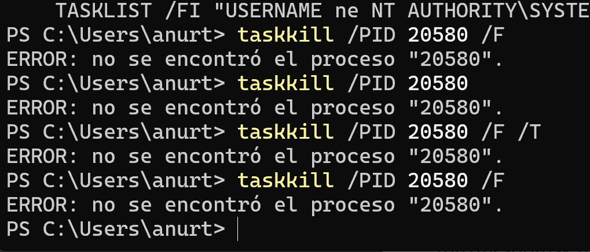
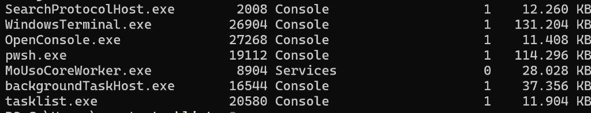

# Prozesuak Identifikatu, Kontrolatu eta Hiltzeko Gida Praktikoa

**Modulua:** 0490 - Zerbitzu eta Prozesuen Programazioa  
**Sistema:** Windows 10/11 (CMD eta PowerShell)  
**Egilea:** Zerbitzu eta Prozesuen Programazioa (Goierri Eskola)  

---

## 1. Gertatutako Arazoaren Azterketa (Kasu Erreala)

PowerShell kontsolan prozesu bat hiltzen saiatzean errore hau agertu da behin eta berriz:

```text
PS C:\Users\anurt> taskkill /PID 20580 /F
ERROR: no se encontró el proceso "20580".
```


*1. Irudia: taskkill aginduak prozesua ez duela aurkitzen adierazten duen errorea.*


*2. Irudia: tasklist exekuzioaren azken lerroan PID 20580 ageri zen uneko argazkia.*

---

## 2. Zergatik Gertatu Da Errore Hori? (Azalpen Teknikoa)

2. irudiko azken lerroari arretaz erreparatuz gero, argi ikusten da zer zen `20580` PIDa zuen prozesua:

```text
tasklist.exe                  20580 Console             1     11.904 KB
```

> [!IMPORTANT]
> **PID 20580 prozesua erabiltzaileak exekutatutako `tasklist.exe` komandoa bera zen!**

### Funtzionamendua eta Bizitza-Zikloa:
1. Erabiltzaileak `tasklist` idatzi eta Enter sakatzean, Windows-ek prozesu berri bat sortzen du (`tasklist.exe`), eta PID bat esleitzen dio (kasu honetan `20580`).
2. Prozesu honek une horretan RAM memorian dauden prozesu guztien zerrenda eskuratzen du eta kontsolan inprimatzen du.
3. Bere zerrenda inprimatzen amaitzen duen une berean (**milisegundo gutxi batzuen buruan**), prozesuak bere lana amaitu duela adierazten dio Sistema Eragileari eta **berehala itzaltzen da** (`Terminado` egoerara pasatuz).
4. Erabiltzaileak `taskkill /PID 20580 /F` idatzi eta exekutatzen duenerako, `tasklist.exe` (20580) **jada hilik dago eta ez da existitzen sisteman**. Horregatik ematen du sistemak errore hori:
   `ERROR: no se encontró el proceso "20580"`.

---

## 3. Prozesu Motak: Iraunkorrak vs. Iragankorrak

Konputazioan funtsezkoa da bi prozesu mota hauek bereiztea:

| Mota | Ezaugarriak | Bizitza-iraupena | Adibideak |
| :--- | :--- | :--- | :--- |
| **Prozesu Iragankorrak (Transient / Batch)** | Ataza bakar eta zehatz bat betetzeko abiarazten dira; lana amaitu bezain laster automatikoki hiltzen dira. | Milisegundoak edo segundo gutxi batzuk | `tasklist.exe`, `dir`, `ping`, `ipconfig`, `javac` |
| **Prozesu Iraunkorrak (Persistent / Interaktiboak)** | Erabiltzaileak edo beste prozesu batek berariaz itxi arte memorian zabalik geratzen dira. | Minutuak, orduak edo egunak | `notepad.exe`, `chrome.exe`, `calc.exe`, Zerbitzuak |

> [!TIP]
> `taskkill` bidez prozesu bat hiltzen probatzeko, **prozesu iraunkor bat** erabili behar da (adibidez, *Notepad* edo *Kalkulagailua*).

---

## 4. Gida Praktikoa: Nola Probatu `taskkill` Arrakastaz (Pausoz Pauso)

### 1. Urratsa: Ireki prozesu iraunkor bat (Notepad)
Ireki Bloc de notas bat kontsolatik bertatik:
```powershell
notepad.exe
```
*(Notepad leihoa zabalduko da pantailan).*

---

### 2. Urratsa: Bilatu Notepad-en PID erreala
Beste PowerShell leiho edo fitxa batean, kontsultatu ea martxan dagoen:

**CMD bidez:**
```cmd
tasklist | findstr /I notepad
```

**PowerShell natibo bidez:**
```powershell
Get-Process notepad
```

Emaitzan zerbait antzekoa ikusiko duzu:
```text
notepad.exe                  14520 Console             1     24.500 KB
```
Hemen PIDa **`14520`** da.

---

### 3. Urratsa: Hil prozesua `taskkill` erabiliz

#### A Aukera: PIDaren bidez hiltzea (Gomendatua)
```powershell
taskkill /PID 14520 /F
```

- **/PID 14520**: Hasi nahi dugun prozesuaren zenbakia.
- **/F**: Indarrez ixtea (*Force*), gorde gabeko aldaketak galdetzeko leihorik atera gabe.

**Kontsolako irteera arrakastatsua:**
```text
CORRECTO: se finalizó el proceso con PID 14520.
```
*(Une horretan ikusiko duzu nola Notepad-en leihoa berehala desagertzen den).*

#### B Aukera: Exekutagarriaren izenaren bidez hiltzea
Ez badakizu PIDa zein den edo izen hori duten leiho guztiak batera itxi nahi badituzu:
```powershell
taskkill /IM notepad.exe /F
```

- **/IM notepad.exe**: Irudiaren izena (*Image Name*).

---

## 5. Agindu Konparatiboen Taula: Windows CMD vs PowerShell vs Linux

| Ekintza | Windows (CMD / Legacy) | Windows (PowerShell Natiboa) | GNU/Linux (Bash) |
| :--- | :--- | :--- | :--- |
| **Prozesu guztiak zerrendatu** | `tasklist` | `Get-Process` *(edo `gps`)* | `ps aux` |
| **Prozesu zehatz bat bilatu** | `tasklist \| findstr notepad` | `Get-Process notepad` | `ps aux \| grep notepad` edo `pgrep -l notepad` |
| **PID bidez hil (Bortxaz)** | `taskkill /PID <PID> /F` | `Stop-Process -Id <PID> -Force` *(edo `kill <PID> -Force`)* | `kill -9 <PID>` |
| **Izenaren bidez hil** | `taskkill /IM notepad.exe /F` | `Stop-Process -Name notepad -Force` | `killall -9 notepad` |
| **Zuhaitz osoa hil (Umeekin batera)** | `taskkill /PID <PID> /F /T` | `Stop-Process -Id <PID> -Force` | `pkill -P <PID>` |

---

## 6. Ohiko Erroreak eta Haien Konponbidea

### 1. `ERROR: no se encontró el proceso "XXXXX"`
- **Kausa:** Prozesua jada amaitu da (adibidez `tasklist`), edo PID zenbakian akats tipografiko bat egin da.
- **Konponbidea:** Exekutatu berriz `Get-Process` edo `tasklist` eta egiaztatu uneko PID erreala.

### 2. `ERROR: Acceso denegado (Access is denied)`
- **Kausa:** Hiltzen saiatzen ari zaren prozesua sistemako zerbitzu bat da (`SYSTEM` edo beste erabiltzaile batena) eta zure terminalak ez ditu administratzaile pribilegiorik.
- **Konponbidea:** Ireki PowerShell **"Exekutatu administratzaile gisa"** (*Run as Administrator*) sakatuz eta errepikatu agindua.

---

## 7. Java Lengoaian Prozesuak Nola Hiltzen Dira?

Java aplikazio batek `ProcessBuilder` bidez sortutako kanpoko prozesu bat itxi nahi duenean:

```java
ProcessBuilder pb = new ProcessBuilder("notepad.exe");
Process prozesua = pb.start();

// ... zenbait ataza egin ondoren ...

// 1. Modu adeitsuan ixteko eskaera (SIGTERM baliokidea):
prozesua.destroy();

// 2. Prozesua indarrez akabatzeko (taskkill /F edo kill -9 baliokidea):
if (prozesua.isAlive()) {
    prozesua.destroyForcibly();
}
```
