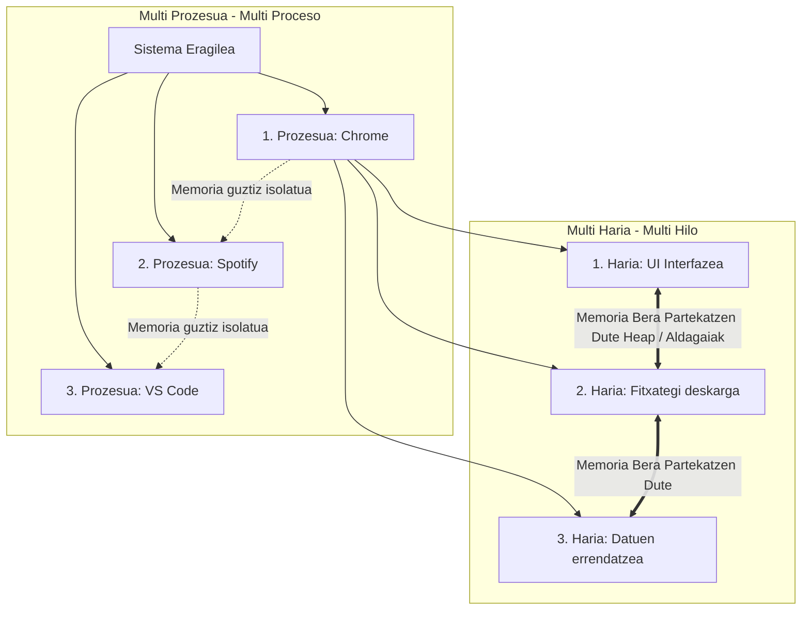
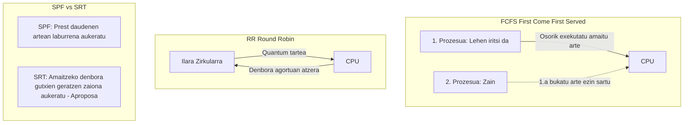
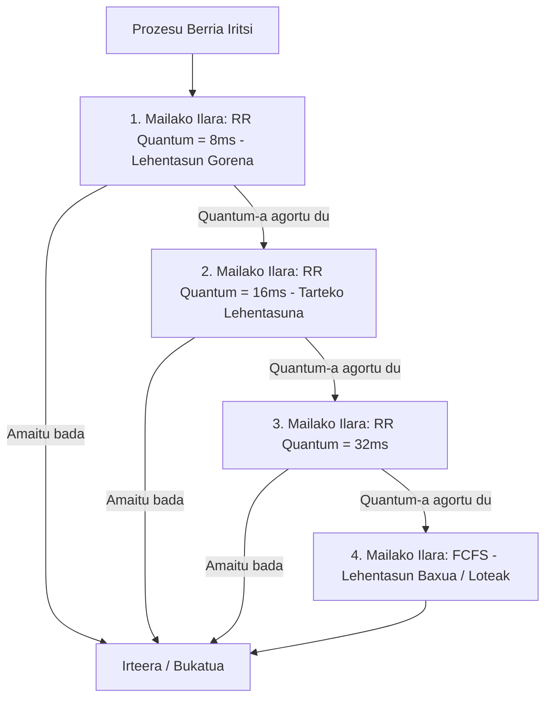
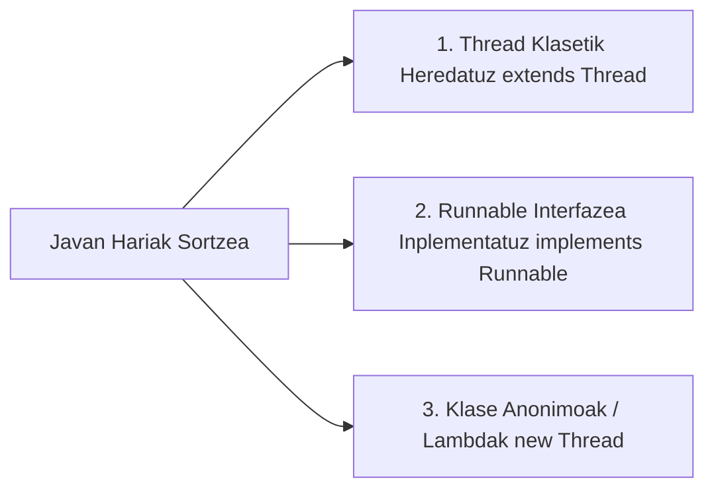
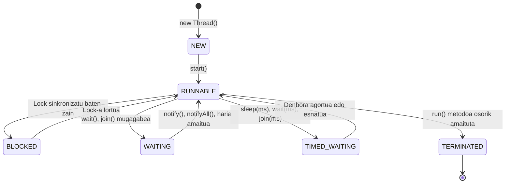

# Hari Anitzeko Programazioa (Programación Multihilo en Java)

Dokumentu honek **«HARI ANITZEN PROGRAMAZIOA.pdf»** aurkezpeneko 17 orrialdeetako eduki teoriko, arkitektural eta praktiko guztiak sakonki garatzen ditu, prozesuen eta harien arteko ezberdintasunak, SEaren planifikazio-algoritmoak, Java harien bizitza-zikloa eta proposatutako ariketen ebazpen osoak azalduz.

---

## 1. Multi Prozesua vs. Multi Haria (Multi Proceso vs. Multi Hilo)

Konputazio modernoan bi modu nagusi daude hainbat ataza aldi berean exekutatzeko:



| Ezaugarria | Multi Prozesua (Multi Proceso) | Multi Haria (Multi Hilo / Thread) |
| :--- | :--- | :--- |
| **Definizioa** | Hainbat aplikazio independente aldi berean exekutatzea (elkarrekin zerikusia izan ala ez). | Aplikazio **bakar baten barruan** ataza anitz aldi berean exekutatzea. |
| **Memoria** | Prozesu bakoitzak bere memoria-eremu isolatua du; batak ezin du bestearena ukitu. | Prozesu beraren barruko hariek memoria-eremu bera (heap-a, instantzia-aldagaiak) partekatzen dute. |
| **Unitatearen Pisua** | Exekuzio-unitate **astuna** da. Sortzea eta testuinguru-aldaketa garestiak dira. | Exekuzio-unitate **arina** da (*prozesu arinak*). Sortzea eta txandakatzea oso azkarrak dira. |
| **Komunikazioa** | IPC mekanismo konplexuak behar ditu (Socketak, MMF, Tutuak). | Datu-egitura eta aldagai komunen bidez zuzenean komunikatzen dira. |
| **Porrotaren Eragina**| Prozesu batek huts eginez gero, sistema ez da erortzen; beste prozesuek aurrera jarraitzen dute. | Hari batean kudeatu gabeko salbuespen larri batek prozesu osoa bota dezake. |

> [!NOTE]
> Bi kasuetan **programazio konkurrenteaz** ari gara. Nukleo bakarreko ordenagailu batean exekuzioa ez da benetan aldiberekoa; Sistema Eragileak **planifikazio-algoritmoen** bidez txandakatzen ditu atazak, aldi bereko ilusioa sortuz.

---

## 2. Sistema Eragilearen Plangintza-Algoritmoak (Scheduling)

Ataza anitzeko inguruneetan, plangintza-algoritmoak erabakitzen du prozesatze-denbora nola banatu behar den une jakin batean prest dauden ataza guztien artean.

### Plangintza-Algoritmo baten Helburuak:
1. **Inpartziala eta eraginkorra izatea:** Ataza guztiek jaso behar dute CPU denbora; inor ezin da betiko ahaztuta utzi (*starvation* galarazi).
2. **Erantzun-denbora minimizatzea:** Erabiltzailearekiko aplikazio interaktiboetan atzerapenak txikitzea.
3. **Errendimendua maximizatzea:** Ahalik eta prozesu gehien amaitzea denbora-unitate bakoitzeko.
4. **Baliabideen oreka mantentzea:** CPUa, RAMa eta S/I gailuak modu orekatuan lanean edukitzea.

---

### 2.1. Algoritmo Klasikoak



| Algoritmoa | Izena Euskaraz | Funtzionamendua | Abantailak eta Desabantailak |
| :--- | :--- | :--- | :--- |
| **FCFS** | *First Come, First Served* (Lehena iristen, Lehena zerbitzatzen) | Prozesadorera iristen den lehen prozesua lehenago eta osorik exekutatzen da. Amaitu arte beste inor ezin da sartu (ez-aproposa). | Oso sinplea, baina prozesu luze batek gainerako guztiak blokeatzen ditu (*Konboi efektua*). |
| **RR** | *Round Robin* (Txandakakoa) | Prozesu guztiei denbora-tarte finko eta labur bat (**quantum**) esleitzen zaie txandaka. Denbora agortzean, ilararen atzera doa. | Oso inpartziala eta egokia sistema interaktiboentzat. Quantum txikiegia bada, testuinguru-aldaketen gainkarga handia da. |
| **SPF / SPN** | *Shortest Process First* (Laburrena Lehenik) | Exekutatzeko prest dauden prozesu guztietatik, CPU denbora gutxien beharko duena hautatzen da lehenik. | Batez besteko itxaron-denbora txikiena lortzen du. Hala ere, zaila da prozesu batek zenbat iraungo duen aurrez jakitea. |
| **SRT** | *Shortest Remaining Time* (Gainerako Denbora Gutxiena Duela) | SPFren aldaera lehentasunezkoa (aproposa). Une oro amaitzeko denbora gutxien geratzen zaion prozesuari ematen dio CPUa. | Oso azkarra da, baina prozesu luzeek "gosea" (*starvation*) pairatu dezakete prozesu laburrak etengabe iristen badira. |

---

### 2.2. Berrelikadura Duten Hainbat Ilara (Multilevel Feedback Queues)

Aurreko algoritmo guztiak baino errealistagoa eta konplexuagoa da. Prozesu batek zenbat denbora beharko duen aurrez ez dakigun ingurune modernoetan erabiltzen da.



- Sistemak hainbat ilara ditu, bakoitza bere lehentasun eta politikekin (adib. goiko mailetan Round Robin quantum txikiarekin, eta behekoan FCFS).
- Prozesu interaktibo laburrak goiko mailetan amaitzen dira azkar.
- CPU asko kontsumitzen duten prozesu luzeak beheragoko mailetara jaisten dira pixkanaka, beste prozesuei bidea libratuz.

---

## 3. Programazio Konkurrentea, Paraleloa eta Banatua

| Paradigma | Nola funtzionatzen du? | Hardwarea | Datu-partekatzea |
| :--- | :--- | :--- | :--- |
| **Konkurrentea** | Hainbat ataza denboran gainjartzen dira. Prozesadorea erabiltzeagatik lehiatzen dira; une jakin batean bat bakarrik dago exekutatzen (txandaka). | CPU bakarra (edo nukleo mugatuak). | Memoria bera parteka dezakete; koordinazio eta sinkronizazio zorrotza eskatzen du. |
| **Paraleloa** | Atazak benetan **une zehatz berean** exekutatzen dira. Prozesuak ez dira lehiatzen, bakoitzak bere nukleo fisikoa baitu. | Hainbat nukleo (Multi-core) edo CPU fisikoak. | Memoria partekatua edo bus dedikatu azkarrak. Arazoa zeregin txikitan zatitzen da. |
| **Banatua** | Lana sare baten bidez konektatutako ordenagailu independenteen artean banatzen da (**nodoak**). | Ordenagailu sarea (LAN, WAN, Hodeia). | Ez dago memoria partekaturik; sareko mezu-trukearen bidez komunikatzen dira. |

---

## 4. Zer Dira Hariak (Threads)?

**Hari edo thread bat aplikazio batek aldi berean egin dezakeen ataza bakoitza da.**
- Besterik adierazi ezean, aplikazio orok exekuzio-hari bakarra du hasieran: **hari nagusia (Main Thread)**.
- Hari nagusiak ataza luze bat hasten badu (adib. fitxategi erraldoi bat deskargatzea), aplikazioaren erabiltzaile-interfazea izoztuta geratzen da.
- Horregatik, beste zeregin batzuk aldi berean egin nahi diren bakoitzean, **hari gehigarri berriak** abiarazi behar dira.

---

## 5. Javan Hariak Sortzeko Bideak

Java programazio-lengoaian hiru modu nagusi daude hariak sortzeko:



### 5.1. 1. Bidea: `Thread` Klasetik Heredatuz (`extends Thread`)
Klaseak `Thread` klasea hedatzen du eta `run()` metodoa gainidazten du:
```java
public class NireHaria extends Thread {
    @Override
    public void run() {
        System.out.println("Haria martxan dago: " + getName());
    }

    public static void main(String[] args) {
        NireHaria h = new NireHaria();
        h.start(); // GARRANTZITSUA: start() deitu behar da, ez run()!
    }
}
```
- **Muga:** Javak ez du herentzia anitzik onartzen. Klase honek ezingo du beste inoren oinordeko izan.

### 5.2. 2. Bidea: `Runnable` Interfazea Inplementatuz (`implements Runnable`) - **GOMENDATUA**
Klaseak `Runnable` inplementatzen du. Horrela beste klase baten oinordeko izaten jarrai dezake:
```java
public class NireAtaza implements Runnable {
    @Override
    public void run() {
        System.out.println("Ataza exekutatzen hari arin batean.");
    }

    public static void main(String[] args) {
        Thread h = new Thread(new NireAtaza());
        h.start();
    }
}
```

### 5.3. 3. Bidea: Lambda Adierazpenak (Java 8+)
Klase berririk sortu gabe, ataza laburrak azkar abiarazteko modurik garbi eta erosoena da:
```java
new Thread(() -> {
    System.out.println("Hari anonimo azkarra lanean!");
}).start();
```

> [!WARNING]
> **Oso Garrantzitsua: `start()` vs. `run()`**
> - `h.run()` deitzen baduzu, ez da hari berririk sortzen; deia egin duen uneko hariaren barruan exekutatuko da sekuentzialki!
> - `h.start()` deitu behar da beti: metodo honek sistema eragileari eskatzen dio hari berri bat sortzea eta hari horren barruan `run()` automatikoki abiaraztea.

---

## 6. Harien Bizitza-Zikloa eta Egoerak (`Thread.State`)

Javako hari batek egoera hauek izan ditzake, `Thread.getState()` metodoaren bidez kontsultatu daitezkeenak:



| Egoera (`Thread.State`) | Esanahia | Nola sartzen da egoera honetan? |
| :--- | :--- | :--- |
| **`NEW`** | Haria sortu da, baina oraindik ez da `start()` deitu. | `Thread h = new Thread(...)` |
| **`RUNNABLE`** | Haria martxan dago edo CPU txandaren zain dago prest. | `h.start()` |
| **`BLOCKED`** | Blokeatuta dago, bloke `synchronized` batean sartzeko lock-aren zain. | Beste hari batek dauka monitorearen giltza. |
| **`WAITING`** | Mugarik gabe zain dago beste hari batek ekintza bat egin arte. | `o.wait()`, `h.join()` |
| **`TIMED_WAITING`** | Denbora zehatz batez zain dago lo edo itxaroten. | `Thread.sleep(500)`, `h.join(1000)` |
| **`TERMINATED`** | Hariaren exekuzioa behin betiko amaitu da. | `run()` metodoak bere azken lerrora iritsi denean. |

---

## 7. Harien Sinkronizazio-Metodoak `Thread` Klasean

| Metodoa | Deskribapena |
| :--- | :--- |
| **`join()`** | Metodo honi deitzen dion haria **geldirik itxaroten geratzen da** deitutako haria guztiz amaitu arte (`TERMINATED`). |
| **`Thread.sleep(long millis)`** | Uneko haria lo uzten du zehaztutako milisegundoetan, CPUa beste harientzat libre utziz. |
| **`isAlive()`** | Boolear bat itzultzen du (`true`/`false`), haria oraindik aktibo dagoen (abiarazi da eta ez da amaitu) jakiteko. |
| **`yield()`** | Planifikatzaileari (*scheduler*) iradokitzen dio uneko haria prest dagoela bere CPU txanda beste bati uzteko (ez dago bermatuta). |
| **`stop()` [DEPRECATED]** | **Inoiz ez erabili.** Datuak egoera ezegonkorrean uzten dituelako gaitzetsi zen. Hariak modu garbian gelditzeko seinale-aldagai boolearrak (`volatile boolean running`) edo `interrupt()` erabili behar dira. |

---

## 8. Aurkezpeneko Kode Adibidea: `isAlive()` Erabilera

Aurkezpeneko 14. orrialdeak bi hariren arteko koordinazioa erakusten du `isAlive()` bidez:

```java
package eus.goierrieskola.hariak;

/**
 * Ataza Nagusia: 10 aldiz mezu bat idatzi eta 500 ms itxaroten du.
 */
class AtazaNagusia implements Runnable {
    @Override
    public void run() {
        for (int i = 0; i < 10; i++) {
            System.out.println("Ni naiz Ataza Nagusia (" + i + ")");
            try {
                Thread.sleep(500);
            } catch (InterruptedException ie) {
                ie.printStackTrace();
            }
        }
    }
}

/**
 * AtazaAlive: Beste haria bizirik dagoen bitartean (isAlive == true)
 * atzeko planoan mezua errepikatzen du.
 */
class AtazaAlive implements Runnable {
    private Thread besteHaria;

    public AtazaAlive(Thread besteHaria) {
        this.besteHaria = besteHaria;
    }

    @Override
    public void run() {
        while (besteHaria.isAlive()) {
            System.out.println("Martxan nago beste haria bizirik dagoen bitartean...");
            try {
                Thread.sleep(500);
            } catch (InterruptedException ie) {
                ie.printStackTrace();
            }
        }
        System.out.println(">>> Beste hariak BUKATU du eta ni berarekin batera amaitzen naiz.");
    }
}

public class App {
    public static void main(String[] args) {
        // 1. Lehen haria sortu
        Thread hariaNagusia = new Thread(new AtazaNagusia());

        // 2. Bigarren haria sortu, lehenengoaren erreferentzia pasatuz
        Thread hariaAlive = new Thread(new AtazaAlive(hariaNagusia));

        // 3. Biak abiarazi
        hariaNagusia.start();
        hariaAlive.start();

        System.out.println("Noiz bukatuko dute bi hariek?");
    }
}
```

---

## 9. Aurkezpeneko Ariketen Ebazpen Osoa

Aurkezpeneko 15. orrialdeak bi ariketa proposatzen ditu kontsolan zenbaketa banatua egiteko.

### 9.1. 1. Ariketa: Zenbaketa Bi Haritan Banatuta
> *«Sortu kontsola-aplikazio bat zenbaki jakin bateraino zenbatzen duena (sekuentzia pantailaratuz) bi hari erabiliz, bakoitzak zenbaki-tarte bat zenbatzeko.»*

```java
package eus.goierrieskola.ariketak;

/**
 * Tarte jakin bateko zenbakiak pantailaratzen dituen haria.
 */
class ZenbatuTartea implements Runnable {
    private final int hasiera;
    private final int bukaera;
    private final String hariarenIzena;

    public ZenbatuTartea(String hariarenIzena, int hasiera, int bukaera) {
        this.hariarenIzena = hariarenIzena;
        this.hasiera = hasiera;
        this.bukaera = bukaera;
    }

    @Override
    public void run() {
        for (int i = hasiera; i <= bukaera; i++) {
            System.out.println("[" + hariarenIzena + "] Zenbakia: " + i);
            try {
                Thread.sleep(50); // Irteera argi ikusteko geldialdi txikia
            } catch (InterruptedException e) {
                Thread.currentThread().interrupt();
            }
        }
        System.out.println(">>> [" + hariarenIzena + "] AMAITUTA (" + hasiera + " - " + bukaera + ")");
    }
}

public class Ariketa1BiHari {
    public static void main(String[] args) {
        int muga = 100;
        int erdia = muga / 2;

        System.out.println("=== 1. ARIKETA: 1etik " + muga + "ra zenbatzen 2 harirekin ===");

        // 1. Tartea: 1etik 50era
        Thread h1 = new Thread(new ZenbatuTartea("1. Haria", 1, erdia));
        // 2. Tartea: 51tik 100era
        Thread h2 = new Thread(new ZenbatuTartea("2. Haria", erdia + 1, muga));

        h1.start();
        h2.start();

        try {
            // main haria itxaron biak amaitu arte
            h1.join();
            h2.join();
        } catch (InterruptedException e) {
            e.printStackTrace();
        }

        System.out.println("=== ZENBAKETA OSOA AMAITU DA ===");
    }
}
```

---

### 9.2. 2. Ariketa: Zenbaketa N Haritan Era Orekatuan Banatuta
> *«Sortu kontsola-aplikazio bat zenbaki jakin bateraino zenbatzen duena N hari erabiliz. Zenbaki-sekuentzia hari guztien artean modu orekatuan banatuko da, bakoitzari tarte bat esleituz.»*

```java
package eus.goierrieskola.ariketak;

import java.util.ArrayList;
import java.util.List;

public class Ariketa2NHari {

    public static void main(String[] args) {
        final int GUZTIRA = 105; // Zenbatu nahi den muga
        final int N_HARIAK = 4;  // Erabiliko den hari kopurua

        System.out.println("=== 2. ARIKETA: 1etik " + GUZTIRA + "ra zenbatzen " + N_HARIAK + " harirekin ===");

        int tarteTamaina = GUZTIRA / N_HARIAK;
        int hondarra = GUZTIRA % N_HARIAK; // Hondarra lehen hariei banatuko zaie

        List<Thread> hariZerrenda = new ArrayList<>();
        int unekoHasiera = 1;

        for (int i = 0; i < N_HARIAK; i++) {
            // Hondarra balego, zati bakoitzari +1 gehitzen diogu oreka lortzeko
            int tamaina = tarteTamaina + (i < hondarra ? 1 : 0);
            int unekoBukaera = unekoHasiera + tamaina - 1;

            String izena = (i + 1) + ". Haria";
            Thread h = new Thread(new ZenbatuTartea(izena, unekoHasiera, unekoBukaera));
            hariZerrenda.add(h);

            unekoHasiera = unekoBukaera + 1;
        }

        // Hari guztiak abiarazi
        for (Thread h : hariZerrenda) {
            h.start();
        }

        // main hariak guztiak itxaron
        for (Thread h : hariZerrenda) {
            try {
                h.join();
            } catch (InterruptedException e) {
                e.printStackTrace();
            }
        }

        System.out.println("=== " + N_HARIAK + " HARIEK LAN GUZTIA AMAITU DUTE ===");
    }
}
```

---

## 10. Laburpen-Gakoak

1. **Multiataza vs Multithreading:** Prozesuek memoria isolatua dute (astunak); hariek memoria bera partekatzen dute aplikazio barruan (arinak).
2. **Plangintza-Algoritmoak:** FCFS (sinplea, konboia), RR (quantum bidez txandaka, interaktiboa), SPF/SRT (laburrena lehenik) eta Berrelikaduradun Ilarak (sistema modernoetako eredu errealista).
3. **Hariak sortzea:** `implements Runnable` da aukerarik gomendagarriena, Javaren herentzia aske uzten duelako.
4. **Koordinazioa:** `join()` ezinbestekoa da harien amaiera itxaroteko eta emaitzak ordenan biltzeko; `isAlive()`-k egoera egiaztatzen du eta `Thread.sleep()`-ek CPUa uzten du.
5. **Egoerak:** `NEW` $\rightarrow$ `RUNNABLE` $\leftrightarrow$ `BLOCKED` / `WAITING` / `TIMED_WAITING` $\rightarrow$ `TERMINATED`.
