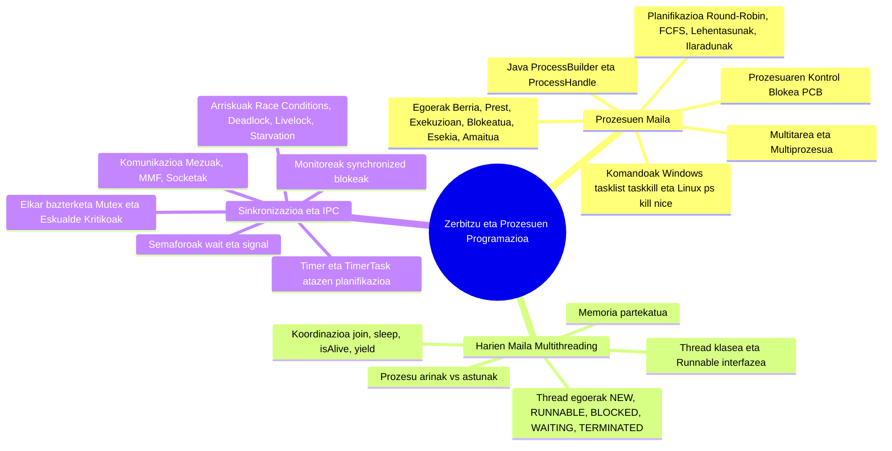

# 0490 - Zerbitzu eta Prozesuen Programazioa (1. Ebaluaketa)

> **AZTERKETA ENTRENATZAILEA (Web & Android App)**: Karpeta honetan ZPP 1. ebaluaketako azterketa prestatzeko garatutako aplikazio interaktiboa daukazu, **Android APK** eta **Web aplikazio** formatuan!
>
> - 🌐 **Web bertsioa zuzenean nabigatzailean erabiltzeko (Deskargatu gabe):**👉 [**https://anderuriengoierri.github.io/ZPP_1_Ebaluaketa_App/**](https://anderuriengoierri.github.io/ZPP_1_Ebaluaketa_App/)
> - 📲 **Android APK deskargatzeko:** [`ZPP_Entrenatzailea.apk`](https://github.com/AnderUrienGoierri/ZPP_1_Ebaluaketa_App/raw/main/ZPP_Entrenatzailea.apk)
> - 📦 **ZIP pakete osoa (Web + APK + Argibideak):** [`ZPP_1_Ebaluaketa_Azterketa_Entrenatzailea.zip`](https://github.com/AnderUrienGoierri/ZPP_1_Ebaluaketa_App/raw/main/ZPP_1_Ebaluaketa_Azterketa_Entrenatzailea.zip)
>
> **Aplikazioaren ezaugarriak:**
>
> 1. 📝 **Teoria Testa**: 80 galdera erreal, aukera nahasiak (B arriskurik gabe), tenporizadorea eta akatsak birpasatzeko modua.
> 2. 💻 **Zati Praktikoa (4 Modu)**: Klaseko kodeak aztertu, hutsuneak bete, akatsak zuzendu (Bug Hunter) eta kode zatiak idatzi.
> 3. 📊 **Estatistikak & Puntu Ahulak**: Zure nota eta asmatze-tasak aztertu, eta puntu ahulak berariaz entrenatzeko botoia.
> 4. 📚 **Gida Bizkorra**: Teoriaren laburpena eta 5 SVG diagrama bektorial (7 egoerak, Harien zikloa, EDT vs Worker, Deadlock eta Race Condition).

---

Karpeta honetan **«0490 - Zerbitzu eta prozesuen programazioa»** moduluko lehen ebaluaketako material didaktiko guztia biltzen da. PDF bakoitzeko **Markdown (.md) artxibo xehe, profesional eta oso bat** sortu da euskaraz, Mermaid diagramak, taulak, arkitektura-esquemen azalpenak eta ariketa praktikoen ebazpenak barne hartuta.

---

## Fitxategien Aurkibidea eta Loturak

| Jatorrizko PDF Fitxategia                                                                                                                                                                                             | Sortutako Markdown Gida (.md)                                                                                                                                                                               | Deskribapen Laburra                                                                                                                                                                                                                                                                                                          |
| :-------------------------------------------------------------------------------------------------------------------------------------------------------------------------------------------------------------------- | :---------------------------------------------------------------------------------------------------------------------------------------------------------------------------------------------------------- | :--------------------------------------------------------------------------------------------------------------------------------------------------------------------------------------------------------------------------------------------------------------------------------------------------------------------------- |
| **[`0-Zerbitzu eta prozesuen programazioa 01.pdf`](file:///c:/Dev/GoierriEskola/2_maila/0490-Zerbitzu%20eta%20prozesuen%20programazioa/1_ebaluaketa/1_sarrera/0-Zerbitzu%20eta%20prozesuen%20programazioa%2001.pdf)** | **[`0-Zerbitzu_eta_prozesuen_programazioa_01.md`](file:///c:/Dev/GoierriEskola/2_maila/0490-Zerbitzu%20eta%20prozesuen%20programazioa/1_ebaluaketa/1_sarrera/0-Zerbitzu_eta_prozesuen_programazioa_01.md)** | Moduluaren sarrera orokorra, ataza anitzeko sistemak, lengoaia konpilatu/interpretatu/hibridoak, programa vs exekutablea vs prozesua vs zerbitzua, prozesuen egoerak eta Java `ProcessBuilder` / `Runtime` klaseen bidez prozesuak abiarazteko ariketa.                                                                      |
| **[`Tema1 - PROGRAMACION MULTIPROCESO.pdf`](file:///c:/Dev/GoierriEskola/2_maila/0490-Zerbitzu%20eta%20prozesuen%20programazioa/1_ebaluaketa/1_sarrera/Tema1%20-%20PROGRAMACION%20MULTIPROCESO.pdf)**                 | **[`Tema1_-_PROGRAMACION_MULTIPROCESO.md`](file:///c:/Dev/GoierriEskola/2_maila/0490-Zerbitzu%20eta%20prozesuen%20programazioa/1_ebaluaketa/1_sarrera/Tema1_-_PROGRAMACION_MULTIPROCESO.md)**               | Prozesu anitzeko programazioaren teoria sakona: exekutagarri motak, multiataza motak (kooperatiboa vs aproposa), prozesuen egoerak, PCB egitura, planifikazio-algoritmoak (Round-Robin, lehentasunak), testuinguru-aldaketa (PC, SP) eta Windows/Linux kudeaketa komandoak (`tasklist`, `kill`, `ps`, etab.).                |
| **[`Tema2 - PROGRAMACION CONCURRENTE.pdf`](file:///c:/Dev/GoierriEskola/2_maila/0490-Zerbitzu%20eta%20prozesuen%20programazioa/1_ebaluaketa/1_sarrera/Tema2%20-%20PROGRAMACION%20CONCURRENTE.pdf)**                   | **[`Tema2_-_PROGRAMACION_CONCURRENTE.md`](file:///c:/Dev/GoierriEskola/2_maila/0490-Zerbitzu%20eta%20prozesuen%20programazioa/1_ebaluaketa/1_sarrera/Tema2_-_PROGRAMACION_CONCURRENTE.md)**                 | Programazio konkurrentearen oinarriak: zergatik konkurrentzia?, prozesu lehiakideak vs lankideak, eskualde kritikoak, elkar-bazterketa (Mutex), Deadlock-aren analisia (lau autoen bidegurutzea) eta IPC komunikazio-motak (Simplex/Duplex, Sinkronoa/Asinkronoa, Memoria Mapeatua vs Socketak).                             |
| **[`Tema3 - SINCRONIZACION.pdf`](file:///c:/Dev/GoierriEskola/2_maila/0490-Zerbitzu%20eta%20prozesuen%20programazioa/1_ebaluaketa/1_sarrera/Tema3%20-%20SINCRONIZACION.pdf)**                                         | **[`Tema3_-_SINCRONIZACION.md`](file:///c:/Dev/GoierriEskola/2_maila/0490-Zerbitzu%20eta%20prozesuen%20programazioa/1_ebaluaketa/1_sarrera/Tema3_-_SINCRONIZACION.md)**                                     | Prozesuen arteko sinkronizazio-teknikak: irakurle-idazle arazoa, itxaronaldi aktiboaren arriskuak, Semaforoak (`wait`/`signal`), Monitoreak ("bizkartzain" metafora), mezu-ilarak, kalitate-baldintzak (Safety vs Liveness: Deadlock, Livelock, Starvation) eta arazketaren zailtasunak (Heisenbugs).                        |
| **[`Sinkronizazioa01.pdf`](file:///c:/Dev/GoierriEskola/2_maila/0490-Zerbitzu%20eta%20prozesuen%20programazioa/1_ebaluaketa/1_sarrera/Sinkronizazioa01.pdf)**                                                         | **[`Sinkronizazioa01.md`](file:///c:/Dev/GoierriEskola/2_maila/0490-Zerbitzu%20eta%20prozesuen%20programazioa/1_ebaluaketa/1_sarrera/Sinkronizazioa01.md)**                                                 | Aldi bereko programazioa Javan: hari-segurtasuna bildumetan (`java.util.Collections` vs `java.util.concurrent`), `Runnable`, `Thread`, `Timer` eta `TimerTask` konparaketa, baratzearen ureztatze adibidea eta «Geldirik ez egoteko planifikazioa» (SystemTray jakinarazpenak) ariketaren soluzio osoa.                      |
| **[`HARI ANITZEN PROGRAMAZIOA.pdf`](file:///c:/Dev/GoierriEskola/2_maila/0490-Zerbitzu%20eta%20prozesuen%20programazioa/1_ebaluaketa/1_sarrera/HARI%20ANITZEN%20PROGRAMAZIOA.pdf)**                                   | **[`HARI_ANITZEN_PROGRAMAZIOA.md`](file:///c:/Dev/GoierriEskola/2_maila/0490-Zerbitzu%20eta%20prozesuen%20programazioa/1_ebaluaketa/1_sarrera/HARI_ANITZEN_PROGRAMAZIOA.md)**                               | Hari anitzeko programazio osoa Javan: prozesua vs haria, SEaren plangintza-algoritmoak (FCFS, RR, SPF, SRT, Berrelikaduradun ilarak), hariak sortzeko moduak (`Thread`, `Runnable`, Lambdak), `Thread.State` egoerak eta `getState()`, metodoak (`join`, `sleep`, `isAlive`, `yield`) eta 2 ariketa praktikoen ebazpen osoa. |

---

## Ebaztutako Atazak

| Ataza                                                                                                                              | Ebazpen Txostena (.md)                                                                                                                                              | Edukia eta Helburuak                                                                                                                                                                                                                                                      |
| :--------------------------------------------------------------------------------------------------------------------------------- | :------------------------------------------------------------------------------------------------------------------------------------------------------------------ | :------------------------------------------------------------------------------------------------------------------------------------------------------------------------------------------------------------------------------------------------------------------------ |
| **[1. Ataza](file:///c:/Dev/GoierriEskola/2_maila/0490-Zerbitzu%20eta%20prozesuen%20programazioa/1_ebaluaketa/1_sarrera/1_ataza)** | **[`1_Ataza_Ebazpena.md`](file:///c:/Dev/GoierriEskola/2_maila/0490-Zerbitzu%20eta%20prozesuen%20programazioa/1_ebaluaketa/1_sarrera/1_ataza/1_Ataza_Ebazpena.md)** | Lengoaia konpilatuak, interpretatuak eta hibridoak (Bytecode / JVM), Programa vs Prozesua eta Sistema Banatuak. Intel 486 vs Intel Core i3, i5, i7 konparaketa sakona.                                                                                                    |
| **[2. Ataza](file:///c:/Dev/GoierriEskola/2_maila/0490-Zerbitzu%20eta%20prozesuen%20programazioa/1_ebaluaketa/1_sarrera/2_ataza)** | **[`2_Ataza_Ebazpena.md`](file:///c:/Dev/GoierriEskola/2_maila/0490-Zerbitzu%20eta%20prozesuen%20programazioa/1_ebaluaketa/1_sarrera/2_ataza/2_Ataza_Ebazpena.md)** | Prozesuen antolaketa, PCB, 3 planifikazio mailak eta 7 egoeren definizioa (Figura 1.11). Prozesuen arteko komunikazioa (IPC). Java `Runtime` eta `ProcessBuilder` klaseen azterketa eta komando-lerroko exekutagarrien programa praktikoa (`ProzesuExekutatzailea.java`). |

---

## Eduki Orokorraren Mapa Kontzeptuala

