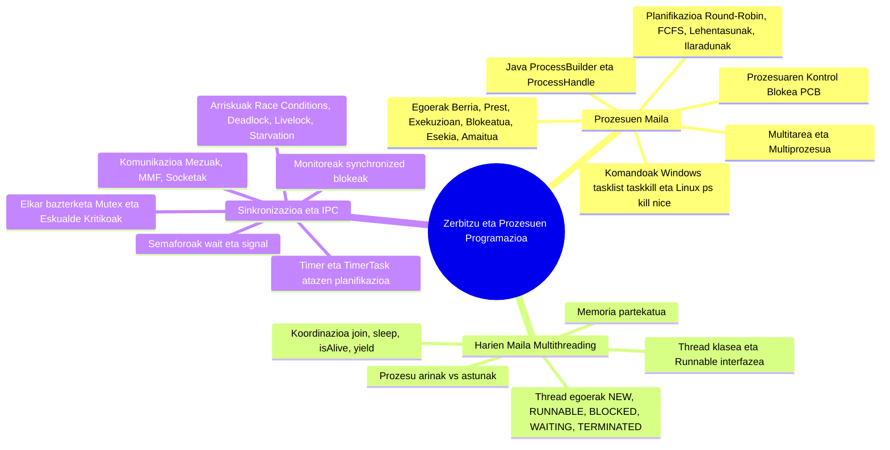

# 0490 - Zerbitzu eta Prozesuen Programazioa (1. Ebaluaketa)

> **AZTERKETA ENTRENATZAILEA (Web & Android App)**: Karpeta honetan ZPP 1. ebaluaketako azterketa bikain prestatzeko garatutako aplikazio interaktiboa daukazu, **Android APK**, **PWA Web aplikazio** eta **ZIP eramangarri** formatuetan!
>
> - 🌐 **Web bertsioa zuzenean nabigatzailean erabiltzeko (Instalatu gabe):** 👉 [**https://anderuriengoierri.github.io/ZPP_1_Ebaluaketa_App/**](https://anderuriengoierri.github.io/ZPP_1_Ebaluaketa_App/)
> - 📲 **Android APK deskargatzeko:** [`ZPP_Entrenatzailea.apk`](https://github.com/AnderUrienGoierri/ZPP_1_Ebaluaketa_App/raw/main/ZPP_Entrenatzailea.apk)
> - 📦 **ZIP pakete osoa (Weba + APK + Kode Guztiak):** [`ZPP_1_Ebaluaketa_Azterketa_Entrenatzailea.zip`](https://github.com/AnderUrienGoierri/ZPP_1_Ebaluaketa_App/raw/main/ZPP_1_Ebaluaketa_Azterketa_Entrenatzailea.zip)
>
> **Aplikazioaren ezaugarri nagusiak:**
>
> 1. 📖 **Teoria eta Simulagailu Interaktiboak**: 1. Ebaluazioko teoria osoa, azalpen sakonak, taula konparatiboak (FCFS, SJF, SRTF, Round Robin...) eta **5 simulagailu animatu interaktibo**:
>    - *Prozesuen 7 Egoeren Zikloa (RAM eta Swap diskoa, animazio automatikoa eta eskuzko trantsizioak)*
>    - *CPU Planifikatzailea eta 3 Hari Paralelo*
>    - *Lasterketa-baldintza (Race Condition) vs Synchronized babesa*
>    - *Deadlock eta Coffman-en 4 baldintzak*
>    - *Swing EDT interfazearen blokeoa vs Atzeko planoko Worker-a*
> 2. 📝 **Teoria Testa**: Galderak banaka (Aurrekoa / Hurrengoa / Aurkibide zuzena), tenporizadorea, ausazko nahasketa eta erantzun bakoitzaren arrazoibide zehatza.
> 3. 💻 **Zati Praktikoa (12 Ariketa Kronologiko)**: Ariketa praktiko guztiak desplegable eroso batean kronologikoki ordenatuta (ProcessBuilder, Thread vs Runnable, join(), isAlive(), Kotxe Lasterketa, Kronometroa & EDT, TimerTask, Deadlock/Inanizioa, Semaforoak, CyclicBarrier & CountDownLatch, ExecutorService & Future). 4 azterketa modu: Kodearen azalpena, Hutsuneak bete, Akatsak zuzendu (Bug Hunter) eta Kodea idatzi.
> 4. 🎨 **Modu Argia eta Iluna**: Kontraste handiko diseinua bi gaietan, begiak ez nekatzeko.
> 5. 🔍 **Zoom Sistema Moldagarria**: Pantaila guztietan %50etik %150era doitzeko kontrol flotatzailea.
> 6. ⚡ **Gida Bizkorra eta SVG Ikono Bektorialak**: Kontzeptu gakoak, formula azkarrak eta ikono bektorial modernoak.

---

Karpeta honetan **«0490 - Zerbitzu eta prozesuen programazioa»** moduluko lehen ebaluaketako material didaktiko guztia biltzen da. PDF bakoitzeko **Markdown (.md) artxibo xehe, profesional eta oso bat** sortu da euskaraz, Mermaid diagramak, taulak, arkitektura-esquemen azalpenak eta ariketa praktikoen ebazpenak barne hartuta.

---

## Fitxategien Aurkibidea eta Loturak

| Jatorrizko PDF Fitxategia | Sortutako Markdown Gida (.md) | Deskribapen Laburra |
| :------------------------- | :----------------------------- | :------------------ |
| **[`0-Zerbitzu eta prozesuen programazioa 01.pdf`](teoria/0-Zerbitzu%20eta%20prozesuen%20programazioa%2001.pdf)** | **[`0-Zerbitzu_eta_prozesuen_programazioa_01.md`](teoria/0-Zerbitzu_eta_prozesuen_programazioa_01.md)** | Moduluaren sarrera orokorra, ataza anitzeko sistemak, lengoaia konpilatu/interpretatu/hibridoak, programa vs exekutablea vs prozesua vs zerbitzua, prozesuen egoerak eta Java `ProcessBuilder` / `Runtime` klaseen bidez prozesuak abiarazteko ariketa. |
| **[`Tema1 - PROGRAMACION MULTIPROCESO.pdf`](teoria/Tema1%20-%20PROGRAMACION%20MULTIPROCESO.pdf)** | **[`Tema1_-_PROGRAMACION_MULTIPROCESO.md`](teoria/Tema1_-_PROGRAMACION_MULTIPROCESO.md)** | Prozesu anitzeko programazioaren teoria sakona: exekutagarri motak, multiataza motak (kooperatiboa vs aproposa), prozesuen egoerak, PCB egitura, planifikazio-algoritmoak (Round-Robin, lehentasunak), testuinguru-aldaketa (PC, SP) eta Windows/Linux kudeaketa komandoak (`tasklist`, `kill`, `ps`, etab.). |
| **[`Tema2 - PROGRAMACION CONCURRENTE.pdf`](teoria/Tema2%20-%20PROGRAMACION%20CONCURRENTE.pdf)** | **[`Tema2_-_PROGRAMACION_CONCURRENTE.md`](teoria/Tema2_-_PROGRAMACION_CONCURRENTE.md)** | Programazio konkurrentearen oinarriak: zergatik konkurrentzia?, prozesu lehiakideak vs lankideak, eskualde kritikoak, elkar-bazterketa (Mutex), Deadlock-aren analisia (lau autoen bidegurutzea) eta IPC komunikazio-motak (Simplex/Duplex, Sinkronoa/Asinkronoa, Memoria Mapeatua vs Socketak). |
| **[`Tema3 - SINCRONIZACION.pdf`](teoria/Tema3%20-%20SINCRONIZACION.pdf)** | **[`Tema3_-_SINCRONIZACION.md`](teoria/Tema3_-_SINCRONIZACION.md)** | Prozesuen arteko sinkronizazio-teknikak: irakurle-idazle arazoa, itxaronaldi aktiboaren arriskuak, Semaforoak (`wait`/`signal`), Monitoreak ("bizkartzain" metafora), mezu-ilarak, kalitate-baldintzak (Safety vs Liveness: Deadlock, Livelock, Starvation) eta arazketaren zailtasunak (Heisenbugs). |
| **[`Sinkronizazioa01.pdf`](teoria/Sinkronizazioa01.pdf)** | **[`Sinkronizazioa01.md`](teoria/Sinkronizazioa01.md)** | Aldi bereko programazioa Javan: hari-segurtasuna bildumetan (`java.util.Collections` vs `java.util.concurrent`), `Runnable`, `Thread`, `Timer` eta `TimerTask` konparaketa, baratzearen ureztatze adibidea eta «Geldirik ez egoteko planifikazioa» (SystemTray jakinarazpenak) ariketaren soluzio osoa. |
| **[`HARI ANITZEN PROGRAMAZIOA.pdf`](teoria/HARI%20ANITZEN%20PROGRAMAZIOA.pdf)** | **[`HARI_ANITZEN_PROGRAMAZIOA.md`](teoria/HARI_ANITZEN_PROGRAMAZIOA.md)** | Hari anitzeko programazio osoa Javan: prozesua vs haria, SEaren plangintza-algoritmoak (FCFS, RR, SPF, SRT, Berrelikaduradun ilarak), hariak sortzeko moduak (`Thread`, `Runnable`, Lambdak), `Thread.State` egoerak eta `getState()`, metodoak (`join`, `sleep`, `isAlive`, `yield`) eta 2 ariketa praktikoen ebazpen osoa. |

---

## Ebaztutako Atazak eta Ariketa Praktiko Guztiak

| # | Ataza / Ariketa Praktikoa | Fitxategi Nagusiak & Txostenak (.md / .java) | Edukia eta Azalpen Praktikoa |
| :-: | :--- | :--- | :--- |
| **1** | **1. Ataza: Arkitektura eta Konpilazio Ereduak** | • [`1_Ataza_Ebazpena.md`](1_ataza/1_Ataza_Ebazpena.md) • [`1_Ataza_ZPP_ANDER_URIEN.pdf`](1_ataza/1_Ataza_ZPP_ANDER_URIEN.pdf) | Lengoaia konpilatuak, interpretatuak eta hibridoak (Bytecode / JVM), Programa vs Prozesua eta Sistema Banatuak. Intel 486 vs Intel Core i3, i5, i7 konparaketa sakona. |
| **2** | **2. Ataza: ProzesuExekutatzailea (ProcessBuilder)** | • [`2_Ataza_Ebazpena.md`](2_ataza/2_Ataza_Ebazpena.md) • [`Prozesuak_Identifikatu_Eta_Hil_Gida.md`](2_ataza/Prozesuak_Identifikatu_Eta_Hil_Gida.md) • [`ProzesuExekutatzailea.java`](2_ataza/src/ataza2/ProzesuExekutatzailea.java) | Prozesuen antolaketa, PCB, 7 egoeren zikloa. Java `ProcessBuilder` eta `ProcessHandle` bidez kanpoko prozesuak exekutatu, PID lortu, irteera-kodeak jaso eta prozesuak gelditu/akabatu (`destroyForcibly`). |
| **3** | **Harien Hastapenak (Thread vs Runnable)** | • [`Haria.java`](hariak_ariketa/src/HarienHastapenak/Haria.java) • [`Ataza.java`](hariak_ariketa/src/HarienHastapenak/Ataza.java) • [`APP.java`](hariak_ariketa/src/HarienHastapenak/APP.java) | Java Hariak (Threads) sortzeko bi bide nagusiak: `Thread` klasea hedatu vs `Runnable` interfazea inplementatu. `start()` vs `run()` arteko alde kritikoa, eta zergatik `Runnable` gomendatzen den. |
| **4** | **Hariaren Bizitza Egiaztatzea (`isAlive()`)** | • [`AtazaAlive.java`](hariak_ariketa/src/is_alive/AtazaAlive.java) • [`APP.java`](hariak_ariketa/src/is_alive/APP.java) | Hariaren bizi-zikloa kontrolatzea, `start()` egin aurretik (false), martxan dagoenean (true) eta `join()` ondoren (false) egoera egiaztatzea `isAlive()` metodoaren bidez. |
| **5** | **Harien Koordinazioa (`join()`)** | • [`KontagailuAtaza.java`](hariak_ariketa/src/ataza_ariketa/KontagailuAtaza.java) • [`APP.java`](hariak_ariketa/src/ataza_ariketa/APP.java) • [`APP_join_gabe.java`](hariak_ariketa/src/ataza_ariketa/APP_join_gabe.java) • [`UlermenGalderak.md`](hariak_ariketa/src/ataza_ariketa/UlermenGalderak.md) | Hari nagusiak bigarren mailako hariei amaitu arte itxarotea (`join()`). Konparaketa zehatza: `join()` erabilita vs gabe gertatzen den desorden kaotikoa eta nola bermatzen den emaitzen zuzentasuna. |
| **6** | **Zenbaketa Paraleloa N Harirekin (Ariketa 1 & 2)** | • [`Ariketa_1/ZenbatzaileAtaza.java`](hariak_ariketa/src/Ariketa_1/ZenbatzaileAtaza.java) • [`Ariketa_1/APP.java`](hariak_ariketa/src/Ariketa_1/APP.java) • [`Ariketa_2/ZenbatzaileAtaza.java`](hariak_ariketa/src/Ariketa_2/ZenbatzaileAtaza.java) • [`Ariketa_2/APP.java`](hariak_ariketa/src/Ariketa_2/APP.java) | Batura handiak ($1$etik $N$-ra) $K$ zatitan banatzea hari paraleloen artean. Hari bakoitzak bere emaitza partziala kalkulatzen du bere Stack memorian eta hari nagusiak `join()` bidez guztiak batu eta denborak neurtzen ditu. |
| **7** | **Kotxe Lasterketa (Swing & Konkurrentzia)** | • [`KotxeLasterketa.java`](hariak_ariketak_entrega/hariak_ariketak/src/main/java/KotxeLasterketa.java) | Swing interfaze grafikoan mugimendu paraleloa simulatzea. Hainbat auto helmugara iristen saiatzen dira; `volatile` aldagaia ikusgarritasunerako eta `synchronized(giltza)` sekzio kritikoa irabazle bakarra aldarrikatzeko. |
| **8** | **Kronometroa eta Atzerako Kontaketa (EDT Segurtasuna)** | • [`Cronometroa.java`](hariak_ariketak_entrega/hariak_ariketak/src/main/java/Cronometroa.java) • [`AtzerakoKontua.java`](hariak_ariketak_entrega/hariak_ariketak/src/main/java/AtzerakoKontua.java) • [`Hariak_Ariketak_Dokumentazioa.md`](hariak_ariketak_entrega/Hariak_Ariketak_Dokumentazioa.md) | Swing interfaze grafikoa ez blokeatzeko haria atzeko planoan exekutatzea (`Thread.sleep(1000)`). `SwingUtilities.invokeLater()` erabiliz EDT (Event Dispatch Thread) hariari GUI eguneraketak modu seguruan bidaltzea. |
| **9** | **Timer eta TimerTask (Aldizkako Jakinarazpenak)** | • [`LuzatzeAtaza.java`](timer_eta%20timer_task/timer_eta_timer_task/src/main/java/org/example/LuzatzeAtaza.java) • [`Luzatze_Ariketa_Azalpena.md`](timer_eta%20timer_task/Luzatze_Ariketa_Azalpena.md) • [`ARIKETA.md`](timer_eta%20timer_task/ARIKETA.md) | «Geldirik ez egoteko planifikazioa». Java `Timer` eta `TimerTask` erabiliz atazak aldizka planifikatzea (`scheduleAtFixedRate`) eta Windows SystemTray jakinarazpenak bistaratzea. |
| **10** | **Konkurrentziaren 5 Arazo Nagusiak (Lanketa IV)** | • [`LANKETA_IV_AZALPENA.md`](sinkronizazioa/talde_lana_sinkronizazioa_berreskuratua/sinkronizazioa_4_lanketa_1T/LANKETA_IV_AZALPENA.md) • [`DeadlockAdibidea.java`](sinkronizazioa/talde_lana_sinkronizazioa_berreskuratua/sinkronizazioa_4_lanketa_1T/src/main/java/org/example/arazoak/DeadlockAdibidea.java) • [`InanizioAdibidea.java`](sinkronizazioa/talde_lana_sinkronizazioa_berreskuratua/sinkronizazioa_4_lanketa_1T/src/main/java/org/example/arazoak/InanizioAdibidea.java) • [`LasterketaBaldintzaAdibidea.java`](sinkronizazioa/talde_lana_sinkronizazioa_berreskuratua/sinkronizazioa_4_lanketa_1T/src/main/java/org/example/arazoak/LasterketaBaldintzaAdibidea.java) • [`LerratutakoBaldintzakAdibidea.java`](sinkronizazioa/talde_lana_sinkronizazioa_berreskuratua/sinkronizazioa_4_lanketa_1T/src/main/java/org/example/arazoak/LerratutakoBaldintzakAdibidea.java) • [`MemoriaInkontsistentziaAdibidea.java`](sinkronizazioa/talde_lana_sinkronizazioa_berreskuratua/sinkronizazioa_4_lanketa_1T/src/main/java/org/example/arazoak/MemoriaInkontsistentziaAdibidea.java) | Klaseko Lanketa IV-ko 5 konkurrentzia akatsak, kode adibideak eta konponbideak: Elkar-blokeoa (Deadlock) eta Coffman-en 4 baldintzak, Inanizioa (Starvation), Lasterketa-baldintza (Race Condition), Lerratutako baldintzak (Slipped Conditions) eta Memoriaren inkontsistentzia (CPU katxeak). |
| **11** | **Sinkronizazio Aurreratuko Mekanismoak (Java Concurrency)** | • [`SemaphoreDemo.java`](sinkronizazioa/Sinkonizazio_adibideak/SemaphoreDemo.java) • [`BarrierDemo.java`](sinkronizazioa/Sinkonizazio_adibideak/BarrierDemo.java) • [`LatchDemo.java`](sinkronizazioa/Sinkonizazio_adibideak/LatchDemo.java) • [`ExecutorDemo.java`](sinkronizazioa/Sinkonizazio_adibideak/ExecutorDemo.java) • [`FutureDemo.java`](sinkronizazioa/Sinkonizazio_adibideak/FutureDemo.java) • [`QueueDemo.java`](sinkronizazioa/Sinkonizazio_adibideak/QueueDemo.java) • [`ConcurrentMapDemo.java`](sinkronizazioa/Sinkonizazio_adibideak/ConcurrentMapDemo.java) | Java Concurrency paketearen utilitate nagusiak: `Semaphore` (sarbide baimen mugatuak), `CyclicBarrier` (hesi berrerabilgarriak), `CountDownLatch` (sinkronizazio giltzak), `ExecutorService` & `Future` (hari poolak eta emaitza asinkronoak), eta bilduma seguruak. |
| **12** | **ZPP Entrenatzailea (Android APK & Web PWA)** | • [`zpp_entrenatzailea/`](zpp_entrenatzailea/) • [`ZPP_Entrenatzailea.apk`](ZPP_Entrenatzailea.apk) • [🌐 Lineako Web App](https://anderuriengoierri.github.io/ZPP_1_Ebaluaketa_App/) | ZPP 1. ebaluaketako azterketa entrenatzeko aplikazio integrala: 80 galderako teoria testa, 12 ariketa praktikoen analisia, 5 simulagailu animatu interaktiboak, estatistika aurreratuak eta Modu Argia/Iluna. |

---

## Eduki Orokorraren Mapa Kontzeptuala

