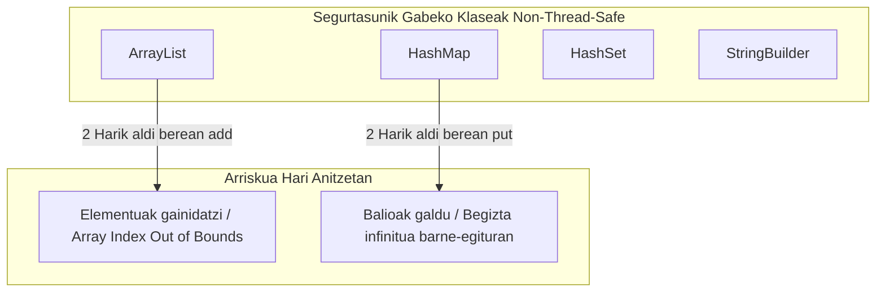
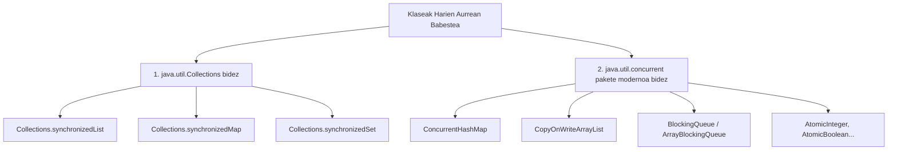
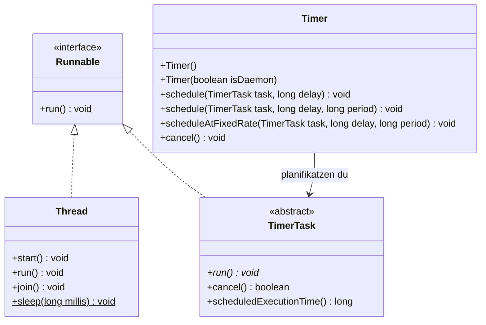

# Sinkronizazioa Javan: Bildumak, Hariak eta Atazen Planifikazioa (Timer / TimerTask)

Dokumentu honek **«Sinkronizazioa01.pdf»** aurkezpenaren eduki teoriko eta praktiko guztiak garatzen ditu sakonki, Java plataformako aldi bereko programazioaren erronkak, segurtasunik gabeko klaseak konpontzeko bideak, `Timer` eta `TimerTask` bidezko planifikazioa eta proposatutako ariketa praktikoaren ebazpen profesionala bilduz.

---

## 1. Aldi Bereko Programazioaren Erronkak Javan (Thread-Safety)

Java garatzaileek egunero erabiltzen dituzten klase arruntenetako asko **ez daude prestatuta hari anitzeko inguruneetan funtzionatzeko** (*non-thread-safe* dira). Hainbat harik aldi berean egitura horiek aldatzen badituzte, datu-galerak, balio okerrak edo `ConcurrentModificationException` salbuespenak gertatzen dira.



### Zergatik gertatzen da hau?
Errendimendua lehenesteko, Java-ko oinarrizko bilduma gehienek ez dituzte beren metodoak sinkronizatzen. Hari bakarreko aplikazio batean hori aproposa da (ez dagoelako sinkronizazio-gainkargarik), baina hari anitzeko aplikazio batean ezinbestekoa da neurriak hartzea.

---

## 2. Nola Zuzendu? Sinkronizazio Teknikak

Java plataformak bi bide nagusi eskaintzen ditu datu-egitura seguruak lortzeko:



### 2.1. `java.util.Collections` bidezko Egitura Sinkronizatuak
Metodo hauek jatorrizko bildumaren inguruan *wrapper* edo bilgarri sinkronizatu bat sortzen dute:

```java
// Arrunta (ez segurua hari anitzetan)
List<String> zerrendaArrunta = new ArrayList<>();

// Sinkronizatua (segurua: metodo guztiak synchronized dira)
List<String> zerrendaSegurua = Collections.synchronizedList(new ArrayList<>());
Map<String, Integer> mapaSegurua = Collections.synchronizedMap(new HashMap<>());
```

> [!NOTE]
> `Collections.synchronizedList`-en bidez metodo indibidualak babestuta daude, baina zerrenda begizta batean zeharkatzean (`iterator` edo `foreach`), programatzaileak eskuz sinkronizatu behar du:
> ```java
> synchronized (zerrendaSegurua) {
>     for (String elementua : zerrendaSegurua) {
>         System.out.println(elementua);
>     }
> }
> ```

### 2.2. `java.util.concurrent` Datu-Egitura Aurreratuak (Gomendatuak)
Java 5etik aurrera, pakete honek aldi bereko sarbideetarako espresuki optimizatutako datu-egiturak eskaintzen ditu, errendimendu askoz hobearekin:
- **`ConcurrentHashMap`:** Map osoa blokeatu beharrean, segmentu bakoitza modu independentean blokeatzen du (*lock striping*), irakurketak sekula blokeatu gabe.
- **`CopyOnWriteArrayList`:** Zerrenda irakurtzeko oso eraginkorra; aldaketa bat (`add`, `set`) egiten denean barneko array-aren kopia berri bat sortzen du.
- **`BlockingQueue` (adib. `ArrayBlockingQueue`, `LinkedBlockingQueue`):** Ekoizle-kontsumitzaile eredurako aproposa; automatikoki blokeatzen du kontsumitzailea ilara hutsik badago, eta ekoizlea ilara beteta badago.

---

## 3. Oinarrizko Klaseak: Runnable, Thread, Timer eta TimerTask

Aurkezpeneko 4. orrialdean jorratzen diren lau osagai nagusien xehetasunak:

| Izena | Mota | Paketea | Deskribapena eta Erabilera |
| :--- | :---: | :---: | :--- |
| **`Runnable`** | Interfazea | `java.lang` | Hari batek exekutatu beharreko ataza definitzen du. Metodo bakarra du: `public void run()`. Beste klase batzuetatik heredatzeko beharra dugunean erabiltzen da. |
| **`Thread`** | Klasea | `java.lang` | Exekuzio-hari independente bat ordezkatzen du (`Runnable` inplementatzen du). `start()` metodoaren bidez SEan hari berria abiarazten du eta bere `run()` metodoa exekutatzen da. |
| **`Timer`** | Klasea | `java.util` | Atazen exekuzioa atzeratuta (diferituan) edo modu errepikakorrean (periodikoan) planifikatzeko aukera ematen du atzeko planoan. |
| **`TimerTask`** | Klase Abstraktua | `java.util` | `Runnable` inplementatzen duen klase abstraktua da. `Timer` batek exekutatuko duen ataza programagarria definitzeko heredatzen da, bere `run()` metodoa gainidatziz. |



---

## 4. Atazen Planifikazioa: Timer eta TimerTask

`Timer` objektu batek atzeko planoko hari bat sortzen du planifikatutako atazak banan-banan exekutatzeko.

### 4.1. `schedule()` Metodoaren Funtzionamendua
`Timer` klaseak hainbat aldaera eskaintzen ditu:
1. `schedule(TimerTask task, long delay)`: Ataza behin bakarrik exekutatzen du, `delay` milisegundo igaro ondoren.
2. `schedule(TimerTask task, long delay, long period)`: Ataza lehen aldiz `delay` ms igaro ostean exekutatzen du, eta ondoren `period` milisegundoro errepikatzen du.
3. `scheduleAtFixedRate(TimerTask task, long delay, long period)`: Erloju finko bati jarraituz exekutatzen du (aurreko ataza atzeratu bada ere, galdutako txandak berreskuratzen saiatzen da).

---

### 4.2. Aurkezpeneko Adibidea: Baratzearen Ureztatzea (Regadio)

Aurkezpeneko 5. orrialdeko adibide praktikoa:

```java
package timer;

import java.util.Timer;
import java.util.TimerTask;

/**
 * Ureztatze automatikoa simulatzen duen klasea, TimerTask erabiliz.
 */
public class Regadio extends TimerTask {
    
    @Override
    public void run() {
        System.out.println("Regando... (Ureztatzen...)");
    }

    public static void main(String[] args) {
        Timer temporizador = new Timer();
        
        // 1000 ms (segundo 1) itxaron hasi aurretik, 
        // eta ondoren 2000 ms-ro (2 segundoro) exekutatu.
        temporizador.schedule(new Regadio(), 1000, 2000);
        
        System.out.println("Ureztatze-sistema programatuta dago. Martxan...");
    }
}
```

```mermaid
sequenceDiagram
    autonumber
    actor Main as main() Haria
    participant T as Timer Haria
    participant R as Regadio (TimerTask)

    Main->>T: new Timer() sortu
    Main->>T: schedule(new Regadio(), 1000, 2000)
    Note over Main: main metodoa amaitu daiteke;<br/>Timer haria atzeko planoan lanean geratzen da.
    
    Note over T: 1000 ms itxaron...
    T->>R: run() deitu -> "Regando..."
    Note over T: 2000 ms itxaron...
    T->>R: run() deitu -> "Regando..."
    Note over T: 2000 ms itxaron...
    T->>R: run() deitu -> "Regando..."
```

---

## 5. Ariketa Praktikoaren Ebazpena: "Geldirik ez Egoteko Planifikazioa"

### 5.1. Ariketaren Enuntziatua
> *«Sortu aplikazio bat `Timer` eta `TimerTask` erabiliz, erabiltzaileari gogorarazten diona 30 minuturo mugitu behar dela! Saiatu zaitez abisua agertaraztea Sistema Eragilearen notifikazio baten bidez, `SystemTray` eta `TrayIcon` erabiliz `java.awt` paketetik.»*

### 5.2. Ebazpen Profesional Osoa Java Kodean

Soluzio honek baldintza guztiak betetzen ditu:
- `SystemTray` bateragarria den egiaztatzen du (Windows, Linux, macOS).
- 16x16 pixeleko ikono dinamiko bat sortzen du memoriatik bertatik (kanpoko irudirik behar izan gabe).
- Ataza 30 minuturo errepikatzen du (`30 * 60 * 1000 ms`). Proba azkarrak egiteko, aldagaia konfigura daiteke.
- Sistemaren erretiluko ikonoan (*System Tray*) mezua eta globoa agerrarazten ditu.

```java
package eus.goierrieskola.osasuna;

import java.awt.*;
import java.awt.image.BufferedImage;
import java.util.Timer;
import java.util.TimerTask;

/**
 * Geldirik ez egoteko abisuen aplikazioa.
 * Timer, TimerTask eta java.awt.SystemTray erabiltzen ditu.
 */
public class MugimenduAbisua {

    // 30 minutu milisegundotan: 30 * 60 * 1000 = 1.800.000 ms
    // (Probak azkar egiteko 5000 ms erabil daiteke)
    private static final long ALDI_TARTETXOA = 30 * 60 * 1000; 
    private static final long HASIERAKO_ATZERAPENA = 2000; // 2 segundo

    private static TrayIcon trayIcon;

    public static void main(String[] args) {
        System.out.println(">>> Geldirik ez egoteko jakinarazpen-zerbitzua abiarazten...");

        // 1. Egiaztatu Sistema Eragileak SystemTray onartzen duen
        if (!SystemTray.isSupported()) {
            System.err.println("ERROREA: Sistema Eragile honek ez du SystemTray onartzen.");
            System.err.println("Kontsolako mezu bidez jakinaraziko da.");
        } else {
            konfiguratuSystemTray();
        }

        // 2. Timer eta TimerTask konfiguratu
        Timer temporizador = new Timer("OsasunTimerHaria", false);
        
        TimerTask mugituAtaza = new TimerTask() {
            private int zenbatAldiz = 0;

            @Override
            public void run() {
                zenbatAldiz++;
                bistaratuJakinarazpena("GARAIA DA MUGITZEKO!", 
                    zenbatAldiz + ". abisua: 30 minutu daramatzazu eserita. " +
                    "Altxatu, luzatu hankak eta edan ura!");
            }
        };

        // 3. Planifikatu ataza periodikoa
        temporizador.schedule(mugituAtaza, HASIERAKO_ATZERAPENA, ALDI_TARTETXOA);
        System.out.println("Zerbitzua aktibo! Abisua 30 minuturo agertuko da.");
    }

    /**
     * Sistemaren erretiluan (System Tray) ikonoa eta menua konfiguratzen ditu.
     */
    private static void konfiguratuSystemTray() {
        try {
            SystemTray tray = SystemTray.getSystemTray();

            // Ikono sinple bat dinamikoki marraztu memoriatik (16x16 urdin bat)
            Image ikonoa = sortuIkonoDinamikoa();

            // Popup menua sortu aplikazioa erretilutik itxi ahal izateko
            PopupMenu popup = new PopupMenu();
            MenuItem irtenItem = new MenuItem("Irten aplikaziotik");
            irtenItem.addActionListener(e -> {
                System.out.println("Aplikazioa itzaltzen...");
                System.exit(0);
            });
            popup.add(irtenItem);

            trayIcon = new TrayIcon(ikonoa, "Geldirik Ez Egoteko Monitorea", popup);
            trayIcon.setImageAutoSize(true);
            tray.add(trayIcon);

            trayIcon.displayMessage("Osasun Zerbitzua Martxan",
                    "Aplikazioa atzeko planoan aktibatuta dago.",
                    TrayIcon.MessageType.INFO);

        } catch (AWTException e) {
            System.err.println("Errorea SystemTray-ra ikonoa gehitzean: " + e.getMessage());
        }
    }

    /**
     * Jakinarazpen bisuala erakusten du Sistema Eragilean.
     */
    private static void bistaratuJakinarazpena(String izenburua, String testua) {
        System.out.println("\n[ABISUA] " + izenburua + " - " + testua);
        if (trayIcon != null) {
            trayIcon.displayMessage(izenburua, testua, TrayIcon.MessageType.WARNING);
        }
    }

    /**
     * Kanpoko .png irudirik behar ez izateko, 16x16 ikono bat margotzen du memorian.
     */
    private static Image sortuIkonoDinamikoa() {
        BufferedImage img = new BufferedImage(16, 16, BufferedImage.TYPE_INT_ARGB);
        Graphics2D g2 = img.createGraphics();
        g2.setColor(new Color(30, 144, 255)); // Urdin bizia
        g2.fillOval(0, 0, 16, 16);
        g2.setColor(Color.WHITE);
        g2.setFont(new Font("SansSerif", Font.BOLD, 10));
        g2.drawString("M", 3, 12);
        g2.dispose();
        return img;
    }
}
```

---

## 6. Laburpen-Gakoak

1. **Hari-Segurtasuna (Thread-Safety):** `ArrayList` edo `HashMap` bezalako egiturak ez dira seguruak; `Collections.synchronizedList()` edo `java.util.concurrent` (`ConcurrentHashMap`) erabili behar dira.
2. **`Runnable` vs `Thread`:** `Runnable` ataza bera da (zer egin); `Thread` langilea da (nork egin). Gomendagarria da `Runnable` inplementatzea klasearen herentzia aske uzteko.
3. **`Timer` eta `TimerTask`:** Aldizkako edo atzeratutako lanak antolatzeko tresna sinple eta indartsuak dira, atzeko planoko hari bakar bat erabiliz.
4. **`SystemTray` integrazioa:** Erabiltzaileari mahaigaineko jakinarazpenak modu dotorean bidaltzeko balio du, aplikazioa minimizatuta mantenduz.
