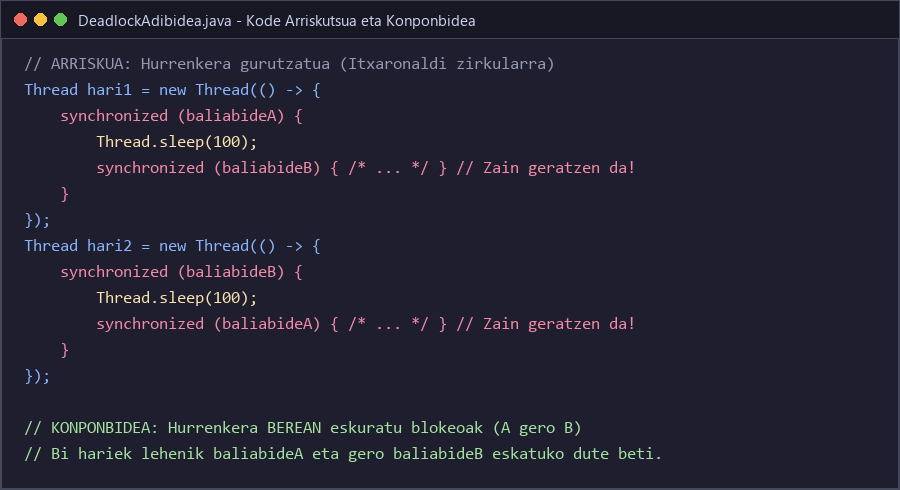
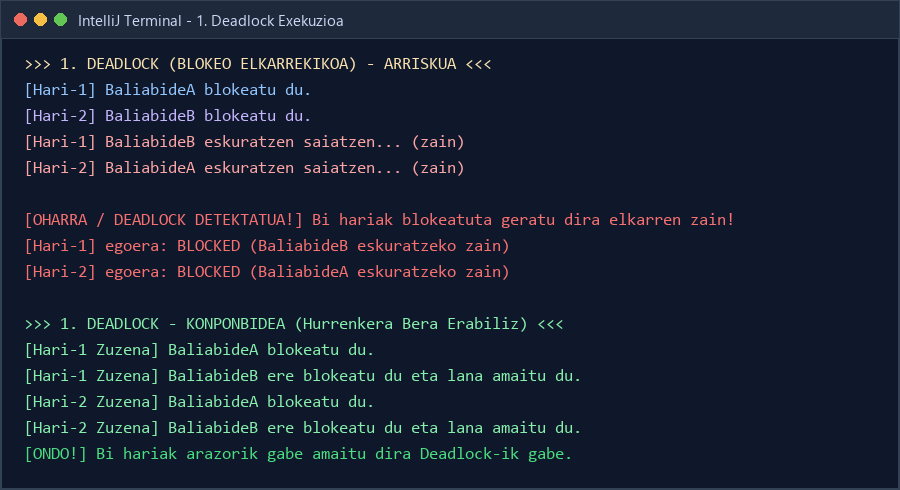
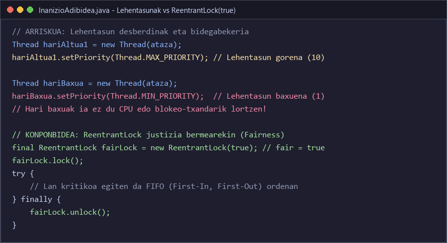
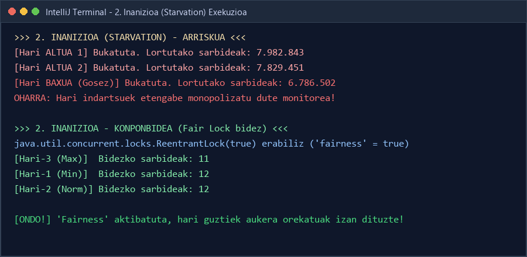
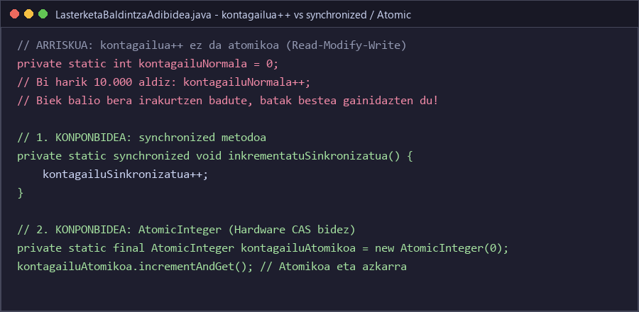
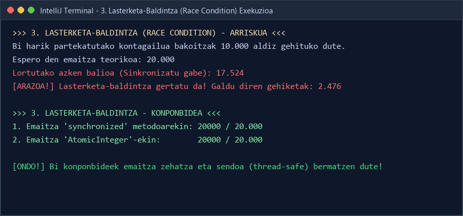
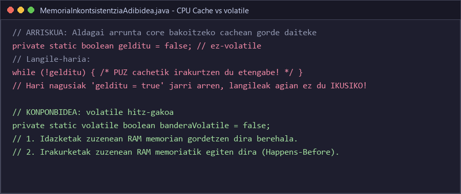
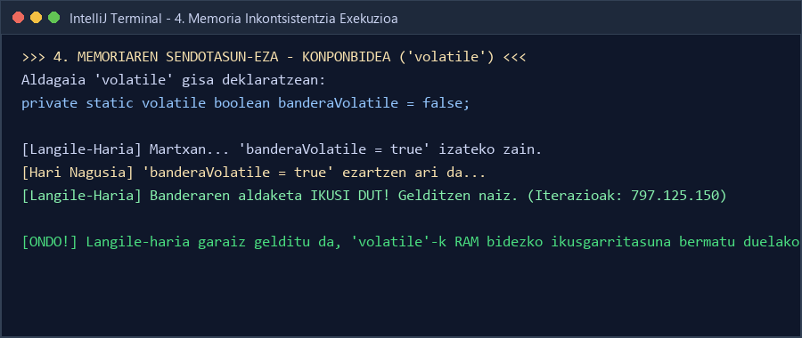
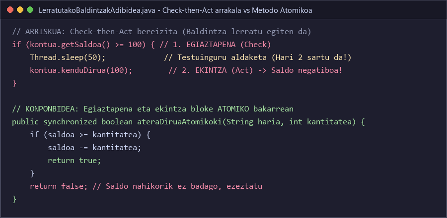
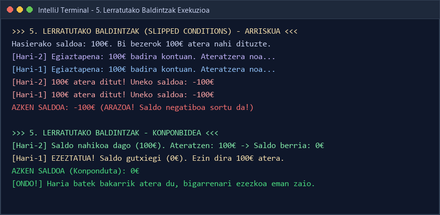

# LANKETA IV: PROGRAMAZIO KONKURRENTEAREN ARAZO NAGUSIAK
**0490 - Zerbitzu eta Prozesuen Programazioa (2. Maila)**  
**Goierri Eskola - 1. Ebaluaketa**  
**Egileak (1T Taldea):** Julen, Iker, Ander U  

---

## 1. Sarrera eta Testuingurua

Aplikazio modernoetan hari anitzeko programazioa (**Multithreading**) funtsezkoa da PUZaren nukleo anitzak baliatzeko, ataza astunak paraleloan prozesatzeko eta erabiltzaile-interfazeak edo zerbitzariak erantzun-gaitasun onean mantentzeko. Hala ere, hari ezberdinak memoria eta baliabide berberak aldi berean erabiltzen hasten direnean, programazio sekuentzialean existitzen ez diren arazo larriak eta zailtasun handikoak sortzen dira.

Gelan emandako teorian azpimarratzen den bezala (*Sinkronizazioa01.pdf*):
> *"Aldi bereko programazioan (concurrente) ikuspegi honetatik daude klase asko sinkronizatuta egoteko prest ez daudenak. Ez daude prest ondo funtzionatzeko hari ezberdinengatik erabilita izateko."*

Lan honetan (**Lanketa IV**, 1T taldeari esleitutako gaia), aldi bereko programazioaren **5 arazo nagusiak** aztertu, simulatu, pantaila-argazkien bidez dokumentatu eta konponbide teknikoak eskaini ditugu:

1. **Interbloqueo o Deadlock (Blokeo elkarrekikoa)**
2. **Muerte por inanición / Starvation (Baliabide-gosetea)**
3. **Condiciones de carrera / Race conditions (Lasterketa-baldintzak)**
4. **Inconsistencia de memoria / Memory inconsistency (Memoriaren sendotasun-eza / volatile)**
5. **Condiciones deslizadas / Slipped conditions (Lerratutako baldintzak / Check-then-act)**

Ariketa guztiak IntelliJ IDEA-ko Java 17 proiektuan inplementatu dira (`sinkronizazioa_4_lanketa_1T`), eta kontsolako menu interaktibo baten bidez exekuta daitezke (`Main.java`).

---

## 2. Bost Arazoen Garapen Sakona, Kodea eta Pantaila-Argazkiak

```
                          PROGRAMAZIO KONKURRENTEAREN 5 ARAZOAK
                                         │
     ┌───────────────────┬───────────────┴───────────────┬───────────────────┐
     ▼                   ▼                               ▼                   ▼
1. Deadlock         2. Inanizioa                  3. Race Condition     4. Memoriaren
 (Elkarren zain)    (Baliabide-monopolioa)        (Ez-atomikotasuna)     Inkontsistentzia
                                                         │              (CPU cache vs RAM)
                                                         ▼
                                                5. Slipped Conditions
                                                  ("Check-then-Act")
```

---

### 1. PUNTUA: Interbloqueo o Deadlock (Blokeo Elkarrekikoa)

#### Kontzeptua eta Kausa
Deadlock edo blokeo elkarrekikoa gertatzen da bi hari (edo gehiago) elkarren zain geratzen direnean modu mugagabean. Hari bakoitzak besteak behar duen baliabide bat blokeatuta dauka, eta inork ez du berea askatzen bestea eskuratu aurretik. Emaitza da programa erabat izoztuta geratzen dela eta ez duela inoiz bere exekuzioa amaituko.

E. G. Coffman-ek 1971n definitutako **4 baldintzak** aldi berean bete behar dira Deadlock bat gertatzeko:
1. **Elkarrekiko Bazterketa (Mutual Exclusion):** Baliabidea haria bakarrak erabil dezake une bakoitzean.
2. **Eutsi eta Itxaron (Hold and Wait):** Hari batek baliabide bati eusten dio beste baten zain dagoen bitartean.
3. **Desjabetzerik Eza (No Preemption):** Baliabidea ezin zaio hari bati indarrez kendu; haria berak askatu behar du modu naturalean.
4. **Itxaronaldi Zirkularra (Circular Wait):** Mendekotasun begizta itxia sortzen da ($H_1 \rightarrow B_2 \rightarrow H_2 \rightarrow B_1$).

#### IntelliJ Kodea eta Exekuzioa





#### Emaitzaren Analisia eta Konponbidea
Terminaleko pantaila-argazkian ikus daitekeenez:
- **Arriskua:** `Hari-1`ek `BaliabideA` hartzen du eta `BaliabideB`ren zain geratzen da. Aldi berean, `Hari-2`k `BaliabideB` hartzen du eta `BaliabideA`ren zain geratzen da. Bi hariak `BLOCKED` egoeran harrapatuta geratzen dira.
- **Konponbidea (Resource Ordering):** Coffman-en 4. baldintza apurtzen da. Hari guztiek blokeoak beti ordena zorrotz BEREAN eskuratzen dituzte (lehenik A, eta gero B). Hurrenkera bera erabilita, ezinezkoa da itxaronaldi zirkularrik sortzea eta bi hariak arazorik gabe amaitzen dira.

---

### 2. PUNTUA: Muerte por Inanición / Starvation (Baliabide-Gosetea)

#### Kontzeptua eta Kausa
Inanizioa (starvation) gertatzen da hari batek (normalean lehentasun baxukoa edo zorte txarrekoa) behar duen baliabidea edo PUZ denbora sekula edo ia inoiz lortu ezin duenean, beste hari batzuek (lehentasun handikoak edo oldarkorragoak) baliabidea etengabe bereganatzen dutelako.

**Deadlock vs Inanizioa:**
- *Deadlock-ean:* Hariak blokeatuta daude elkarren artean; inork ezin du ezer egin.
- *Inanizioan:* Haria exekutatzeko prest dago (`READY` / `RUNNABLE`), baina sistemaren planifikatzaileak (*scheduler*) edo blokeo-kudeatzaileak ez dio sekula txandarik ematen.

#### IntelliJ Kodea eta Exekuzioa





#### Emaitzaren Analisia eta Konponbidea
Terminaleko pantaila-argazkian ikus daitekeenez:
- **Arriskua:** Lehentasun altuko bi hariek (`Thread.MAX_PRIORITY`) 7.900.000+ sarbide monopolizatzen dituzte, eta lehentasun baxuko haria baztertuta geratzen da.
- **Konponbidea (Fair Lock):** `java.util.concurrent.locks.ReentrantLock(true)` erabili dugu (`fairness = true`). Mekanismo honek FIFO (First-In, First-Out) ilara bat ezartzen du. Emaitza ikusgarria da: hari guztiek (lehentasuna edozein izanda ere) sarbide kopuru guztiz orekatua lortu dute (11, 12, 12 sarbide bakoitzak).

---

### 3. PUNTUA: Condiciones de Carrera / Race Conditions (Lasterketa-Baldintza)

#### Kontzeptua eta Kausa
Lasterketa-baldintza gertatzen da bi hari edo gehiago aldi berean partekatutako aldagai berera atzitzen direnean eta gutxienez batek idazketa egiten duenean, behar bezalako sinkronizaziorik gabe. Azken emaitza harien exekuzio-abiaduraren eta ordenaren mende geratzen da (ez-deterministikoa).

Zergatik ez da atomikoa `kontagailua++`?
Makina-mailan 3 mikro-instrukzio ezberdinetan banatzen da:
1. **READ:** Aldagaiaren uneko balioa RAMetik PUZ erregistrora ekarri.
2. **MODIFY:** Erregistroan balioari 1 gehitu.
3. **WRITE:** Emaitza berria RAM memorian gorde.

Bi harik aldi berean balio bera irakurtzen badute (adibidez 5), biek 6 kalkulatuko dute eta biek 6 gordeko dute memorian (7 beharrean). Gehiketa bat betiko galtzen da!

#### IntelliJ Kodea eta Exekuzioa





#### Emaitzaren Analisia eta Konponbidea
Terminaleko pantaila-argazkian ikus daitekeenez:
- **Arriskua:** Bi harik 10.000 aldiz gehitzen dute kontagailua. Espero den emaitza **20.000** da, baina sinkronizatu gabe **17.524** bakarrik lortu da (**2.476 gehiketa galdu dira!**).
- **Konponbideak:**
  1. `synchronized` metodoak: hari bakarra sar daiteke aldi bakoitzean, elkarrekiko bazterketa bermatuz (Emaitza: **20.000 / 20.000**).
  2. `java.util.concurrent.atomic.AtomicInteger`: blokeorik gabeko metodoa, hardwarearen CAS (*Compare-And-Swap*) instrukzioak erabiltzen dituena (Emaitza: **20.000 / 20.000**).

---

### 4. PUNTUA: Inconsistencia de Memoria / Memory Inconsistency (Memoriaren Sendotasun-Eza)

#### Kontzeptua eta Kausa
Memoriaren sendotasun-eza edo ikusgarritasun-arazoa (**Visibility Problem**) PUZ modernoen azpiegituragatik gertatzen da. Prozesagailuek L1/L2 cache azkarrak dituzte eta nukleo bakoitzak aldagaiaren kopia bat gordetzen du bere cachean.

Hari batek partekatutako aldagai batean aldaketa bat egiten duenean:
- Baliteke aldaketa hori bere cache lokalean bakarrik geratzea eta RAM nagusira berehala ez idaztea.
- Beste nukleo bateko haria bere cache lokal zaharretik irakurtzen jarraitzen du, eta ez da konturatzen aldagaia aldatu dela.
- Gainera, Java-ren JIT (*Just-In-Time*) konpilatzaileak `while(!gelditu)` begizta optimiza dezake aldagai erregistroan kargatuz (*loop hoisting*), begizta infinitu bihurtuz.

#### IntelliJ Kodea eta Exekuzioa





#### Emaitzaren Analisia eta Konponbidea
Terminaleko pantaila-argazkian ikus daitekeenez:
- **Arriskua:** Aldagai arrunta denean, langile-hariak bere cachetik irakurtzen jarraitzen du eta agian ez da sekula geldituko.
- **Konponbidea (`volatile`):** Aldagaia `private static volatile boolean banderaVolatile` deklaratuta:
  - Idazketa guztiak **zuzenean RAM nagusira** bidaltzen dira berehala.
  - Irakurketa guztiak **zuzenean RAM nagusitik** egiten dira.
  - Java Memoria Ereduan (**JMM**) **"Happens-Before"** bermea ezartzen da. Terminalean ikus daitekeenez, hari nagusiak aldatu bezain pronto langileak 797 milioi iterazio egin ondoren aldaketa ikusi eta segurtasunez gelditu da.

---

### 5. PUNTUA: Condiciones Deslizadas / Slipped Conditions (Lerratutako Baldintzak)

#### Kontzeptua eta Kausa
Lerratutako baldintza lasterketa-baldintza mota espezifiko bat da, **"Check-then-Act"** (Egiaztatu eta Gero Ekin) arrakalagatik sortzen dena. 

Haria batek baldintza bat egiaztatzen du (`if (saldoa >= 100)`), baina ekintza burutu aurretik (`saldoa -= 100`), testuinguru-aldaketa bat (*context-switch*) gertatzen da eta beste hari batek baldintza hori baliogabetzen du. Lehen haria bere txandara bueltatzen denean, jada faltsua den egoera batean oinarrituta gauzatzen du ekintza.

#### IntelliJ Kodea eta Exekuzioa





#### Emaitzaren Analisia eta Konponbidea
Terminaleko pantaila-argazkian ikus daitekeenez:
- **Arriskua (Banku-kontuaren adibidea):** Kontuan 100 € daude. Bi bezerok (Hari-1 eta Hari-2) 100 € atera nahi dituzte. Biek egiaztatzen dute 100 € badaudela, eta biek ateratzen dituzte 100 €. Ondorioz, kontua **-100 €-ko saldo negatiboan** geratzen da!
- **Konponbidea (Atomikotasuna):** Egiaztapena eta ekintza metodo `synchronized` bakar batean bateratu ditugu:
  ```java
  public synchronized boolean ateraDiruaAtomikoki(String haria, int kantitatea) {
      if (saldoa >= kantitatea) {
          saldoa -= kantitatea;
          return true;
      }
      return false;
  }
  ```
  Terminaleko irteerak erakusten duenez, Hari-2k 100 € atera ondoren saldoa 0 € geratu da, eta Hari-1i ezezkoa eman zaio; azken saldoa **0 €** da eta sistemaren osotasuna mantendu da.

---

## 3. Laburpen Konparatiboaren Taula

| # | Arazoa | Kausa Nagusia | Arriskua / Sintoma | Java Konponbide Zuzena |
|---|---|---|---|---|
| **1** | **Deadlock** | Itxaronaldi zirkularra blokeoetan | Programa betiko izoztuta | Baliabideak ordena berean eskuratu (*Resource Ordering*) |
| **2** | **Inanizioa** | Baliabide-monopolioa / Bidegabekeria | Hari batzuek sekula ez dute txandarik | `ReentrantLock(true)` (*Fairness* bermea) |
| **3** | **Race Conditions** | Eragiketa ez-atomikoak partekatuan | Datu-galerak, emaitza okerrak | `synchronized` metodoak / `AtomicInteger` |
| **4** | **Memoria Inkontsist.** | PUZ Cache-ak RAM-ekin sinkronizatu gabe | Hari batek ez ditu aldaketak ikusten | `volatile` gako-hitza (*Happens-Before*) |
| **5** | **Slipped Conditions** | Check-then-act arrakala banandua | Egoera baliogabeak (saldo negatiboa) | Egiaztapena eta ekintza `synchronized` bakarrean |

---

## 4. Sortutako Aurkezpena eta Fitxategiak

Talde-lan honen emaitza gisa, fitxategi hauek sortu dira:
- **PowerPoint Aurkezpen Osoa (14 diapositiba):** [LANKETA_IV_1T_TALDEA.pptx](file:///c:/Dev/GoierriEskola/2_maila/0490-Zerbitzu%20eta%20prozesuen%20programazioa/1_ebaluaketa/1_sarrera/sinkronizazioa/talde_lana_sinkronizazioa/LANKETA_IV_1T_TALDEA.pptx)
- **Aurkezpenaren PDF Bertsioa:** [LANKETA_IV_1T_TALDEA.pdf](file:///c:/Dev/GoierriEskola/2_maila/0490-Zerbitzu%20eta%20prozesuen%20programazioa/1_ebaluaketa/1_sarrera/sinkronizazioa/talde_lana_sinkronizazioa/LANKETA_IV_1T_TALDEA.pdf)
- **IntelliJ IDEA Proiektua:** [sinkronizazioa_4_lanketa_1T](file:///c:/Dev/GoierriEskola/2_maila/0490-Zerbitzu%20eta%20prozesuen%20programazioa/1_ebaluaketa/1_sarrera/sinkronizazioa/talde_lana_sinkronizazioa/sinkronizazioa_4_lanketa_1T)
- **Programa Nagusia:** [Main.java](file:///c:/Dev/GoierriEskola/2_maila/0490-Zerbitzu%20eta%20prozesuen%20programazioa/1_ebaluaketa/1_sarrera/sinkronizazioa/talde_lana_sinkronizazioa/sinkronizazioa_4_lanketa_1T/src/main/java/org/example/Main.java)
- **Sortutako Irudiak:** [irudiak/](file:///c:/Dev/GoierriEskola/2_maila/0490-Zerbitzu%20eta%20prozesuen%20programazioa/1_ebaluaketa/1_sarrera/sinkronizazioa/talde_lana_sinkronizazioa/sinkronizazioa_4_lanketa_1T/irudiak)

---

## 5. Nola Exekutatu

### IntelliJ IDEA bidez:
1. Ireki proiektua IntelliJ IDEA-n.
2. Ireki `Main.java` eta sakatu **Run** (edo `Shift + F10`).
3. Hautatu kontsolan aztertu nahi duzun puntua (1-5), demo osoa (6) edo teoria gehigarria (7).

### Terminaletik:
```powershell
# Proiektuaren barruan konpilatu:
javac -d target/classes (Get-ChildItem -Path src/main/java -Recurse -Filter *.java | Select-Object -ExpandProperty FullName)

# Exekutatu demo osoa:
java -cp target/classes org.example.Main demo
```
