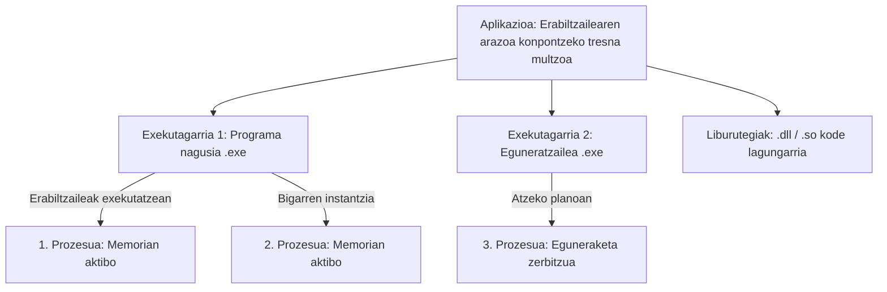
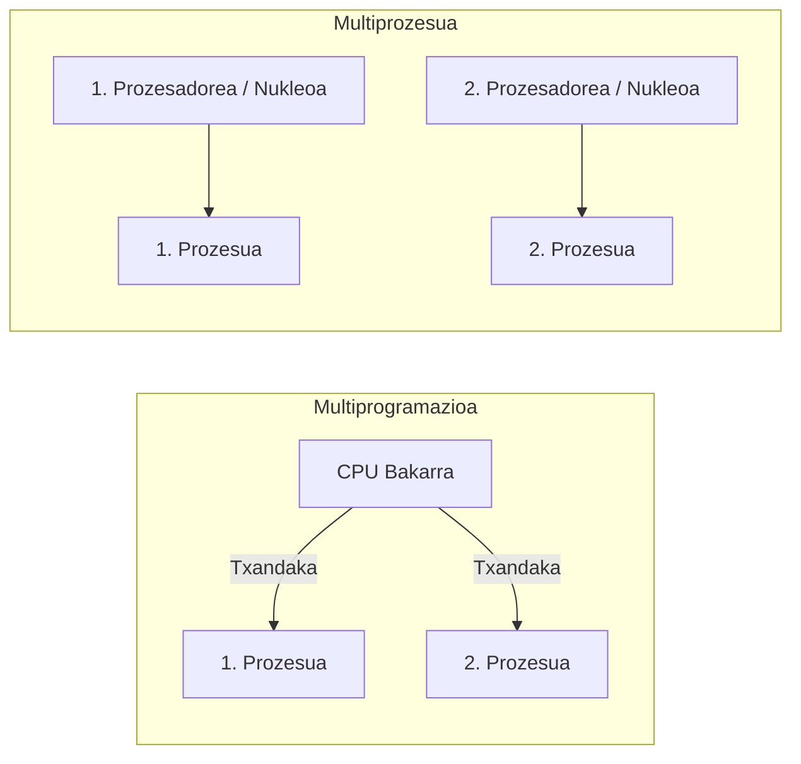
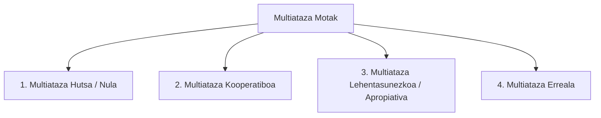
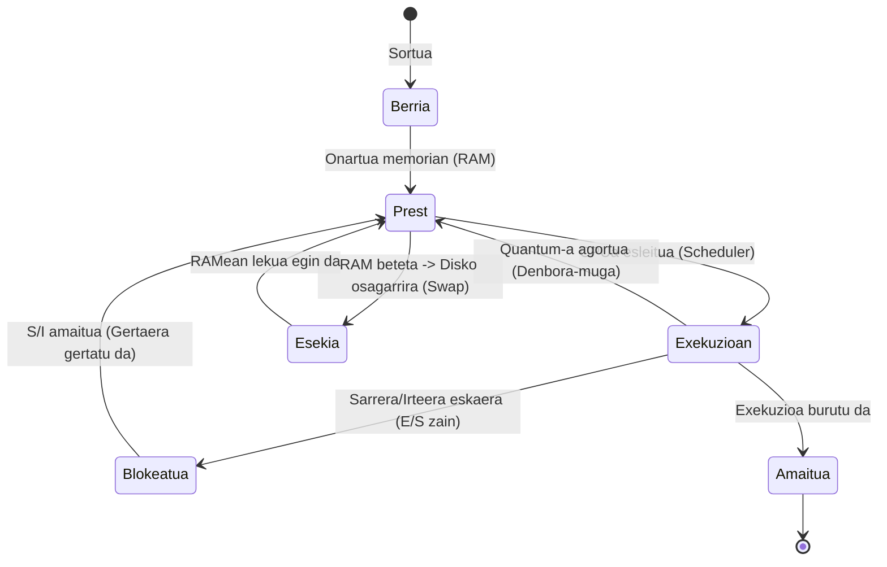
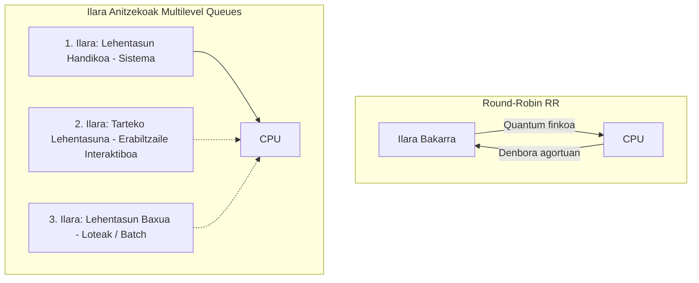
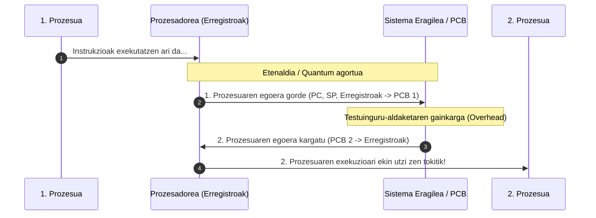

# Tema 1: Prozesu Anitzeko Programazioa (Programación Multiproceso)

Dokumentu honek **«Tema1 - PROGRAMACION MULTIPROCESO.pdf»** ikasgaiaren eduki osoa garatzen du sakonki, sistema eragileen prozesu-kudeaketa, planifikazioa, hardwarearen funtzionamendua eta agindu praktikoak aztertuz.

---

## 1. Sarrera: Aplikazioak, Exekutagarriak eta Prozesuak

Sistema informatiko baten hardwarearen gainean exekutatzen den guztia softwarea da. Hala ere, softwarearen baitan funtsezkoa da kontzeptu hauen arteko aldea ulertzea:

- **Aplikazioa:** Erabiltzailearen arazo zehatz bat modu automatikoan konpontzeko diseinatutako software-multzoa da (adibidez, LibreOffice, GIMP, Google Chrome). Aplikazio bat hainbat exekutagarriz, liburutegiz eta konfigurazio-fitxategiz osatuta egon daiteke. Sistema eragileetatik eta sistemaren mantentze-tresnetatik bereizten dira.
- **Programa:** Ordenagailu batek ataza bat egiteko jarraitu beharreko instrukzio-sekuentzia logikoa da.
- **Exekutagarria (Binarioa):** Konpilazio edo interpretazio bidez lortutako fitxategia da, biltegiratze-unitatean (diskoan) gordetzen dena. Sistema eragileak irakurri eta exekutatzeko moduko kodea dauka. Entitate **pasiboa** da.
- **Prozesua:** **Exekuzioan dagoen programa bat da.** Entitate **aktiboa** da. Sistema Eragileak prozesu bakoitzari lan-unitate oso bat esleitzen dio: RAM memoria-eremu propioa, CPU erregistroen balioak, irekitako fitxategien kontrola eta lehentasunak.

---

## 2. Exekutagarri Motak

Exekutagarri baten barruan dagoen kode-motaren arabera, lau kategoria nagusi bereizten dira:

| Mota | Deskribapena | Plataformaren Menpekotasuna | Adibideak |
| :--- | :--- | :--- | :--- |
| **Bitarrak (Nativoak)** | Prozesadoreak (CPU) zuzenean exekutatzen dituen makina-aginduez osatuta daude. Kode iturria konpilatzaile baten bidez itzultzen da zuzenean. | **Handia:** Konpilatu den arkitektura eta sistema eragilerako soilik balio du (ez da multiplataforma). | C, C++, Go edo Rust bidez sortutako `.exe` (Windows) edo ELF bitarrak (Linux). |
| **Interpretatuak (Bytecode)** | Ez dira zuzenean prozesadorearen makina-aginduak, tarteko kode bat baizik (bytecode). Makina birtual batek edo interprete batek itzultzen ditu exekuzio-unean. | **Baxua (Multiplataforma):** Makina birtuala dagoen edozein sistema eragiletan exekuta daiteke. | Java (`.class` / JVM), C# (.NET CLR). |
| **Script-ak** | Testu-fitxategi lauak dira, aginduak bata bestearen atzetik idatzita dituztenak. Ez dira aldez aurretik konpilatzen; motor edo interprete batek lerroz lerro exekutatzen ditu. | Interpretearen araberakoa. Testu-editore arruntekin ireki eta editatu daitezke. | Python (`.py`), Bash (`.sh`), PowerShell (`.ps1`), JavaScript / Node.js, Batch (`.bat`). |
| **Liburutegiak (Libraries)** | Funtzio eta klase berrerabilgarrien bildumak dira. Ezin dira modu independentean exekutatu; beste programa batzuek deitzen diete beren kodea berrerabiltzeko. | Liburutegi motaren araberakoa (dinamikoa edo estatikoa). | Windows-eko DLL (`.dll`), Linux-eko Shared Objects (`.so`), C-ko liburutegi estandarra, .NET eta Java APIak. |

---

## 3. Multiprogramazioa edo Multiataza

**Multiprogramazioa (edo Multiataza)** teknika bat da, zeinaren bidez bi prozesu edo gehiagok memoria nagusi bera (RAM) partekatzen duten eta CPU berean "aldi berean" exekutatzen diren (**seudo-paralelismoa**).

> [!IMPORTANT]
> Nukleo bakarreko CPU batean une jakin batean **prozesu bakar bat** egon daiteke exekuzioan. Multiatazak CPUaren denbora zati txikitan banatzen du prozesu aktiboen artean, denak batera doazela irudikatuz.

### Multiprogramazioaren Abantailak:
1. **Hainbat prozesu batera exekutatzea ahalbidetzen du.**
2. **Erabiltzaile anitzei zerbitzu interaktiboa modu eraginkorrean ematea.**
3. **Sarrera/Irteera (S/I) itxaronaldiak aprobetxatzea:** Prozesu batek diskoan fitxategi bat idatzi edo erabiltzaileak tekla bat sakatu zain dagoen bitartean (S/I eragiketa motela), CPUak ez du alferrik itxaroten; berehala beste prozesu bati ematen dio txanda. Horrela CPUaren erabilera-ehunekoa (% 100era hurbilduz) maximizatzen da.
4. **Helbide erlatiboak:** Garatzaileak ez du jakin behar bere prozesua RAMeko zein helbide fisikotan kargatuko den; Sistema Eragileak kudeatzen du helbide logikoetatik helbide fisikoetarako itzulpena.

---

## 4. Multiprogramazioa vs. Multiprozesua

Termino hauek ez dira sinonimoak:

- **Multiprogramazioa:** Software mailako kontzeptua da. Sistema batean aldi berean hainbat prozesu aktibo (memorian kargatuta eta txandakatzen) egotea ahalbidetzen du, nahiz eta prozesadore bakarra izan.
- **Multiprozesua:** Hardware mailako kontzeptua da. Sistema berean bi CPU/nukleo fisiko edo gehiago egotea esan nahi du, lanak benetan aldi berean (paraleloan) exekutatzeko gai direnak.
- **Multiprogramazio-maila:** Sistema eragilearen memorian une jakin batean kargatuta eta aktibo dauden prozesu kopuruak definitzen du.

---

## 5. Multiataza Motak

Sistema eragileek historian zehar hainbat modu erabili dituzte prozesuen arteko denbora banatzeko:

1. **Multiataza Hutsa (Monotarea):**
   - Sistema eragileak ez du multiatazarik onartzen. Programa bakar bat exekutatzen da, eta hura amaitu arte ezin da beste ezer egin.
   - *Adibidea:* MS-DOS.
2. **Multiataza Kooperatiboa (Ez-aproposa / Non-preemptive):**
   - Erabiltzailearen prozesuek berek erabakitzen dute noiz uzten dioten CPUa libre sistema eragileari eta gainerako prozesuei.
   - *Arriskua:* Programa batek akats bat badu edo begizta infinitu batean sartzen bada, sistema osoa blokeatzen da ("cuelgue general").
   - *Adibidea:* Windows 3.11, Mac OS zaharra (System 7).
3. **Multiataza Lehentasunezkoa edo Aproposa (Preemptive):**
   - **Sistema Eragilea da agintari bakarra.** SEak denbora-tarte jakin bat (*quantum*) esleitzen dio prozesu bakoitzari. Tartea agortutakoan, SEak prozesuari CPUa kentzen dio eta beste bati ematen dio, lehenengoak nahi izan ala ez.
   - *Abantaila:* Egonkortasun eta segurtasun handia; programa batek huts egiten badu, ez du sistema botatzen.
   - *Adibidea:* UNIX, GNU/Linux, Windows NT / 2000 / XP / 10 / 11.
4. **Multiataza Erreala:**
   - Nukleo edo prozesadore anitz dituzten sistemetan prozesuak une berean eta paraleloan exekutatzen dira. Prozesu kopurua nukleo kopurua baino handiagoa denean, multiataza aproposarekin konbinatzen da.

---

## 6. Prozesuen Kudeaketa Sistema Eragilean

### 6.1. Prozesu Motak
1. **Lote bidezkoak (Batch):** Erabiltzailearen interakziorik behar ez duten atazak. Datuak hasieran sartzen dira, eta sistema atzeko planoan aritzen da lanean amaitu arte (adib. inprimaketa-lanak, birusen eskaneatzea, bideo-errendatzea).
2. **Interaktiboak:** Erabiltzailearekin etengabeko hartu-emanean dauden prozesuak (adib. testu-prozesadoreak, web nabigatzaileak, jokoak). Erantzun-denbora azkarra eskatzen dute.
3. **Denbora errealekoak (Real-Time):** Erantzun-denbora kritikoa den sistemak. Epe zehatz baten barruan erantzun behar dute nahitaez; bestela, akats katastrofikoa gerta daiteke (adib. automobilen ABS/airbag kontrola, hegazkinen nabigazioa, robotika industriala).

### 6.2. Kudeaketarako Tresna Grafikoak
- **Windows:** *Ataza-kudeatzailea (Task Manager)*. Prozesuen PIDa, CPU, RAM, disko eta sare-erabilera erakusten ditu, prozesuak hiltzeko eta lehentasuna aldatzeko aukerarekin.
- **GNU/Linux:** *Sistemaren Monitorea (System Monitor)* edo tresna aurreratuak grafikoan (`gnome-system-monitor`, `ksysguard`).

---

## 7. Prozesu baten Egoerak eta Bizitza-Zikloa

Prozesu batek bere sorreratik amaierara arte hainbat egoera zeharkatzen ditu:

| Egoera | Deskribapena |
| :--- | :--- |
| **Berria (New)** | Prozesua sortu berria da, oraindik ez dago RAM memorian kargatuta. |
| **Prest (Ready)** | Prozesua RAMean dago, behar dituen baliabide guztiak ditu eta CPU txandaren zain dago ilaran. |
| **Exekuzioan (Running)** | Prozesuak CPUaren kontrola dauka une horretan eta bere instrukzioak exekutatzen ari dira. |
| **Blokeatua (Blocked)** | Kanpoko gertaera baten zain dago (adibidez, diskoan datuak irakurtzea edo erabiltzaileak teklatua sakatzea). Ezin du CPUa erabili. |
| **Esekia (Suspended)** | RAM memoria libre uzteko, prozesuaren datuak aldi baterako disko osagarrira (Swap / Memoria Birtuala) eraman dira. |
| **Amaitua (Terminated)** | Prozesuak bere lana amaitu du eta sistema eragileak haren baliabide guztiak askatu ditu. |

---

## 8. Sistema Eragilearen Planifikazioa (Scheduling)

Sistema eragilearen barruan bi osagai nagusik kontrolatzen dute prozesuen fluxua:
1. **Karga-tresna (Loader):** Exekutablearen aginduak eta datuak diskotik RAM memoriara kopiatzen ditu, prozesuaren helbide-eremua prestatzen du eta **PCB** egitura sortzen du.
2. **Planifikatzailea (Scheduler):** Prest dauden prozesuen artean CPUa zeini eta zenbat denboraz eman erabakitzen duen prozesua da.

### 8.1. PCB (Prozesuaren Kontrol Blokea - Process Control Block)
PCB prozesu bakoitzari lotutako datu-egitura bakarra da (prozesuaren "NAN"a):
- **PID (Process Identifier):** Prozesuaren zenbakizko identifikatzaile bakarra.
- **Uneko egoera:** Prest, exekuzioan, blokeatua, etab.
- **Memoria-eremua:** Prozesuaren memoriaren hasiera-helbidea eta tamaina (muga hauek gaindituz gero, salbuespena sortzen da, adib. *Segmentation Fault* Linuxen edo *Pantaila Urdina* Windowsen).
- **Planifikazio-informazioa:** Lehentasuna, quantum balioa, kontsumitutako CPU denbora.
- **Testuinguru-aldaketarako erregistroak:** CPU erregistroen egoera (Program Counter, Stack Pointer, etab.).

### 8.2. Planifikazio-Algoritmo Nagusiak

1. **Round-Robin (Txandakakoa):**
   - Prozesu bakoitzari denbora-tarte finko bat (*quantum*) ematen zaio. Tarte horretan amaitzen ez bada, ilararen bukaerara doa berriro itxarotera. Oso egokia da prozesu interaktiboentzat.
2. **Lehentasunen araberakoa (Priority Scheduling):**
   - Prozesu bakoitzak zenbakizko lehentasun bat du. Lehentasun handieneko prozesuek dute CPUa erabiltzeko lehentasuna (adib. sistema eragilearen atazak erabiltzailearen aplikazioen aurretik).
3. **Ilara Anitzekoak (Multilevel Feedback Queues):**
   - Egungo sistema eragile modernoek erabiltzen dutena. Hainbat ilara daude, bakoitza lehentasun maila eta politika ezberdinekin. Prozesu bat ilara batetik bestera mugi daiteke bere portaeraren arabera.

### 8.3. Planifikazioaren Helburuak
- **Ekitatea (Fairness):** Prozesu guztiek izan behar dute CPUa erabiltzeko aukera (inortxo ere ez baztertu).
- **Eraginkortasuna:** CPUa ahalik eta denbora gehien (% 100) lanean mantentzea.
- **Erantzun-denbora (Response Time):** Erabiltzailearen eskaerei ahalik eta azkarren erantzutea.
- **Itzulera-denbora (Turnaround Time):** Lote-prozesuek emaitzak emateko behar duten denbora minimizatzea.
- **Errendimendua (Throughput):** Orduko edo segundoko ahalik eta ataza kopuru handiena amaitzea.

---

## 9. Testuinguru-Aldaketa CPUan (Context Switch)

CPU batek une batean prozesu baten aginduak eta hurrengo unean beste batenak nola exekutatzen ditu datuak nahastu gabe? **Testuinguru-aldaketari** esker.

### CPUren Egoera eta Erregistro Gakoak:
- **Erregistroak:** CPUaren barruan dauden memoria ultra-azkarreko gelaxkak dira. Uneko instrukzioaren datuak gordetzen dituzte.
- **Program Counter (PC - Programa Kontagailua):** Exekutatu behar den hurrengo instrukzioaren memoria-helbidea adierazten du.
- **Stack Pointer (SP - Pila Erakuslea):** Prozesuaren dei-pilaren (*stack*) goiko aldea seinalatzen du (funtzio-deiak, aldagai lokalak).

> [!WARNING]
> **Gainkarga (Overhead):** Testuinguru-aldaketan zehar CPUak ez du erabiltzailearen lan baliagarririk egiten; sistema eragilearen administrazio-lana da soilik. Testuinguru-aldaketak maizegi eginez gero, sistemaren errendimendu orokorra asko jaisten da.

---

## 10. Zerbitzuak eta Hariak (Threads)

### 10.1. Zerbitzuak (Services / Daemons)
- Sistema eragilea abiaraztean automatikoki kargatzen diren prozesuak dira.
- Atzeko planoan geratzen dira, bezero batek edo beste prozesu batek zerbait eskatzen dien arte zain.
- *Adibidea:* **Inprimaketa-zerbitzua (Print Spooler).** Inprimagailua gailu motela denez eta memoria mugatua duenez, inprimaketa-zerbitzuak lanak ilara batean jasotzen ditu, ordenatzen ditu eta banan-banan bidaltzen dizkio inprimagailuari, orriak eta lanak elkarrekin nahas ez daitezen.

### 10.2. Hariak (Threads - Prozesu Arinak)
- **Prozesua:** Exekuzio-unitate **astuna** da (bere memoria-eremu propioa eta isolatua du).
- **Haria:** Exekuzio-unitate **arina** da. Prozesu baten barruan bizi da eta prozesuaren memoria, aldagai globalak eta baliabideak partekatzen ditu gainerako hariekin.
- **Harien arteko testuinguru-aldaketa** askoz merkeagoa eta azkarragoa da prozesuen artekoa baino, soilik Programa Kontagailua (PC) eta erregistro gutxi batzuk aldatu behar direlako.
- **Hyper-Threading (HT):** Intel-ek garatutako teknologia; nukleo fisiko bakoitzak 2 nukleo logiko simulatzen ditu hardware bidez, hari anitzeko aplikazioetan etekina handitzeko.

---

## 11. Prozesuak Kudeatzeko Aginduak (Windows eta Linux)

Sistema-administratzaileek eta garatzaileek komando-lerroa erabiltzen dute prozesuak kontrolatzeko.

### 11.1. Windows Aginduak

| Agindua | Deskribapena eta Adibidea |
| :--- | :--- |
| `tasklist` | Martxan dauden prozesu guztiak zerrendatzen ditu (Irudiaren izena, PID, saio-zenbakia, memoria-erabilera). |
| `tasklist /FI "IMAGENAME eq chrome.exe"` | Iragazki bidez Chrome-ren prozesuak soilik bilatzen ditu. |
| `taskkill /PID <zenbakia>` | Zehaztutako PIDdun prozesua amaitzen du. |
| `taskkill /F /IM notepad.exe` | Notepad-eko instantzia guztiak bortxaz (`/F`) hiltzen ditu. |
| `Get-Process` *(PowerShell)* | Prozesuen zerrenda zehatza objektu moduan eskuratzen du. |
| `Stop-Process -Id <PID>` *(PowerShell)* | Prozesua gelditzen du PIDaren arabera. |

### 11.2. GNU/Linux Aginduak

| Agindua | Deskribapena eta Adibidea |
| :--- | :--- |
| `ps aux` | Sistemako prozesu guztiak xehetasun osoz zerrendatzen ditu (Erabiltzailea, PID, %CPU, %MEM, egoera, komandoa). |
| `pstree -AGu` | Prozesuak **zuhaitz-hierarkian** erakusten ditu, zein prozesuk zein sortu duen argi ikusiz. |
| `kill -9 <PID>` | Prozesuari `SIGKILL` (9) seinalea bidaltzen dio; berehala eta baldintzarik gabe suntsitzen du prozesua. |
| `killall <izena>` | Izen hori duten prozesu guztiak hiltzen ditu (adib. `killall firefox`). |
| `nice -n 5 <komandoa>` | Komando bat lehentasun zehatz batekin abiarazten du (-20 lehentasun handiena, +19 txikiena; lehenetsia 0 da). |
| `renice +10 -p <PID>` | Dagoeneko martxan dagoen prozesu baten lehentasuna aldatzen du. |
| `top` / `htop` | Sistemako prozesuak denbora errealean kontrolatzeko eta kudeatzeko kontsola-interfaze interaktiboa. |

---

## 12. Laburpen-Taula Orokorra

| Kontzeptua | Funtsezko Ideia |
| :--- | :--- |
| **Programa vs. Prozesua** | Programa kode pasiboa da diskoan; Prozesua memorian kargatutako programa aktiboa da. |
| **Multiataza Aproposa** | Sistema Eragileak prozesuei CPUa kentzen die denbora amaitzean (egonkortasun osoa). |
| **PCB** | Prozesuaren NAN egitura (PID, egoera, memoria-mugak, erregistroak). |
| **Testuinguru-aldaketa** | CPUak prozesu baten erregistroak gorde eta bestearenak kargatzea; gainkarga dakar. |
| **Prozesua vs. Haria** | Prozesuak memoria isolatua du (astuna); Hariek memoria partekatzen dute (arina). |
