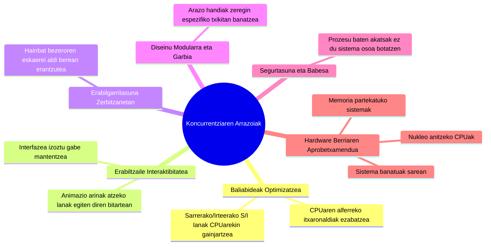
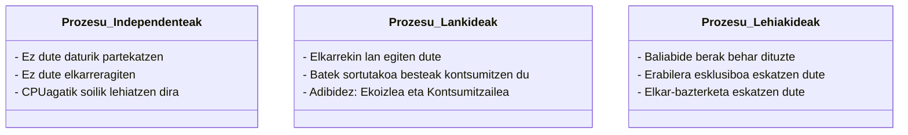
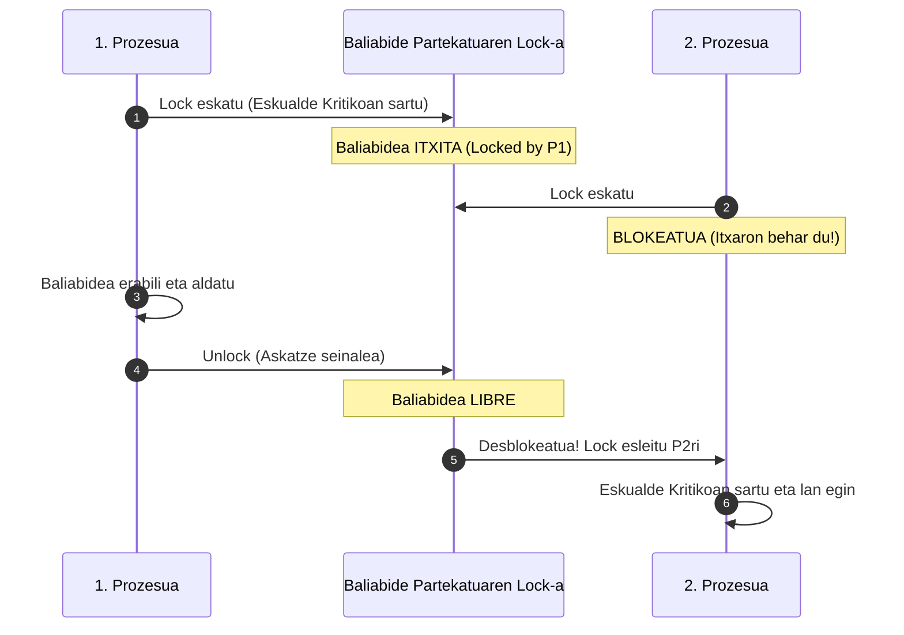
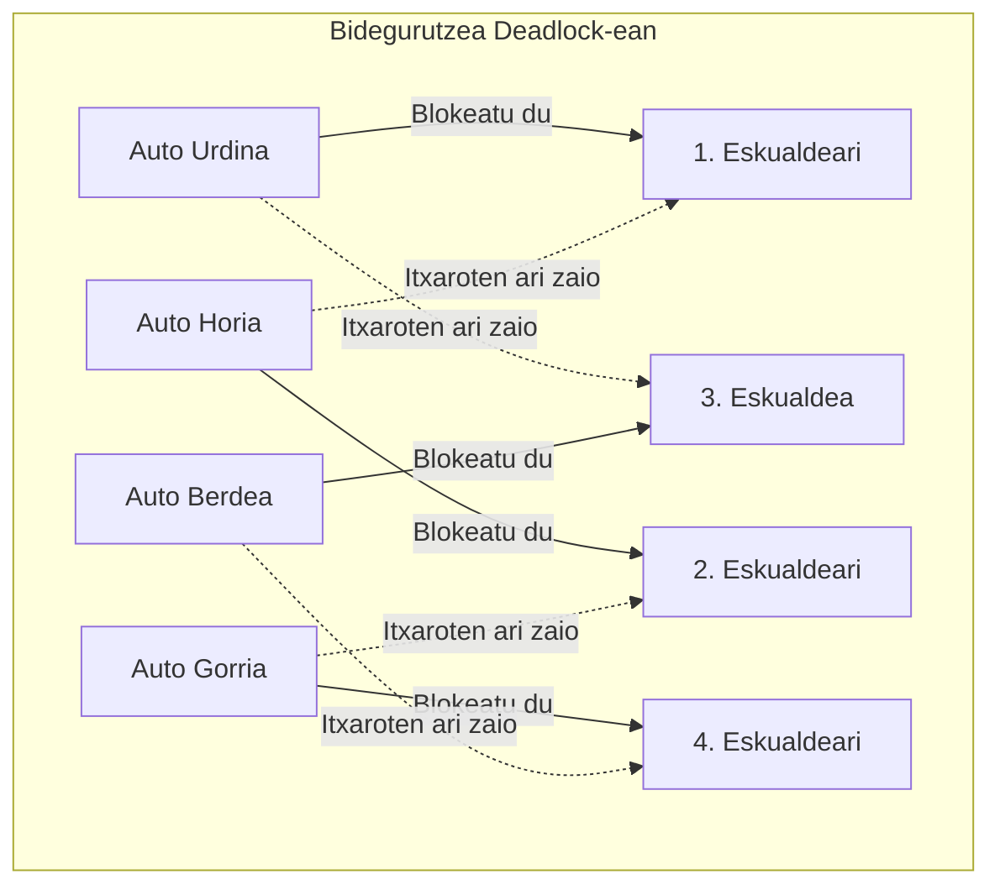
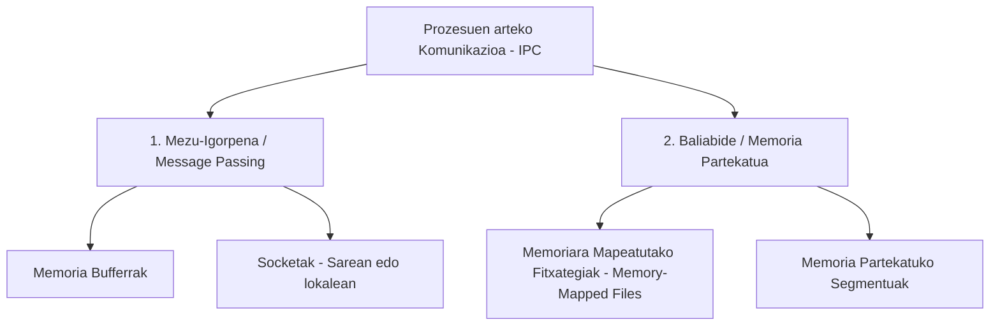
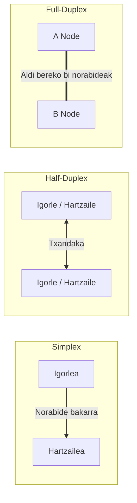
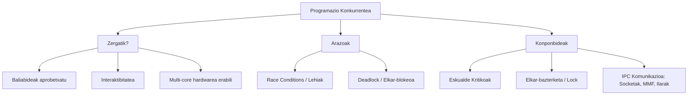

# Tema 2: Programazio Konkurrentea (Programación Concurrente)

Dokumentu honek **«Tema2 - PROGRAMACION CONCURRENTE.pdf»** ikasgaiaren eduki teoriko eta arkitektural guztiak jorratzen ditu sakonki, koncurrentziaren oinarriak, lehia-arazoak, baliabide kritikoen kudeaketa eta prozesuen arteko komunikazio-mekanismoak (IPC) azalduz.

---

## 1. Sarrera: Zer da Programazio Konkurrentea?

Tradizionalki garatzaileek aplikazio sekuentzialak (agindu bat bestearen atzetik) edo gertaeretara bideratutakoak programatu ohi dituzte. Paradigma horietan, programa isolatuta exekutatzen dela suposatzen da. Sistema eragile moderno batean, ordea, ehunka prozesu aritzen dira lanean aldi berean, eta askotan baliabide berak (fitxategiak, hardware-gailuak, memoria) erabili edo elkarrekin komunikatu behar dute.

### 1.1. Koncurrentziaren Definizio Formala

Hiztegian, *koncurrentzia* hainbat gertaera aldi berean gertatzeari deritzo. Informatika teorikoan, ordea, definizio zehatzagoa dugu:

> [!NOTE]
> **Definizio Teknikoa:** Bi prozesu ($P_1$ eta $P_2$) **konkurrenteak** dira baldin eta $P_1$-en lehenengo instrukzioa $P_2$-ren lehenengo instrukzioaren ondoren eta azken instrukzioaren aurretik exekutatzen bada (eta alderantziz). Hau da, haien exekuzio-denborak denboran gainjartzen dira.

$$\text{Hasiera}(P_2) < \text{Hasiera}(P_1) < \text{Amaiera}(P_2) \quad \text{edo} \quad \text{Hasiera}(P_1) < \text{Hasiera}(P_2) < \text{Amaiera}(P_1)$$

Hau lasterketa batekin konpara daiteke: korrikalari guztiak batera ateratzen dira pista berera, helburu beraren bila lehiatuz. Sistema informatiko batean, **Multiprozesua = Koncurrentzia** da.

```mermaid
gantt
    title Prozesu Sekuentzialak vs Konkurrenteak
    dateFormat  X
    axisFormat %s

    section Sekuentziala
    1. Prozesua           :a1, 0, 5
    2. Prozesua           :after a1, 5

    section Konkurrentea (CPU bakarra / Txandaka)
    1. Prozesua (Zatia 1) :c1, 0, 2
    2. Prozesua (Zatia 1) :c2, 2, 4
    1. Prozesua (Zatia 2) :c3, 4, 6
    2. Prozesua (Zatia 2) :c4, 6, 8

    section Paraleloa (Multicore)
    1. Prozesua (1. Nukleoa) :p1, 0, 5
    2. Prozesua (2. Nukleoa) :p2, 0, 5
```

### 1.2. Testuinguru Historikoa
- **Teorialari Handiak:** Edsger Dijkstra (1968), Per Brinch Hansen (1973) eta Tony Hoare (1974) izan ziren programazio konkurrentearen oinarri matematiko eta kontzeptualak ezarri zituztenak (semaforoak, monitoreak, CSP). Lan horiek finkatu zituzten 70eko eta 80ko hamarkadetako sistema eragile modernoen zutabeak.
- **MS-DOS vs. UNIX:**
  - **MS-DOS:** Erabiltzaile eta ataza bakarrekoa (monousuario, monotarea) zen 1995ean Windows 95 agertu arte. Programatzaileek hardware-etenaldiak atzemanez simulatu behar zuten atazen txandakatzea. Gainera, ez zegoen memoria-babesik (prozesu batek beste baten memoria uki zezakeen).
  - **UNIX:** 1969an jaio zenetik eramangarria, ataza anitzekoa (multitask), erabiltzaile anitzekoa (multiuser) eta sarera bideratua izan zen, memoria-isolamendu sendoarekin (GNU/Linux-en arbasoa).

---

## 2. Zergatik Garatu Egitura Konkurrenteak?

Aplikazio bat sekuentzialki eta isolatuta exekutatzea da, berez, aplikazio horrentzat efizienteena (ez du CPUa inorekin partekatu beharrik). Zergatik behartzen dugu, orduan, koncurrentzia?

1. **Baliabideen erabilera optimizatzea:** S/I eragiketak (diskoa, sare-txartela) CPUaren erloju-zikloak baino milaka aldiz motelagoak dira. Prozesu batek datuen zain dagoen bitartean CPUa beste bati emanez, CPUa ez da alferrik egoten.
2. **Interaktibitatea ematea:** Aplikazio batek fitxategi handi bat gordetzen duen bitartean botoiak eta leihoak blokeatuta geratuko balira, erabiltzailearen esperientzia negargarria litzateke. Koncurrentziak interfazea bizirik mantentzen du.
3. **Erabilgarritasuna (Availability):** Web zerbitzari batek bezero baten eskaera bukatu arte itxaron beharko balu hurrengoari erantzuteko, zerbitzaria berehala kolapsatuko litzateke.
4. **Mantengarritasuna eta modularitatea:** Algoritmo erraldoi eta nahasi baten ordez, ataza bakoitzarentzat prozesu edo hari espezifiko bat sortzen da.
5. **Babesa:** Prozesu bakoitzak bere memoria-eremua duenez, batek huts egiten badu, SEak hura hil dezake gainerako sistemak normaltasunez lanean jarrai dezan.

---

## 3. Lehia-Baldintzak eta Prozesuen arteko Elkarreragina

Sistema batean batera dauden prozesuek hiru elkarreragin mota izan ditzakete:

### 3.1. Prozesu Lankideak (Cooperatives): Ekoizle-Kontsumitzaile Eredua
Prozesu batek informazioa sortzen du (**Ekoizlea / Productor**), eta beste batek informazio hori jasotzen eta prozesatzen du (**Biltzailea edo Kontsumitzailea / Recolector - Consumidor**).
- Kontsumitzailea blokeatuta geratuko da ezer kontsumitzeko ez dagoen bitartean.
- Ekoizleak ezin du bufferra infinituki bete; muga bat badago, bera ere blokeatu egin beharko da bufferra betetzean.

---

### 3.2. Prozesu Lehiakideak, Eskualde Kritikoak eta Lock-a

Bi prozesuk baliabide bera (adib. banku-kontu baten saldoa, fitxategi bat edo inprimagailu bat) aldi berean eta kontrolik gabe aldatzen dutenean, datuen usteltzea edo emaitza okerrak gertatzen dira (**Lehia-baldintza / Race Condition**).

> [!IMPORTANT]
> **Eskualde Kritikoa (Critical Section / Región Crítica):** Baliabide partekatu batera sartzen diren programaren instrukzio multzoa da. Instrukzio hauek **modu zatiezinean (atomikoan)** eta **elkar-bazterketan (Mutual Exclusion - Mutex)** exekutatu behar dira nahitaez: prozesu bat eskualde kritikoan dagoen bitartean, beste inor ezin da bertan sartu.

---

## 4. Elkar-Blokeoa edo Interblokeoa (Deadlock)

**Deadlock** edo **elkar-blokeoa** gertatzen da bi prozesu edo gehiago elkarren zain geratzen direnean, bakoitzak besteak behar duen baliabide bat blokeatuta duelarik. Emaitza: prozesuetako batek ere ezin du aurrera egin, eta sistema geldituta edo "izoztuta" geratzen da.

### 4.1. Bidegurutzeko Adibide Klasikoa (Lau Autoak)

Imajina ezazu bi erreiko bidegurutze estu bat, non 4 autok aldi berean biratu edo gurutzatu nahi duten:
- **Auto Urdinak** 1 eta 3 eskualdeak behar ditu.
- **Auto Horiak** 2 eta 1 eskualdeak behar ditu.
- **Auto Gorriak** 4 eta 2 eskualdeak behar ditu.
- **Auto Berdeak** 3 eta 4 eskualdeak behar ditu.

Bakoitzak bere lehen zatia hartu badu eta inork ez badu atzera egiten edo etsitzen, **ziklo zirkular bat** sortzen da: denak geratzen dira betiko blokeatuta.

---

## 5. Prozesuen arteko Komunikazio Mekanismoak (IPC)

Sistema eragileak prozesuen helbide-eremuak zorrotz isolatzen ditu segurtasunagatik (aplikazio batek beste baten memoria zuzenean aldatzea hondamendia litzateke). Horregatik, prozesuek komunikatu behar dutenean, sistema eragilearen **IPC (Inter-Process Communication)** mekanismoak erabili behar dituzte.

### 5.1. Oinarrizko Hiru Interakzio Motak
1. **Sinkronizazioa:** Prozesu batek beste baten exekuzio-puntua ezagutu edo hari itxaron behar dio une jakin batean.
2. **Elkar-bazterketa (Mutual Exclusion):** Prozesu bat baliabide partekatu bat erabiltzen ari den bitartean, beste inor ez sartzea bermatzea.
3. **Baldintzapeko Sinkronizazioa (Conditional Synchronization):** Baliabidera sarbidea soilik hura egoera jakin batean dagoenean baimentzea (adib. bufferrak elementu libreekin egon behar du).

### 5.2. Bi Komunikazio Eredu Nagusiak

1. **Mezu-Igorpena (Message Passing):**
   - Oinarrizko eragiketak: `send(mezua)` eta `receive(mezua)`.
   - **Bufferrak:** Makina berean memoria nagusian kokatutako bideak.
   - **Socketak:** Makina berean zein sare bidez konektatutako prozesuen arteko kanal estandarra (IP helbidea + ataka). Sockets bidezko komunikazioa da gaur egun zabalduena.
2. **Baliabide eta Memoria Partekatua (Shared Memory):**
   - Oinarrizko eragiketak: `read()` eta `write()`.
   - **Memoriara Mapeatutako Fitxategiak (Memory-Mapped Files - MMF):** Diskoan dagoen fitxategi fisiko bat memoria nagusira mapeatzen da. Sistema eragileak RAMeko eremu hori tarteko buffer gisa erabiltzen du, hainbat prozesuk fitxategi berean oso abiadura handian irakurri eta idatzi ahal izateko.
3. **Irakurketa eta Idazketa Blokeatzaileak (Blocking I/O):**
   - Datuak jasotzeko zain dagoen prozesua blokeatu egiten da datuak eskuragarri egon arte.
   - Idazten ari den prozesua blokeatu egiten da hartzailearen bufferra beteta badago.

---

## 6. Komunikazio Motak eta Sailkapena

Komunikazio-prozesu orotan funtsezko lau elementu daude: **Mezua** (edukia), **Igorlea** (iturburua), **Hartzailea** (helmuga) eta **Kanala** (bidea).

Hona hemen komunikazio-kanalen sailkapen osoa:

### 6.1. Norabidearen eta Gaitasunaren Arabera

| Mota | Funtzionamendua | Deskribapena eta Adibidea |
| :--- | :--- | :--- |
| **Sinplex (Simplex)** | $A \longrightarrow B$ | Informazioa **norabide bakarrean** soilik joan daiteke. Igorleak soilik igortzen du; hartzaileak soilik entzuten du.  *Adibidea:* Telebista-emankizuna, zinema-aretoa, sentsore baten datu-igorpena. |
| **Semiduplex (Half-Duplex)** | $A \longleftrightarrow B$ (Txandaka) | Informazioa bi norabideetan ibil daiteke, baina **ez aldi berean**. Aldizkako txandak behar dira.  *Adibidea:* Walkie-talkieak (*"cambio y corto"*), HTTP/1.1 oinarrizko eskaera-erantzun zikloa. |
| **Duplex / Full-Duplex** | $A \rightleftarrows B$ (Aldi berean) | Bi norabideetan **aldi berean** bidal eta jaso daitezke mezuak etenik gabe.  *Adibidea:* Telefono-deiak, TCP Socket konexioak, WebSockets. |

---

### 6.2. Sinkroniaren Arabera

| Mota | Mekanismoa | Ezaugarriak |
| :--- | :--- | :--- |
| **Sinkronoa (Rendezvous / Topaketa)** | Igorlea blokeatu egiten da | Igorleak mezua bidali eta **geldirik itxaroten du** hartzaileak mezua jaso duela baieztatu arte. Bi prozesuak denboran sinkronizatzen dira une horretan. |
| **Asinkronoa** | Igorleak lanean jarraitzen du | Igorleak mezua postontzi edo ilara batean (*message queue / mailbox*) uzten du eta **berehala jarraitzen du** bere lanarekin, blokeatu gabe. Hartzaileak komeni zaionean irakurriko du. |
| **Urruneko Deia (RPC - Remote Procedure Call)** | Esekidura + Kode Komuna | Bezeroa eseki egiten da zerbitzariari eskatu ostean; zerbitzariak erantzuna prestatzen du eta biak kode zati baten arabera koordinatzen dira. |

---

### 6.3. Solaskideen Simetriaren Arabera

- **Simetrikoa:** Solaskide guztiek gaitasun berdina dute: denek bidal ditzakete eta jaso ditzakete mezuak (Peer-to-Peer / P2P ereduak).
- **Asimetrikoa:** Prozesu bakar batek hartzen du igorle-papera (adib. maisua edo zerbitzaria), eta gainerako prozesuek entzule edo bezero papera soilik betetzen dute (Master-Worker eredua).

---

## 7. Laburpen-Eskema

