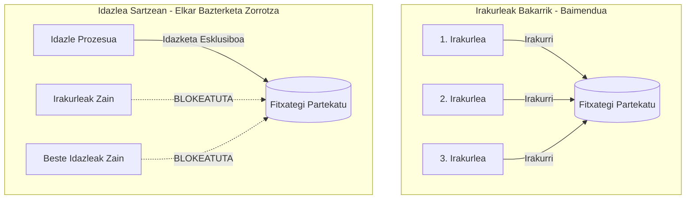
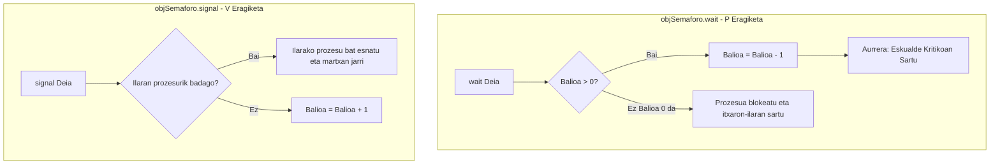
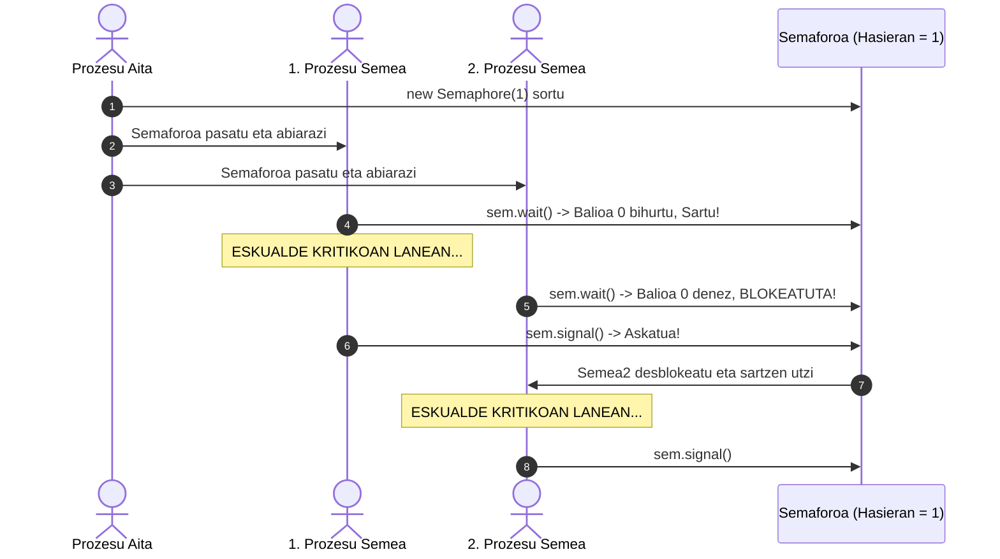
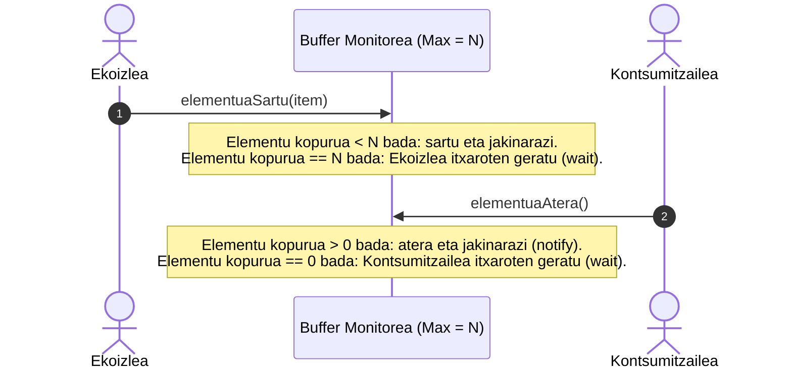
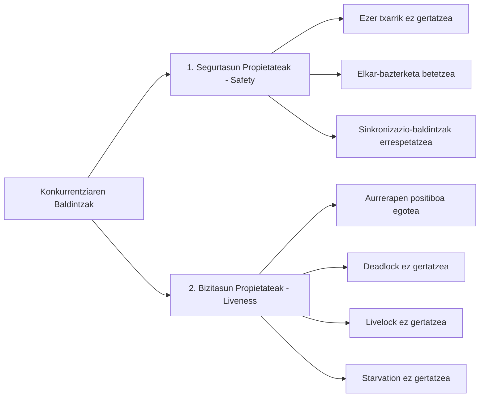

# Tema 3: Sinkronizazioa (Sincronización entre Procesos)

Dokumentu honek **«Tema3 - SINCRONIZACION.pdf»** ikasgaiaren eduki teoriko, mekanismo eta printzipio guztiak sakonki garatzen ditu, prozesu eta harien arteko sinkronizazio-arazoak konpontzeko funtsezko tresnak aztertuz.

---

## 1. Prozesuen arteko Sinkronizazioaren Beharra

Prozesu edo hari anitzek memoria, fitxategi edo hardware-baliabide bera partekatzen dutenean, nahitaezkoa da haien arteko **sinkronizazio-mekanismoak** ezartzea. Sinkronizaziorik gabe, datuen eguneratzeak modu kaotikoan gertatzen dira, emaitza okerrak eta inkonsistenteak sortuz.

Goi-mailako programazio-lengoaietan (hala nola Javan), sistema eragilearen oinarrizko sinkronizazio-mekanismoak klase, objektu eta metodo bidez biltzen (kapsulatzen) dira, garatzaileei erabilera erraztuz.

### 1.1. Irakurle-Idazle Arazo Klasikoa (Readers-Writers Problem)

Fitxategi edo datu-base batera hainbat prozesuk sartu nahi dutenean sortzen den egoera tipikoa da:



- **Irakurketa soila:** Hainbat prozesu irakurle aldi berean sar daitezke fitxategira, datuak aldatzen ez dituztenez ez baitago gatazkarik.
- **Idazketa:** Prozesu batek idatzi nahi duenean, **sarbide esklusiboa** behar du. Gainerako irakurle guztiek eta beste idazleek itxaron egin behar dute idazlea amaitu arte; bestela, datu erdi-aldatuak edo inkonsistenteak irakurriko lirateke.

---

## 2. Eskualde Kritikoak (Critical Sections)

> [!IMPORTANT]
> **Eskualde Kritikoaren Kontzeptua:** Baliabide partekatu batera sartzen diren programaren instrukzio multzoa da. Definizio zuzena izateko, instrukzio horiek **modu atomikoan (zatiezinean)** eta **elkar-bazterketan (modu esklusiboan)** exekutatu behar dira.

### Eskualde Kritikoak Diseinatzeko Urrezko Arauak:
1. **Gutxieneko kodea babestu:** Soilik baliabide partekatua erabiltzen duten aginduak sartu behar dira eskualde kritikoan; inoiz ez beharrezkoak ez diren eragiketa luzeak.
2. **Nahi adina eskualde kritiko:** Programa batek baliabide ezberdinetarako hainbat eskualde kritiko izan ditzake.
3. **Sarbide bakarra:** Une jakin batean prozesu bakar bat egon daiteke eskualde kritikoan. Gainerakoak kanpoan geratuko dira blokeatuta.
4. **Baliabidea askatzea:** Eskualde kritikoko lana amaitutakoan, baliabidea berehala askatu behar da, itxaroten dauden beste prozesuek sartzeko aukera izan dezaten.

---

## 3. Bezero-Hornitzaile Eredua eta Itxaronaldi Aktiboa

**Hornitzaileak (Productor / Suministrador)** informazioa ekoizten du, eta **Bezeroak (Consumidor / Cliente)** kontsumitu egiten du. Informazio hori galkorra izan ohi da: bezeroak irakurri bezain laster desagertzen da bufferretik.

### Itxaronaldi Aktiboaren Arriskua (Busy Waiting / Polling)
Programazio sekuentzial arruntean, bezeroak begizta batean etengabeko galdeketa egin lezake datua prest dagoen jakiteko:

```java
// KODE EZ-EFIZIENTEA: ITXARONALDI AKTIBOA (BUSY WAITING)
while (!datuaPrestatua) {
    // Ezer ez egin, CPUa %100ean erretzen alferrik!
}
kontsumituDatua();
```

> [!CAUTION]
> **Zergatik saihestu itxaronaldi aktiboa?**
> Bezeroak CPU denbora baliotsua xahutzen du ezertarako balio ez duen begizta batean. Gainera, Hornitzaileak berak CPUa behar badu datua sortzeko, bezeroaren begiztak hornitzaileari baliabideak kentzen dizkio, sistema osoa moteltzen edo blokeatzen delarik.

**Soluzio zuzena:** Sistema eragilearen blokeo-primitibak erabiltzea: bezeroa **lo/blokeatuta** geratzen da datua egon arte, CPUa %0an kontsumituz, eta Hornitzaileak berak esnatuko du seinale baten bidez.

---

## 4. Semaforoak (Semaphores)

Edsger Dijkstrak proposatutako behe-mailako sinkronizazio-mekanismo sendo eta eraginkorra da.

### 4.1. Zer da Semaforo bat?
Semaforoa datu-mota berezi bat da, balio oso bat (zenbaki naturala) eta itxaroten dauden prozesuen ilara bat dituena. Bi mota nagusi daude:
1. **Semaforo Bitarrak (Mutex):** 0 edo 1 balioak soilik har ditzakete.
2. **Semaforo Orokorrak (Zenbatzeko semaforoak / Counting Semaphores):** Edozein zenbaki natural har dezakete ($0, 1, 2, \dots, N$). Baliabide berdin anitzen kopurua kontrolatzeko erabiltzen dira.

- **Balioa = 0:** Semaforoa **itxita** dago. Sartu nahi duen prozesua blokeatuta geratzen da ilaran.
- **Balioa > 0:** Semaforoa **irekita** dago. Sartu nahi den prozesuak aurrera egin dezake.



### 4.2. Semaforoen Erabilera-Eskema Tipikoa



### 4.3. Semaforoen Abantailak eta Desabantailak

| Abantailak | Desabantailak |
| :--- | :--- |
| Ulertzeko sinpleak eta oso malguak dira. | Behe-mailakoak dira; programatzailearen ardura osoa da `wait()` eta `signal()` ondo kokatzea. |
| Edozein konkurrentzia-arazo ebazteko gaitasuna dute. | `wait()` bat ahaztuz gero, elkar-bazterketa hausten da; `signal()` ahaztuz gero, betiko **Deadlock** gertatzen da. |
| Ez dute itxaronaldi aktiborik erabiltzen (CPUa aurrezten dute). | Kodean zehar barreiatuta geratzen dira, eta arazketa (*debugging*) oso zaila da. |

---

## 5. Monitoreak (Monitors)

Semaforoen arriskuak eta konplexutasuna gainditzeko, Hoare-k eta Brinch Hansen-ek **Monitoreak** sortu zituzten: goi-mailako abstrakzio-tresna bat, baliabide partekatuen inguruan "bizkartzain" (*guardaespaldas*) gisa jarduten duena.


### 5.1. Monitore baten Egitura
1. **Datu pribatuak:** Aldagaiak eta datu-egiturak monitorearen barruan ezkutatuta daude (kapsulatuta). Kanpoko prozesuek ezin dituzte zuzenean atzitu.
2. **Metodo publikoak:** Kanpoko prozesuentzako interfazea dira. Monitoreak bermatzen du **metodo horiek elkar-bazterketa zorrotzean exekutatzen direla** automatikoki.
3. **Hasieratze-kodea:** Monitorea sortzean datuak prestatzen ditu.

### 5.2. Buffer Mugatuko Irakurketa eta Idazketa Blokeatzaileak

Monitore baten bidez N tamainako buffer bat nola kudeatzen den erakusten du:



### 5.3. Semaforoak vs. Monitoreak Konparaketa

| Ezaugarria | Semaforoa | Monitorea |
| :--- | :--- | :--- |
| **Abstrakzio-maila** | Behe-mailakoa | Goi-mailakoa |
| **Kapsulazioa** | Ez (kodean barreiatuta) | Bai (klase/objektu bakarrean bilduta) |
| **Elkar-bazterketa** | Programatzaileak eskuz kudeatua | Monitoreak automatikoki bermatua |
| **Errore-arriskua** | Oso handia (deskuido batek sistema blokeatzen du) | Txikia (egitura modularra eta segurua) |
| **Javan nola aplikatzen da?** | `java.util.concurrent.Semaphore` klasea | `synchronized` hitz-gakoa, `wait()`, `notify()` |

---

## 6. Memoria Partekatua eta Mezu-Ilarak

### 6.1. Memoria Partekatua (Shared Memory)
- Makina bereko prozesuek RAMeko segmentu bera zuzenean irakurri eta idazteko aukera dute.
- **Adibide praktikoa:** Matrize erraldoi bat ordenatzea. Matrizea zatitan banatu, eta zati bakoitza prozesadore/hari bati esleitzen zaio. Guztiek memoria bera atzitzen dute, lana azkarrago amaituz eta amaieran zatiak bateratuz.

### 6.2. Mezu-Ilarak (Message Queues)
- **Ez du memoria partekaturik behar.** Horregatik, aproposa da bai makina bakar baterako bai sare bidez konektatutako sistema banatuetarako.
- **Asinkronoa:** Igorleak mezua postontzian utzi eta jarraitu egiten du (soilik postontzia beteta badago blokeatzen da).
- **Sinkronoa (Rendezvous / RPC):** Igorleak eta hartzaileak elkarrekin bat egin behar dute une berean; igorlea geldirik egongo da hartzaileak mezua hartu arte.

---

## 7. Kalitate-Baldintzak: Segurtasuna, Bizitasuna eta Efizientzia

Programa konkurrente batek zuzen funtziona dezan, bi propietate teoriko nagusi bete behar ditu:



### 7.1. Segurtasun Propietateak ("Safety" - Ezer txarrik ez gertatzea)
- Bi prozesu ezin dira inoiz aldi berean eskualde kritiko berean sartu.
- Kontsumitzaileak ezin du produkturik kontsumitu ekoizleak sortu aurretik.
- Ekoizleak ezin du produkturik sartu bufferra beteta badago.

### 7.2. Bizitasun Propietateak ("Liveness" - Aurrerapen erreal bat gertatzea)
1. **Deadlock (Interblokeoa):** Prozesuak betiko blokeatuta geratzen dira, batak besteari baliabideak askatu zain.
2. **Livelock (Blokeo aktiboa):** Prozesuak etengabe instrukzioak exekutatzen ari dira (CPUa kontsumituz), baina egoera aldatzen ez denez ez dute inolako aurrerapen erabilgarririk lortzen (adib. korridore estu batean elkarri pasatzen uzteko aldi berean alde berera mugitzen diren bi pertsona).
3. **Starvation (Gosea edo Atzerapen Mugagabea):** Prozesu batek ezin du inoiz aurrera egin, planifikazio-politikak edo lehentasunek beti beste prozesu batzuei ematen dietelako txanda haren aurretik.

---

## 8. Arazketaren (Debugging) Zailtasunak

Programa konkurrenteak araztea programazio sekuentziala araztea baino askoz zailagoa da, arrazoi hauengatik:
1. **Aldi-menpekotasunak (Timing / Non-determinismoa):** Emaitza ez da soilik idatzitako kodearen araberakoa; prozesuak zein ordenatan eta zein milisegundotan txandakatzen diren araberakoa da.
2. **Heisenbug efektua:** Garatzaileak arazoa non dagoen ikusteko `print` edo erregistro-mezuak jartzen dituenean kodean, exekuzio-denborak aldatu egiten dira eta **arazoa magia balitz bezala desagertu egiten da**.
3. **Soluzioa:** Asmakizun berriak inprobisatu beharrean, frogatutako **diseinu-patroiak** (*Design Patterns*) eta lengoaiaren goi-mailako egiturak erabiltzea.

---

## 9. Konputazio Paraleloa eta Banatua

| Ezaugarria | Programazio Paraleloa | Programazio Banatua |
| :--- | :--- | :--- |
| **Hardwarea** | Nukleo anitzeko CPUak edo superordenagailu dedikatuak (arkitektura bera). | Sare bidez konektatutako ekipo heterogeneoak (PCak, zerbitzariak, hodeia). |
| **Datu-trukea** | Memoria partekatua edo bus ultra-azkar dedikatuak. | Sare-mezuak (TCP/IP, HTTP, protokolo estandarrak). |
| **Sistema** | Sistema eragile baten kontrolpean. | Sareko Sistema Eragileak / Middleware banatuak. |
| **Helburua** | Kalkulu masiboak bizkortzea memoria partekatuz. | Baliabideak eta karga geografikoki banatzea. |
